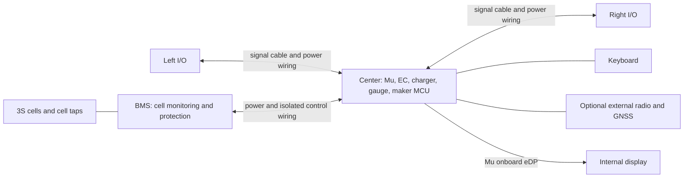

# Ducktop2

current case model, 9 october 2026. the lid and base share a 370 x 274 mm
outline, and the radio is planned as an external accessory. i'm aiming for
33.3 mm closed without feet, but the wiring and cooler still need more work
before everything fits. [case CAD and fit notes](mechanical/flush-case/README.md)

i'm building a 16-inch x86 laptop around the LattePanda Mu Ultra. i wanted the
exposed hardware and flexibility of a cyberdeck in something i could
actually carry around and use every day.

ducktop1 used a Pi 500+ and a portable monitor, with HDMI and USB-C cables
looping around the outside of the case. ducktop2 brings the display onto
direct eDP and puts power, ports, and laptop controls on custom boards.

## what's in it

- LattePanda Mu Ultra 226V initially, with the carrier designed to support a later 256V upgrade; 16 GB RAM and NVMe storage
- 16-inch AUO B160QAN03.K, targeting 2560x1600 at 120 Hz over direct eDP
- M.2 NVMe and a separate Wi-Fi/Bluetooth socket
- 65-key Cherry MX Ultra Low Profile keyboard and a 140 x 105 mm USB trackpad
- five USB-C ports, two USB-A ports, HDMI, and Gigabit Ethernet
- a 3S battery, USB-C PD charging from either side, and AUX/DC input
- STM32F407 for laptop control and a separate RP2350 with protected maker GPIO
- two status OLEDs, speakers, a headphone jack, and a microphone
- optional external VHF/UHF radio and GNSS accessory, with its own audio path

## build status

updated 5 october 2026. the carrier interface is being switched to Mu
Ultra: 226V first, with a later 256V upgrade. the new pin map moves HDMI to
TCP2, reallocates USB and gives NVMe a real clock-request connection. the
100 W power circuit is saved, but placement, routing, cooling and hardware
qualification still need work. the
[module requirements](manufacturing/lattepanda_mu_bios_release.md) separate
that target from the current CAD and the remaining hardware checks.

the revised power circuits, separate power wiring and signal connectors are
saved on all three main boards. the new placement pass uses both sides:
local capacitors sit near their actual supply pins, USB protection follows
its connector, and the audio and maker circuits have been regrouped.
the connector positions, mounting points and board gaps are preserved.
the existing PCIe routing is intact. USB, HDMI and Ethernet route repairs
are in progress, and most main-board routing still remains.

the keyboard now has per-key RGB on four layers, and routing is underway.
the RGB buffer has separate 3.3 V and 5 V supplies. the key positions,
outline and cable connector are unchanged. [keyboard routing notes](keyboard/README.md)
cover the LEDs, current limit and switch keepouts. the old non-RGB order
files have been retired. the radio antenna connectors now match the board edge and their
mechanical drawing. the radio still needs routing.

the four-layer BMS is routed for stronger battery operation, with
an 8 A discharge target and up to 3 A charging. it now uses a BQ76922,
independent current guards and a limited startup branch. the 80 mm board
has zero unconnected items and zero physical DRC findings, including the
stricter fabrication checks. its first assembly leaves the three drive links
out for programming and bench tests. the matching center-board cutout is
saved. [power and battery](docs/hardware/power-and-battery.md) describes the
circuit and the measurements needed before using it with the cells.
the three main-board sections are eight layers,
and most of their routing still remains. [power revision status](docs/hardware/power-revision.md)
records what is saved and what is still unfinished.

firmware corrections cover charger communication, startup, watchdog and fan
handling, USB power permissions, and host communication. assembled-hardware
tests are still pending. the replacement panel has run at 2560x1600 and
120 Hz on the Intehill controller; the final Mu-to-panel cable still needs
validation. the complete laptop is not ready for fabrication or powered
integration.

## boards

the center charges the whole pack. the BMS monitors the cell taps and
controls the protection FETs. balancing is disabled in the prototype profile.
the EC and maker controller have separate jobs,
and the rest of the laptop is intended to work with the radio board removed.

## open in KiCad

the current reference version is KiCad 10.0.4.

| Work | File |
| --- | --- |
| Center schematic | `ducktop2.kicad_pro` |
| Center layout | `ducktop2-center.kicad_pcb` |
| Left I/O | `left_io/left_io.kicad_pro` |
| Right I/O | `right_io/right_io.kicad_pro` |
| BMS | `bms/bms.kicad_pro` |
| Keyboard | `keyboard/12_keyboard_daughterboard.kicad_pro` |
| Radio | `radio_daughterboard/radio_daughterboard.kicad_pro` |

read [build and verification](docs/build-and-verify.md) before regenerating
or syncing a board. the center schematic and PCB have different basenames.
review an explicit current netlist before updating the PCB; rebuilding a
board can replace existing routing.

## files and documentation

| Location | Contents |
| --- | --- |
| Root KiCad files | Center project and active schematic hierarchy |
| `left_io/`, `right_io/`, `bms/`, `keyboard/`, `radio_daughterboard/` | Separate board projects |
| `gen/` | Schematic generators, validation code, and symbol definitions |
| `ducktop2.pretty/`, `Module_LattePanda.pretty/`, `ducktop2.3dshapes/` | Shared footprints and models |
| `docs/hardware/` | Circuit, cable, display, and mechanical documentation |
| `firmware/` | EC/maker code, tests, and firmware release records |
| `mechanical/` | Floorplan, case CAD, layout planner and fit checks |
| `reference/` | Source/reference designs and retained generator inputs |
| `manufacturing/` | Board packages, quotes, and manufacturing requirements |
| `verification/` | Hardware validation record and ignored generated checks |
| `software/` | Fedora setup, recovery, and theme files |

- [hardware and behavior](docs/hardware/overview.md)
- [power and battery](docs/hardware/power-and-battery.md)
- [cables and connectors](docs/hardware/cables-and-connectors.md)
- [display harness](docs/hardware/display-direct-edp.md)
- [mechanical layout](docs/hardware/mechanical.md)
- [build and verify](docs/build-and-verify.md)
- [bring-up procedure](docs/BRINGUP_TEST_PLAN.md)
- [parts and cost](docs/bom-and-cost.md)
- [firmware](firmware/README.md)
- [manufacturing](manufacturing/README.md)
- [OS work](software/os-theme/README.md)
- [ducktop1](docs/ducktop1.md)
- [Forge project pitch](docs/forgery_pitch.md)
- [project journal](JOURNAL.md)

## sponsors

thanks to NextPCB for supporting PCB manufacturing and assembly for ducktop2!

## license

the project files are under the [MIT license](LICENSE).
