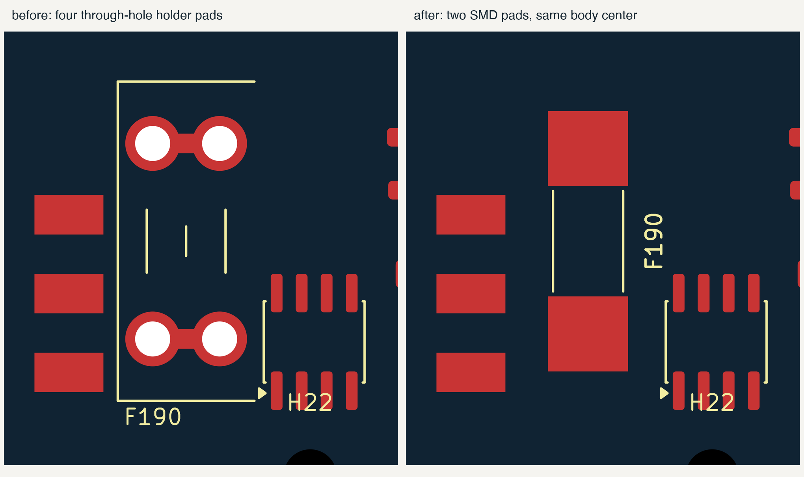
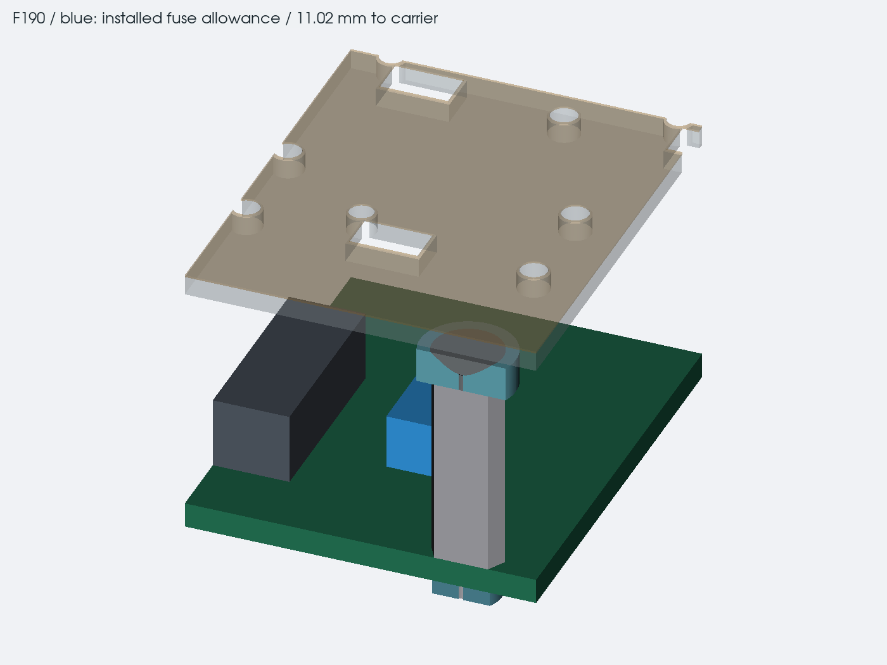

# aux input and backup fuses

15 october 2026. F190 and F195 now use Bel 0678H5000-02 surface-mount
fuses. the old MINI blade holders were too tall for the thin keyboard
stack. the replacement keeps both protection locations and fits inside
the old footprint areas. it needs soldering to replace, rather than
pulling out a blade fuse.

## what the two fuses protect

J190 on the left board feeds F195, then the separate AUX power wire to
the center board. F190 is ahead of D190, the reverse-protection FET,
TPS26630 eFuse and the raw standby feed. D711 takes standby power from
the fused side. the AUX voltage divider also measures that fused node.

both fuses use the same part. there is no promise that one will open
before the other; check both after a fault. neither replaces the eFuse,
the source-current budget or the standby limiter.

## current and part choice

| item | design value |
| --- | --- |
| fuse | Bel 0678H5000-02, silver-plated, tape and reel |
| nominal fuse rating | 5 A |
| DC voltage and breaking rating | 125 VDC, 2000 A |
| total AUX operating budget ceiling | 3 A, including standby |
| initial firmware source setting | 500 mA |
| R710 / main-branch eFuse setting | 6.04 kohm, about 2.98 A nominal |
| fuse local ambient design limit | 85 C, to be measured |
| maximum body height | 3.18 mm |
| installed height allocation | 3.48 mm, including 0.3 mm assembly space |

the [manufacturer's July 2026 drawing and electrical tables](https://www.belfuse.com/media/datasheets/products/circuit-protection/ds-cp-0678h-series.pdf)
give the dimensions, ratings and ordering code. the footprint uses the
recommended 3.81 x 4.06 mm pads with a 5.6 mm gap. its STEP model is a
nominal body drawn from those dimensions; it is not supplier CAD.

the 5 A rating leaves room for continuous use and temperature. a chosen
0.75 continuous factor and conservative 0.95 temperature factor give a
3.5625 A allocation, above the 3 A source budget. the temperature factor
is below the published curve through 85 C. these are design assumptions
to check on the assembled board, not permission to draw 5 A.

the firmware rejects AUX source settings above 3 A. its initial 500 mA
setting stays unchanged. the existing policy subtracts the raw standby
reserve before setting charger input current. tests cover 7, 9, 12, 15,
20 and 22 V inputs and check that the total remains inside the offered
budget after current-sense tolerances. the main charger branch also stays
below the conservative 2.5 A lower eFuse screen at the 3 A source ceiling.

using the full 5% R710 resistance allowance and a 10% current-limit screen
gives about 2.55 to 3.45 A for the eFuse. that does not change its part,
setting, startup ramp, fault outputs or reverse-protection circuit.
measure the actual thresholds before enabling the operating profile.

at 3 A, the two fuses' nominal cold resistance gives about 96 mV total
drop and 0.144 W in each fuse. hot resistance, solder joints and copper
add to that. these nominal figures are not worst-case voltage or thermal
guarantees.

## fault checks before use

the interruption rating says what the fuse can safely break under its
specified test conditions. it does not establish how quickly the board
clears a fault. the datasheet allows up to 60 seconds at twice rated
current. a constant 10 A for that full time is 6000 A2s. the much smaller
10 A2s melting figure is typical at ten times rated current, and must not
be used as a guaranteed total-clearing limit.

Bel also warns against prolonged operation between 100% and 200% of the
fuse rating. a current-limited fault source in that range needs a proven
shutdown or a demonstrated safe result. the existing 18 AWG loom and an
unrouted PCB are not qualified by a fuse substitution. do not enable an
arbitrary external battery or solar source on this basis.

the final qualification needs:

- hot-plug, repeated startup and source-transfer waveforms, including the
  raw standby branch and the main eFuse ramp;
- measured fuse, pad, wire, terminal and TVS temperatures at the intended
  source limits and ambient temperature;
- controlled faults before and after U12, including a shorted TVS and
  failures that bypass semiconductor protection;
- copper necks, layer changes and joints that survive the actual clearing
  waveform, including sources that limit current below a prompt fuse trip;
- reverse-input, overvoltage and recovery tests within a defined source
  envelope, followed by isolation and component-damage checks.

the fuse datasheet uses a 1 oz, 5 mm wide test track for this rating.
the actual pad entries and heat spreading still need designing. the
[power-routing notes](power-routing.md) cover the remaining routing work.

## placement and fit

| reference | PCB center X, Y | rotation | installed center X, Y |
| --- | --- | --- | --- |
| center F190 | 129.250, 94.640 | 90 degrees | 98.700, 58.090 |
| left F195 | 42.960, 21.700 | 0 degrees | 42.960, 21.700 |

these are body centers. the old footprints used one terminal as their
origin, so their old anchor coordinates were different. the body centers
stay fixed. F190's two duplicate-pad joins are removed and its reference
label moves beside the new pad. the other components and routes stay put.

the local check uses the 12 october case solids with the replacement
envelopes. both clear the retained non-PCB geometry. at the saved board
datum, the 3.48 mm installed allowance leaves 11.02 mm to the carrier.
native PCB DRC separately checks the component courtyards and copper.

the full case export still contains its older frozen PCB snapshot. this
local result closes the two fuse-height conflicts for the new board
geometry; it does not update that STEP assembly or prove the rest of the
keyboard, wiring and cooler fit. the remaining switch-pin measurement
and physical tests still apply.

## verification

`gen/verify_aux_input.py` checks the native netlists, both fuse identities,
the protected branches, reverse FET, eFuse, fault feedback and current
allocations. its regression tests reject bypasses and wrong substitutions.
[saved results](../../verification/aux-input.json) record the exact board
and schematic hashes, native connectivity, DRC comparison and test scope.
the design screen passes; powered operation and manufacturing release
remain unqualified.
