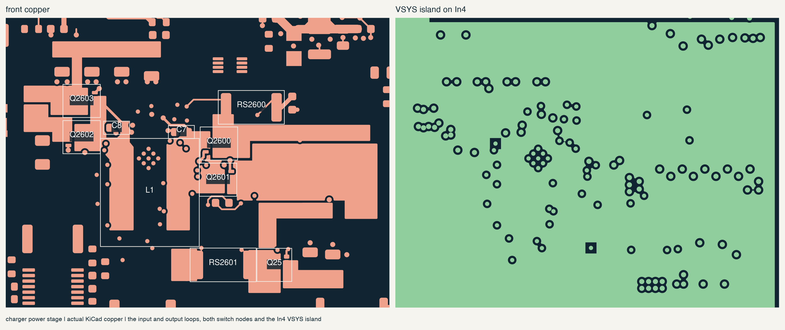
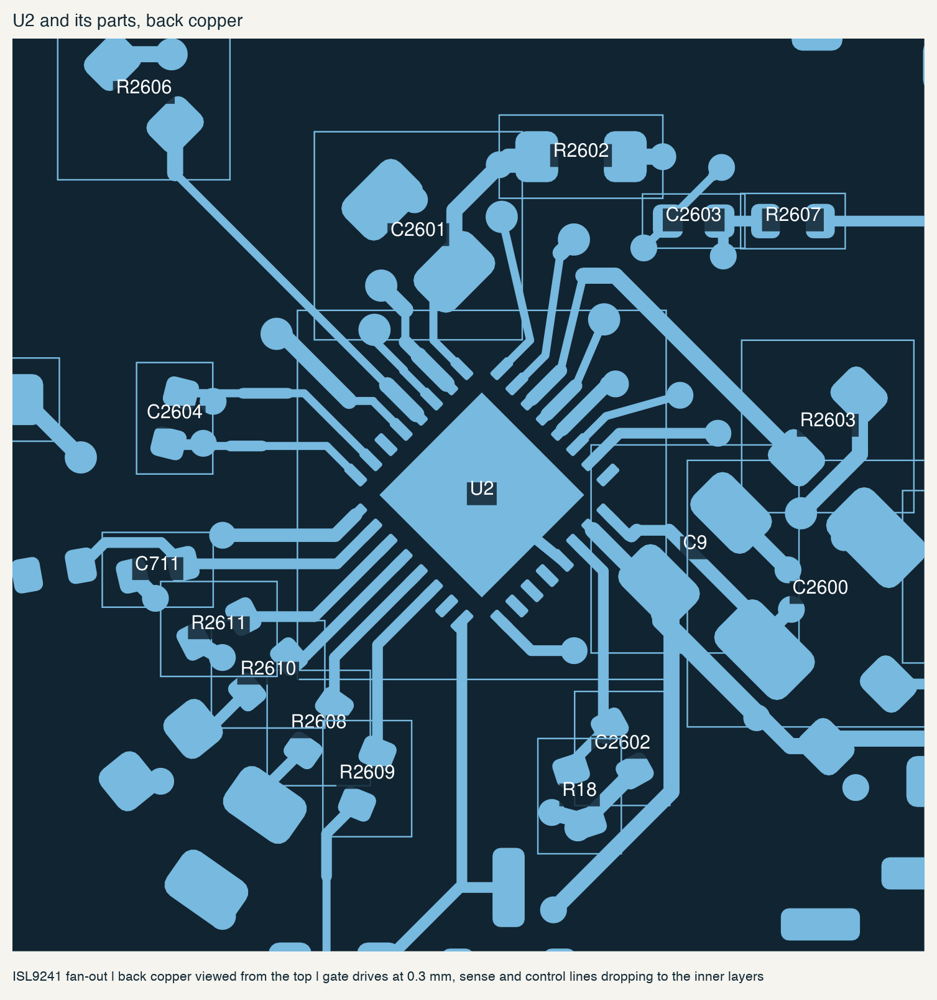
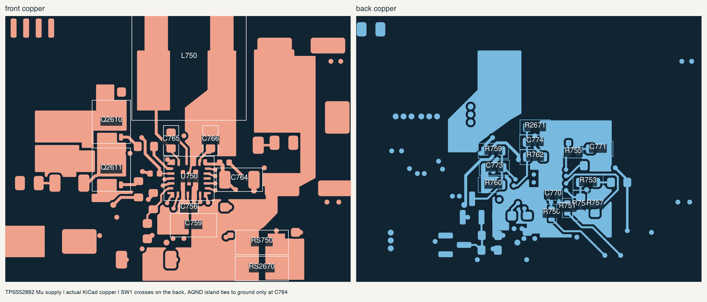

# charger and Mu supply routing

20 october 2026. routed the first two groups from the [power routing order](power-routing.md):
the ISL9241 charger (U2) and the TPS552882 Mu supply (U750). both power stages,
both controllers and their local parts are now copper on the center board.
the feeds that leave these areas are still open: VBUS_COMBINED from U15,
PACK_POS_FUSED from J2071, MU_12V out to the module and fuse, the rest of
VSYS, and the EC control lines.

## charger power stage

the front has separate pours for the input loop (CHG_INPUT), SW1, SW2, the
charger output (VSYS), the input and output power grounds, the system bulk
capacitors, the VSYS end of RS2601, Q25's drain and Q25's source. Q25's drain
and source also have back-side copper for heat spreading.

- input loop: RS2600, Q2600's drain and C701-C705 sit in one pour. their
  ground pads, C10 and Q2601's sources share the ground pour, with 17 vias
  into the ground planes.
- output loop: Q2603's drain, C11 and C706 sit together; their ground pads
  share the pour with Q2602's sources.
- SW1 and SW2 stay on the front between the FETs and L1 and are kept small.
- In4 now has a VSYS island over the charger and a strip to U750. the charger
  output reaches it through 14 vias.
- U2's exposed pad has nine 0.25 mm thermal vias. Renesas asks for at least five.

## charger controller placement

U2's 0.4 mm pins could not escape with the old placement. several small parts
sat right in front of the pins, and the order of the parts around the chip did
not match the pin order. moved 21 parts:

- C7 and C8 (bootstrap) are on the front now, inside their switch-node pours.
- C12 (VBUS_COMBINED 100n) sits on RS2600's VBUS_COMBINED pad instead of beside U2.
- R2602, C2603 and R2607 moved north-east, out of the gate-drive path.
- the south-west parts follow the pin order: COMPR, COMPF, IMON, PSYS, BATP,
  then C2604 for the battery sense.
- C2602 and R18 (PROG) moved below U2. D2600, D2601 and R2601 moved east into free space.

## charger controller routing

- gate drives are 0.3 mm. each high-side drive runs beside its switch-node
  return on the back. the low-side drives cross on In5, directly above the In6
  ground plane.
- the north-east side is a hand-placed fan-out: pins 9 and 12-15 drop to vias
  about 2 mm out, pins 10 and 11 leave as a pair.
- DCIN passes under C9 between its pads to C2600.
- CSIN/CSIP and CSON/CSOP run as Kelvin pairs from the inner edges of RS2600
  and RS2601. the CSOP via has a copper keepout on In4 so it does not join the
  VSYS island.

## Mu supply

followed TI's layout guidance ([TPS552882 section 10](https://www.ti.com/lit/ds/symlink/tps552882.pdf)).
the gate pins of the buck FETs face the path from the FETs to L750, so SW1
crosses to the inductor on a back-side pour with 3 vias at the FETs and 7 at L750.
the boost output loop is C756 directly under PGND pin 9 and VOUT pin 11.

- AGND (pin 10) goes through a via with copper keepouts on the ground planes
  to a back-side AGND island. FSW, MODE, ILIM, COMP, FB, DITH, UVLO and PG return
  there. the island reaches power ground only at C764's ground pad.
- ISP/ISN have their filter at the IC and run as a Kelvin pair to the inner pad
  edges of RS750/RS2670.
- moved 15 parts to make room for this: Q2611 (0.3 mm), C756, C759, R750, C765
  (rotated), C755, R2614, R763, C764, C772, C770, R757 and the PG divider R762,
  C774 and R2671. removed three old ground vias that sat under the new positions.

## clean-up

went back over the routed signal nets: merged collinear segments, replaced
runs of bends with straight or single 45 degree runs, and set each net to one
width wherever clearance allows. narrower sections only remain at the 0.4 mm
pins. 445 segments became 365.

## a via problem found on the way

KiCad changes the net of a via that has no track attached to whatever copper
it touches. 33 power vias placed inside their pours had quietly become GND
vias. DRC did not report them because the pours cleared around them. all of
them are back on their real nets, and every via in this pass now has a short
track to its pad or pour so this cannot happen again.

## checks

| check | result |
| --- | --- |
| physical DRC | zero new findings against the starting board. the 174 dangling vias, 83 dangling tracks and 2 silkscreen warnings were already there |
| native unconnected items | 1,798 before, 1,568 now |
| schematic parity | passes: 870 parts, 3,372 physical pads, no net, value or footprint changes |
| placement exports | regenerated; all 212 power rows and 1,378 component rows match the board |
| case delta | 90 changed parts screened against the frozen thin-case geometry, including the lid through 135 degrees. no hits, no unknown heights |

the [saved record](../../verification/charger-mu-routing.json) has the board
hash, the moved parts and these results.

via banks, using the full board thickness and 20 um hole plating (the plating
still needs confirming with NextPCB):

| path | vias | estimated current per via |
| --- | ---: | ---: |
| charger output VSYS to In4 | 14 | 0.6 A |
| battery shunt VSYS end | 7 | 1.1 A at 8 A |
| Q25 drain | 8 | 1.0 A |
| charger input ground | 17 | 0.3 A |
| charger output ground | 11 | 0.8 A |
| Mu SW1 at the FETs | 3 | about 2 A |
| Mu SW1 at L750 | 7 | 0.9 A |
| Mu low-side source ground | 2 | about 1.4 A |

## still to do

- the Mu SW1 vias at the FETs and the low-side source vias are the tightest.
  there is no more room without putting vias into Q2611's drain pad. check
  their temperature on the first boards.
- U2's exposed pad and U750's PGND bar have vias in the pads. confirm with
  NextPCB whether to plug them or window the paste.
- the TPS552882 compensation still needs loop-response testing with the
  assembled board.
- the feeds listed at the top, then the remaining rails and the control lines.
