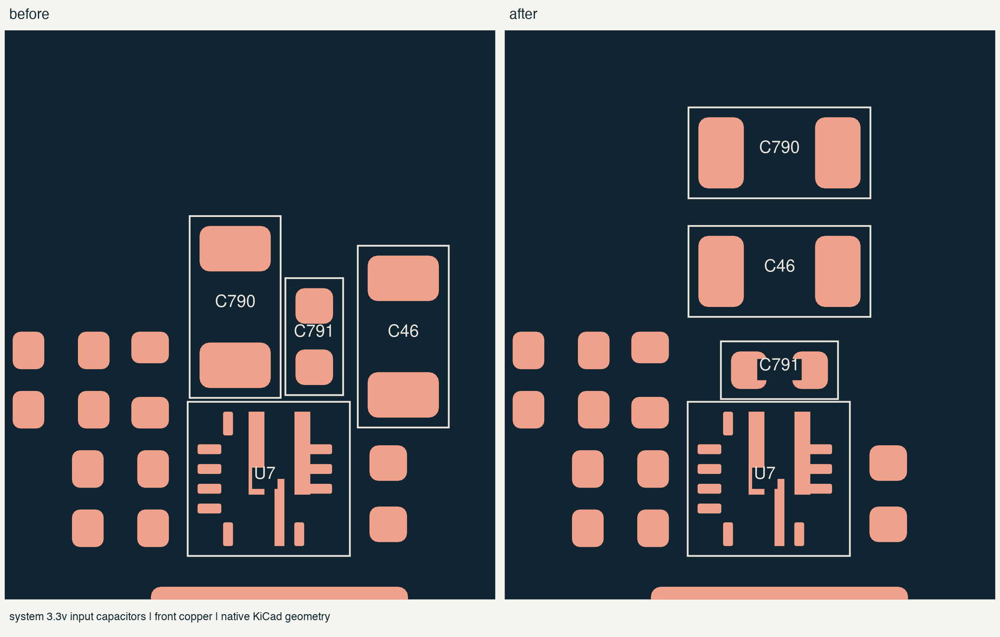
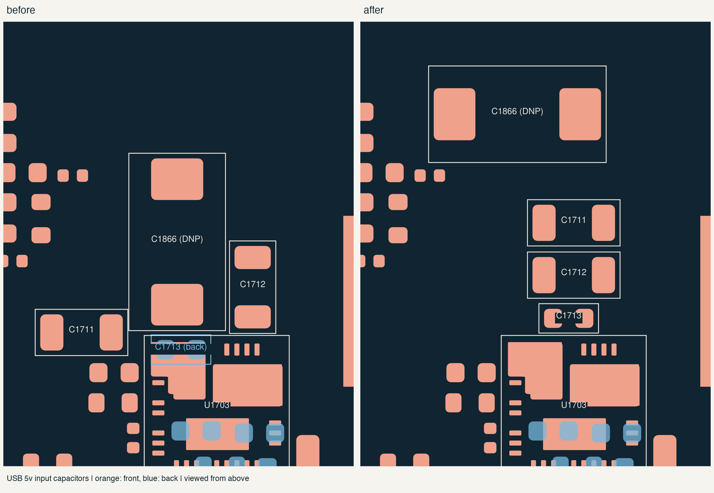

# converter placement

16 october 2026. these notes cover the system 3.3 V and left USB 5 V
capacitors, plus the earlier charger and Mu supply changes. the latest
[main-board power pass](mainboard-power-placement.md) also covers the
PD controllers, USB protection footprints and standby inputs.

## system 3.3 V and USB 5 V

C46, C790 and C791 now line up above U7 with their VIN ends on the right
and ground ends on the left. C791's straight pad-center distance to U7's
power-ground pad drops from 4.00 to 2.11 mm. its VIN distance changes from
2.08 to 2.01 mm. route a broad local return to PGND; a nearby MODE or AGND
pin on the same net is not a substitute for the power return.

left C1713 moves from the back to the front, above U1703's VIN and PGND
pins. each straight connection is about 1.55 mm. the old XY sum was
slightly shorter, but it also needed connections between opposite board
sides. C1711/C1712 now line up behind the small bypass. C1866 moves out
of that space and remains an unpopulated input-damping option.

| board | reference | X, mm | Y, mm | rotation |
| --- | --- | ---: | ---: | ---: |
| center | C46 | 129.745001 | 61.7 | 180 degrees |
| center | C790 | 129.745001 | 58.7 | 180 degrees |
| center | C791 | 129.745001 | 64.2 | 180 degrees |
| left | C1711 | 29 | 70.8 | 0 degrees |
| left | C1712 | 29 | 73.4 | 0 degrees |
| left | C1713 | 28.75 | 75.55 | 0 degrees |
| left | C1866 | 26.2 | 65.4 | 0 degrees |

all seven end on the front. coordinates are in each board's native frame.
U6 SYS_5V and U773 PCIe power retain their placements and existing routes.
their feedback, compensation and sense paths still need the local returns
and dedicated pickups described in the routing notes.

these seven moves preserve their values, pad assignments and existing
tracks/vias. the broader pass includes schematic and local CC-route
repairs; its [saved record](../../verification/mainboard-power-placement.json)
has the current counts and source hashes for all three boards.

these distances describe placement, not routed loop lengths or measured
switching performance. the input-return guidance comes from
[TPS56637 section 10](https://www.ti.com/lit/ds/symlink/tps56637.pdf) and
[LM706x0 section 7.4](https://www.ti.com/lit/ds/symlink/lm70660.pdf).

## charger

RS2600 now sits above the input FET instead of beyond the capacitor bank.
the CHG_INPUT pad is 1.30 mm from Q2600's drain copper, down from 9.90 mm.
the straight-line distance from that shunt pad to the controller's CSIN
pin falls from 19.47 mm to 8.89 mm. those are geometric measurements,
not routed lengths or measured inductance.

moved R198/R199 to the back near their Wi-Fi control buffer to make room.
C10 moves slightly toward the low-side FET's ground pads. C706 moves down
toward the output half-bridge. the other capacitors, FETs, inductor and
controller keep their positions.

## mu supply

rotated C765/C766 beside U750 so their pads no longer crowd the route
between the inductor and regulator. the copper-pad gap grows from 0.60 mm
to 3.05 mm. the inductor, FETs, regulator and sensitive feedback components
stay where they were.

there is a tradeoff: the capacitor-to-BOOT pin center distances are now
2.12 mm and 1.85 mm, and the corresponding switch-return distances are
3.11 mm and 3.54 mm. the returns were previously 1.77 mm and 1.50 mm.
route those pairs together with short connections to the IC, keeping the
larger SW2 path compact. the extra space does not establish a finished
trace's current capacity or a measured improvement in switching behavior.

## saved positions

all coordinates below use the native PCB frame, viewed from the front.

| reference | X, mm | Y, mm | rotation | side |
| --- | ---: | ---: | ---: | --- |
| RS2600 | 219.8 | 156.5 | 180 degrees | front |
| R198 | 220.5 | 154.5 | 0 degrees | back |
| R199 | 217.2 | 154.5 | 0 degrees | back |
| C10 | 218.9 | 162.6 | -90 degrees | front |
| C706 | 194.25 | 156.25 | -90 degrees | front |
| C765 | 149.8 | 113.65 | 90 degrees | front |
| C766 | 153.8 | 113.65 | 90 degrees | front |

the two underside resistors each have a 0.55 mm maximum body height, plus
the existing 0.30 mm assembly allowance. the selected case study puts the
PCB underside at H3.9 and the floor surface at H1.2, leaving 1.85 mm
under these parts. this checks the floor only. the complete case model
still needs its PCB snapshot refreshed and a full collision check.

## earlier charger and Mu checks

the first placement pass had identical physical DRC findings before and after:
zero errors and 344 existing warnings. native schematic comparison and
the explicit pad/net comparison passed. native connectivity stayed at
1,786 unconnected items, with 4,481 segments/arcs and 722 vias.

the source hashes, moves and measured pad gaps are in
[the placement record](../../verification/converter-placement.json).
the power-group and complete component exports now match the saved boards.
R2671 is also included in the power-group export following the preceding
power-good change.

follow [the routing notes](power-routing.md) for dedicated Kelvin pickups,
gate/phase pairs, local ground returns, thermal vias and current-carrying
copper. this placement pass does not qualify the routed loops, startup,
fault behavior or temperature. those still need checking on the assembled
board.

the placement follows the loop and sense guidance in
[Renesas ISL9241 section 9](https://www.renesas.com/en/document/dst/isl9241-datasheet)
and [TI TPS552882 section 10](https://www.ti.com/lit/ds/symlink/tps552882.pdf).
