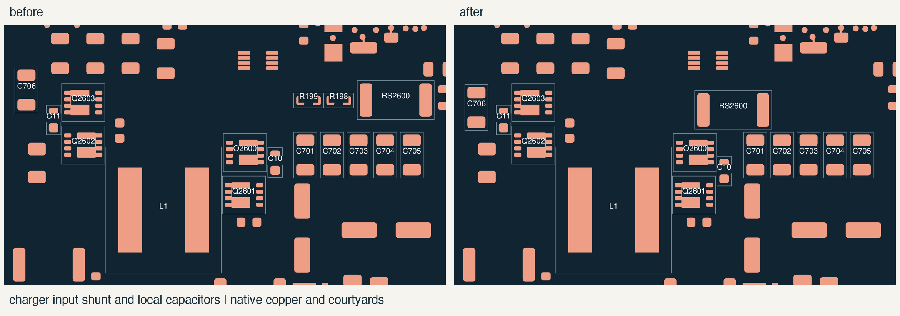
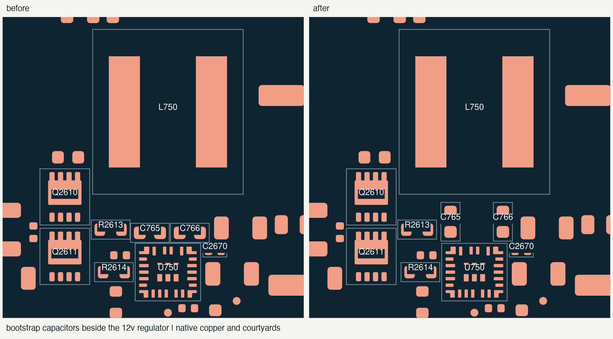

# charger and mu supply placement

16 october 2026. moved seven footprints before routing the power stages.
the parts, pad assignments, outlines, holes and existing tracks/vias are
unchanged. the center still has 1,786 native unconnected items.

## charger

RS2600 now sits above the input FET instead of beyond the capacitor bank.
the CHG_INPUT pad is 1.30 mm from Q2600's drain copper, down from 9.90 mm.
the straight-line distance from that shunt pad to the controller's CSIN
pin falls from 19.47 mm to 8.89 mm. those are geometric measurements,
not routed lengths or measured inductance.

moved R198/R199 to the back near their Wi-Fi control buffer to make room.
C10 moves slightly toward the low-side FET's ground pads. C706 moves down
toward the output half-bridge. the other capacitors, FETs, inductor and
controller keep their positions.

## mu supply

rotated C765/C766 beside U750 so their pads no longer crowd the route
between the inductor and regulator. the copper-pad gap grows from 0.60 mm
to 3.05 mm. the inductor, FETs, regulator and sensitive feedback components
stay where they were.

there is a tradeoff: the capacitor-to-BOOT pin center distances are now
2.12 mm and 1.85 mm, and the corresponding switch-return distances are
3.11 mm and 3.54 mm. the returns were previously 1.77 mm and 1.50 mm.
route those pairs together with short connections to the IC, keeping the
larger SW2 path compact. the extra space does not establish a finished
trace's current capacity or a measured improvement in switching behavior.

## saved positions

all coordinates below use the native PCB frame, viewed from the front.

| reference | X, mm | Y, mm | rotation | side |
| --- | ---: | ---: | ---: | --- |
| RS2600 | 219.8 | 156.5 | 180 degrees | front |
| R198 | 220.5 | 154.5 | 0 degrees | back |
| R199 | 217.2 | 154.5 | 0 degrees | back |
| C10 | 218.9 | 162.6 | -90 degrees | front |
| C706 | 194.25 | 156.25 | -90 degrees | front |
| C765 | 149.8 | 113.65 | 90 degrees | front |
| C766 | 153.8 | 113.65 | 90 degrees | front |

the two underside resistors each have a 0.55 mm maximum body height, plus
the existing 0.30 mm assembly allowance. the selected case study puts the
PCB underside at 5.1 mm and the floor surface at 2.4 mm, leaving 1.85 mm
under these parts. this checks the floor only. the complete case model
still needs its PCB snapshot refreshed and a full collision check.

## checks and routing requirements

the candidate and starting boards have identical physical DRC findings:
zero errors and 344 existing warnings. native schematic comparison and
the explicit pad/net comparison pass. native connectivity remains at
1,786 unconnected items, with 4,481 segments/arcs and 722 vias.

the source hashes, moves and measured pad gaps are in
[the placement record](../../verification/converter-placement.json).
the power-group and complete component exports now match the saved boards.
R2671 is also included in the power-group export following the preceding
power-good change.

follow [the routing notes](power-routing.md) for dedicated Kelvin pickups,
gate/phase pairs, local ground returns, thermal vias and current-carrying
copper. this placement pass does not qualify the routed loops, startup,
fault behavior or temperature. those still need checking on the assembled
board.

the placement follows the loop and sense guidance in
[Renesas ISL9241 section 9](https://www.renesas.com/en/document/dst/isl9241-datasheet)
and [TI TPS552882 section 10](https://www.ti.com/lit/ds/symlink/tps552882.pdf).
