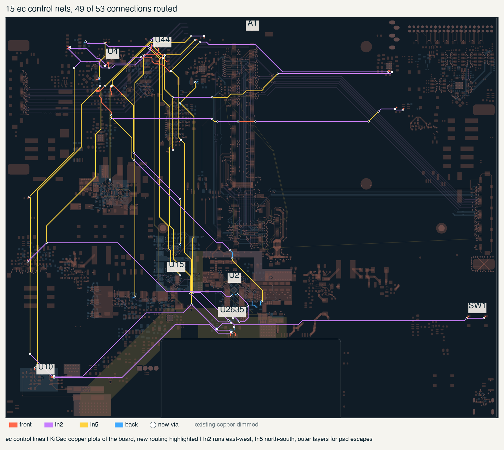

# ec control routing

12 november 2026. routed the ec control lines: the selector and charger
status lines, the gauge alert, I2C, reset, and the Mu power-good and
prochot lines. 49 of their 53 connections are copper now. the last four
pads are boxed in by copper from the power passes and need a hand fix,
see [not routed](#not-routed).

## splitting the open nets

before routing more, i sorted the 433 nets that still had gaps into two
groups, using the schematic pin types, the net names and the parts on
each net.

- special attention, 186 nets with 905 open connections: high-speed
  pairs, power rails and anything on a power pin, inductors, fuses,
  shunts and power fets, switch and bootstrap nodes, sense and feedback
  lines, audio, crystals and rf. these get routed by hand.
- slow digital lines, 247 nets with 394 open connections: status, enable,
  interrupt, reset and I2C. these can be routed in bulk.

all 15 nets in this pass are in the second group.

## routing rules

- 0.2 mm tracks and 0.45/0.2 mm vias, with the board's clearances. that
  includes 0.23 mm to plated through-hole pads, 0.18 mm from a via and
  0.3 mm to holes.
- In2 runs east-west and In5 north-south. diagonals and the wrong
  direction cost more, so long runs stay in bundles instead of crossing
  each other at angles.
- the outer layers cost twice as much as the inner signal layers, so
  they're mostly used for short pad escapes.
- every other net's copper is an obstacle, pours included. a via through
  a power pour costs extra.
- tracks keep away from high-speed pairs and from special-attention pads
  that aren't routed yet, where they can.
- near the pads, clearance is checked against the exact pad shapes. that's
  what lets the charger's 0.4 mm pins escape even though the chip is
  turned 45 degrees.
- afterwards every new track and via was checked against the board rules
  with exact geometry. two vias came out 0.03 mm too close to existing
  tracks and were rerouted.

## result

| net | connections | length | vias |
| --- | ---: | ---: | ---: |
| I2C_SCL | 8 of 9 | 484 mm | 14 |
| I2C_SDA | 8 of 9 | 390 mm | 10 |
| NRST_NET | 8 of 8 | 328 mm | 9 |
| CHG_INT_N | 3 of 3 | 239 mm | 6 |
| MU_12V_PG | 3 of 3 | 192 mm | 11 |
| BQ_ALERT | 1 of 1 | 148 mm | 2 |
| PD2_VALID_N | 2 of 2 | 147 mm | 6 |
| AON_FAULT_N | 2 of 2 | 143 mm | 4 |
| MU_PROCHOT_RELEASE | 2 of 2 | 131 mm | 5 |
| AUX_PATH_EN | 2 of 2 | 128 mm | 4 |
| MAIN_USB_VALID_N | 2 of 2 | 117 mm | 2 |
| MU_PROCHOT_N | 3 of 4 | 26 mm | 4 |
| CHG_BIAS_GOOD | 2 of 2 | 11 mm | 2 |
| MAIN_AUX_VALID_N | 1 of 2 | 4 mm | 0 |
| CHG_THROTTLE_GATE | 2 of 2 | 4 mm | 0 |

that's about 2.5 m of track and 79 vias. on the fully connected nets the
length is at most 24 percent over the shortest tree through their pads,
and mostly 6 to 10 percent.

## not routed

| pad | net | what's in the way |
| --- | --- | --- |
| U2.21, U2.22 | I2C_SDA, I2C_SCL | on the back of the charger, between its power pours. both pins share one gap and one via spot, and only one track fits |
| A1.117 | MU_PROCHOT_N | C783 (the RTC_BAT hold capacitor) sits right at the end of the pad, with the neighbouring pins' tracks on both sides and no room for a via |
| U15.7 | MAIN_AUX_VALID_N | boxed in by the ground via on pin 8 and the track from pin 6 |

U15.7 only needs that ground via moved. A1.117 needs C783 to shift a
little. the charger pins need a second way out from under U2.

## checks

| check | result |
| --- | --- |
| physical DRC | zero new findings against the starting board, refilled the same way |
| exact clearance | no problems, new copper checked against the old and against itself |
| native unconnected items | 1,308 before, 1,259 now |
| schematic parity | passes: 870 parts, 3,372 physical pads, no net, value or footprint changes |
| via nets | all 79 new vias keep their nets after refill |
| placement exports | regenerated; only the board hash changed, all 212 power rows and 1,378 component rows still match |
| case | no parts moved, so nothing new to screen |

the [saved record](../../verification/ec-control-routing.json) has the
board hash and these results.

## weak spots

- 26 track pieces under 0.15 mm, mostly one-cell jogs right where a
  track leaves a via or a pad. harmless, but not tidy.
- a few long diagonals on In5 are still there where they were the most
  direct way.
- I2C_SDA has 27 mm on the outer layers, mostly pad escapes around the ec.
- nothing reserves room for the power feeds that are still open, apart
  from a 1 mm keep-away around their unrouted pads.
