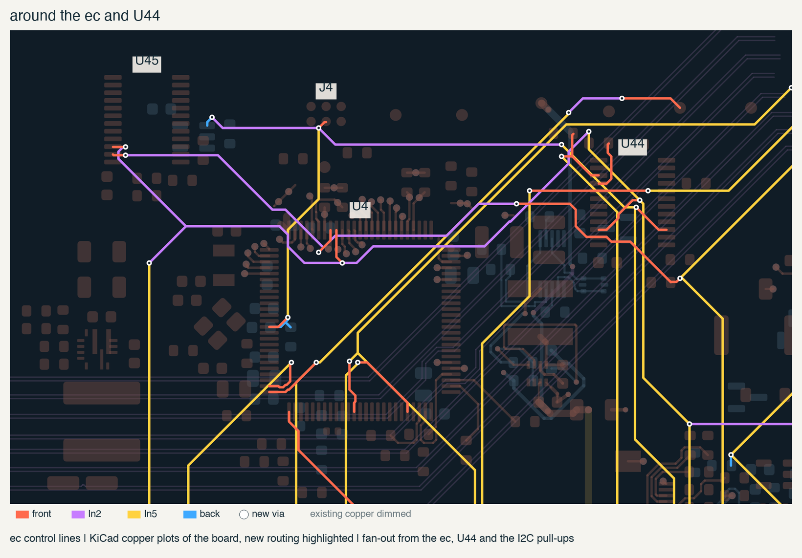
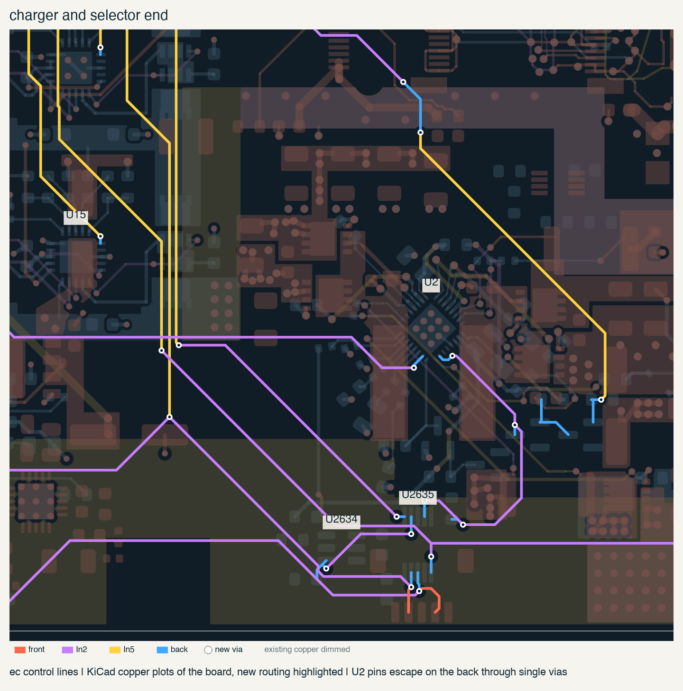
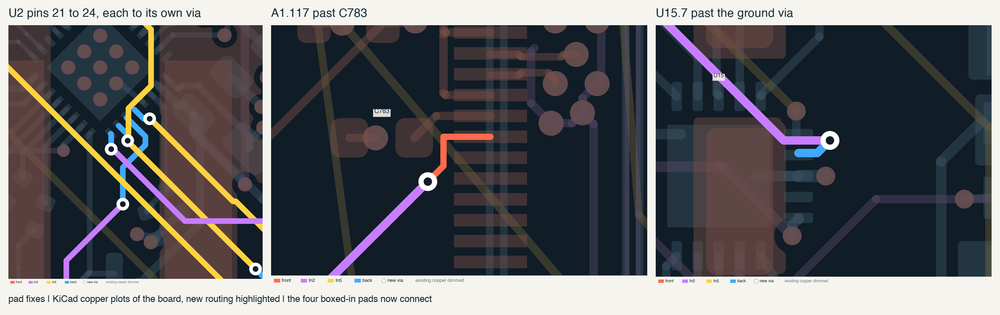

# ec control routing

12 november 2026. routed the ec control lines: the selector and charger
status lines, the gauge alert, I2C, reset, and the Mu power-good and
prochot lines. all 53 connections are copper now. the first pass got 49;
the last four pads were boxed in by copper from the power passes and got
their own fixes, see [pad fixes](#pad-fixes).

## splitting the open nets

before routing more, i sorted the 433 nets that still had gaps into two
groups, using the schematic pin types, the net names and the parts on
each net.

- special attention, 186 nets with 905 open connections: high-speed
  pairs, power rails and anything on a power pin, inductors, fuses,
  shunts and power fets, switch and bootstrap nodes, sense and feedback
  lines, audio, crystals and rf. these get routed by hand.
- slow digital lines, 247 nets with 394 open connections: status, enable,
  interrupt, reset and I2C. these can be routed in bulk.

all 15 nets in this pass are in the second group.

## routing rules

- 0.2 mm tracks and 0.45/0.2 mm vias, with the board's clearances. that
  includes 0.23 mm to plated through-hole pads, 0.18 mm from a via and
  0.3 mm to holes.
- In2 runs east-west and In5 north-south. diagonals and the wrong
  direction cost more, so long runs stay in bundles instead of crossing
  each other at angles.
- the outer layers cost twice as much as the inner signal layers, so
  they're mostly used for short pad escapes.
- every other net's copper is an obstacle, pours included. a via through
  a power pour costs extra.
- tracks keep away from high-speed pairs and from special-attention pads
  that aren't routed yet, where they can.
- near the pads, clearance is checked against the exact pad shapes and
  holes. that's what lets the charger's 0.4 mm pins escape even though the
  chip is turned 45 degrees.
- tracks stay off switch and bootstrap nodes on the same layer: six times
  the cost within 1.5 mm. (added with the pad fixes.)
- a net can also be picked up from a hand-routed escape, not just from its
  pads. (added with the pad fixes.)
- afterwards every new track and via was checked against the board rules
  with exact geometry. two vias came out 0.03 mm too close to existing
  tracks and were rerouted.

## first pass

| net | connections | length | vias |
| --- | ---: | ---: | ---: |
| I2C_SCL | 8 of 9 | 484 mm | 14 |
| I2C_SDA | 8 of 9 | 390 mm | 10 |
| NRST_NET | 8 of 8 | 328 mm | 9 |
| CHG_INT_N | 3 of 3 | 239 mm | 6 |
| MU_12V_PG | 3 of 3 | 192 mm | 11 |
| BQ_ALERT | 1 of 1 | 148 mm | 2 |
| PD2_VALID_N | 2 of 2 | 147 mm | 6 |
| AON_FAULT_N | 2 of 2 | 143 mm | 4 |
| MU_PROCHOT_RELEASE | 2 of 2 | 131 mm | 5 |
| AUX_PATH_EN | 2 of 2 | 128 mm | 4 |
| MAIN_USB_VALID_N | 2 of 2 | 117 mm | 2 |
| MU_PROCHOT_N | 3 of 4 | 26 mm | 4 |
| CHG_BIAS_GOOD | 2 of 2 | 11 mm | 2 |
| MAIN_AUX_VALID_N | 1 of 2 | 4 mm | 0 |
| CHG_THROTTLE_GATE | 2 of 2 | 4 mm | 0 |

that's about 2.5 m of track and 79 vias. on the fully connected nets the
length is at most 24 percent over the shortest tree through their pads,
and mostly 6 to 10 percent.

## pad fixes

the first pass left four pads walled in:

| pad | net | what was in the way |
| --- | --- | --- |
| U2.21, U2.22 | I2C_SDA, I2C_SCL | on the back of the charger, between its power pours, with one gap and one via spot for both |
| A1.117 | MU_PROCHOT_N | C783 (the RTC_BAT hold capacitor) right at the end of the pad, with the neighbouring pins' tracks on both sides |
| U15.7 | MAIN_AUX_VALID_N | pin 8's ground via and the track from pin 6 |

- U15.7 wasn't really boxed in. a track straight east from the pad clears
  the ground via by 0.225 mm and its hole by 0.35 mm, but the router's grid
  margin hid that. it now checks holes exactly near the pads too, and the
  pin drops to a via right after the pad.
- A1.117 goes west into the 0.5 mm gap between the pad and C783, turns
  south between C783 and pin 119 on a 0.15 mm track, and drops through a
  via below C783. C783 didn't have to move.
- the U2 pins needed the most work. the charger's battery-sense lines,
  CHG_SRN on In5 and VSYS on In2, ran as two parallel diagonals under the
  chip, and CHG_SRN passed straight under pin 24. every via in front of
  the pins had to clear both, which left room for three vias where four
  pins needed one. i moved CHG_SRN's In5 run to sit directly under the
  VSYS run on In2, so the sense pair now shares one path. that opened the
  space in front of the pins. a search over every via spot found a fan-out
  that gives pins 21, 23 and 24 each their own via. pin 22 runs down the
  back instead, all with the board's exact clearances. to make room,
  CHG_ACOK (pin 24, the adapter LED) and the prochot branch from pin 23
  were rerouted. the LED end of CHG_ACOK kept its old front-side escape.
- the first reroute ran both I2C lines down the front between the
  charger's two inductor pads. that's why the router now keeps away from
  switch nodes; the I2C lines go down on In2 and In5 instead, between
  the ground planes.

| net | added length | vias |
| --- | ---: | ---: |
| MAIN_AUX_VALID_N | 117 mm | 3 |
| MU_PROCHOT_N | 103 mm | 6 |
| I2C_SDA | 27 mm | 3 |
| I2C_SCL | 22 mm | 2 |
| CHG_SRN (moved) | 20 mm | 0 |
| CHG_ACOK (rerouted) | 8 mm | 1 |

15 tracks and vias came out: the first prochot branch to U2.23, CHG_ACOK's
back and inner run, and the old CHG_SRN diagonal. no parts moved.

## checks

| check | result |
| --- | --- |
| physical DRC | zero new findings after each step, against the board before it, refilled the same way |
| exact clearance | no problems, new copper checked against the old and against itself |
| native unconnected items | 1,308 before, 1,259 after the first pass, 1,255 after the pad fixes |
| schematic parity | passes: 870 parts, 3,372 physical pads, no net, value or footprint changes |
| via nets | all 79 + 15 new vias keep their nets after refill |
| placement exports | regenerated; only the board hash changed, all 212 power rows and 1,378 component rows still match |
| case | no parts moved, so nothing new to screen |

the [saved record](../../verification/ec-control-routing.json) has the
board hash and these results.

## weak spots

- 26 track pieces under 0.15 mm, mostly one-cell jogs right where a
  track leaves a via or a pad. harmless, but not tidy.
- a few long diagonals on In5 are still there where they were the most
  direct way.
- I2C_SDA has 27 mm on the outer layers, mostly pad escapes around the ec.
- the I2C_SDA via at U2 sits 0.2 mm from the SW1 pour on the front. the
  pour clears it by the rule, but it's the closest the I2C lines get to a
  switch node.
- from U2, I2C_SDA loops about 8 mm east because the inner layers south of
  the charger are taken by the battery strip.
- nothing reserves room for the power feeds that are still open, apart
  from a 1 mm keep-away around their unrouted pads.
