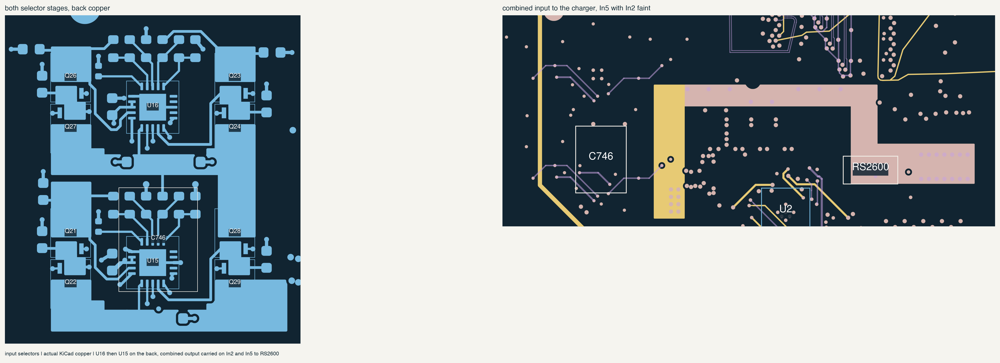
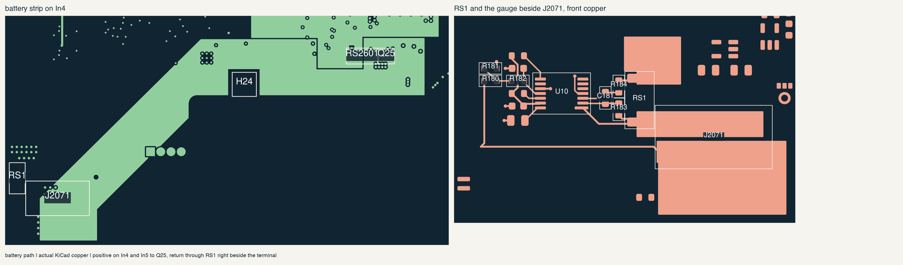
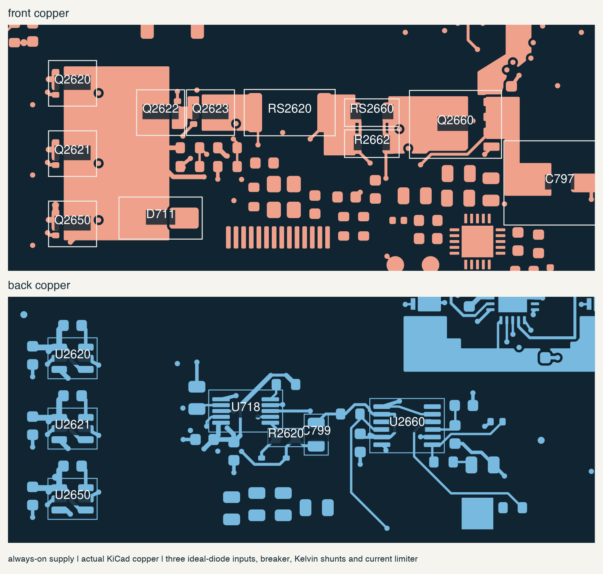

# input selection, battery path and standby routing

20 october 2026. routed steps 3 and 4 from the [power routing order](power-routing.md):
both LTC4418 input selectors, the battery path from J2071 to Q25, the fuel
gauge and the always-on chain up to the standby buck. the long feeds from
the WAGO terminals and the AUX eFuse are still open; they go in with the
In4 power map in the next pass.

## input selectors

U15 used to sit in the bottom-left corner while U16 sat next to the
charger. input power from U16 went about 60 mm west to U15 and then about
95 mm back east to the charger. the front beside U16 has no room (the
Wi-Fi card area and its standoff cover it), so both selector stages moved
to the back as one block, directly behind U16's old spot.

- each stage has its two back-to-back FET pairs in columns, inputs at the
  top and outputs at the bottom, with its controller between them.
- SEL_STAGE2 is now a short band between the two stages instead of a
  60 mm run.
- U16's UV/OV dividers were spread 10 to 15 mm from its pins. both
  stages now have their dividers in a row right above the UV/OV pins.
- the LTC4418's gate, source and output pins all sit on one edge, so one
  gate and one source connection per stage hop through In2 with small vias.
- C746 (100 uF hold-up) moved onto the front above U15. that spot clears
  the case and the BMS wires; the spots east of the block did not.

the combined output drops through 8 vias to In2 and In5, runs north of the
charger's via field and comes back up through 14 vias into a front pour
on the outer end of RS2600. the input-sense pickup on RS2600's inner edge
stays clear of that current. the R706/C714 damper is connected too.

## battery path

J2071 stays where the BMS harness was checked in CAD. RS1 and the gauge
moved next to it instead:

- RS1 stands beside J2071 with its FG_VSS end facing the terminal. the
  8 A return is a short pour under the terminal on both outer layers, and
  RS1's ground end drops into the planes through 16 vias. before, RS1 was
  about 60 mm away and the return would have needed its own long run.
- R180, R181 and R189 were stranded 30 to 80 mm from U10. the whole gauge
  group now sits together west of RS1.
- SRP and SRN are taken from RS1's inner pad edges through R183/R184 and
  C181 straight into the gauge pins. the gauge ground is its own small
  back-side area, tied to the shunt only at U10's VSS pickup.

the positive side runs from J2071 through 40 vias into two strips on In4
and In5, around the north side of H24's mounting keepout, and up through 24
vias into the Q25 pours. the In4 VSYS island's south edge was pulled back
to make room; it still covers RS2601's VSYS end and the bulk capacitors.
R704's battery-voltage pickup comes from the strip.

## always-on chain

routed in place. the three ideal-diode outputs and the AUX diode share one
AON_RAW pour. the breaker FETs, both ends of RS2620, the limiter's sense
node and EC_AON_IN each have their own pour.

- U718 takes Kelvin pickups from RS2620's inner pad edges.
- the two parallel limiter shunts are joined at their inner edges, and
  U2660's pickups come from those joins.
- the breaker gates hop on In2, so the common-source copper between the
  two FETs stays in one piece.
- Q2650 gets VSYS from the In4 island.
- EC_AON_IN runs 102 mm on In5 at 0.6 mm to the standby buck U5. U5's
  local loop is routed; C38 was turned around so BOOT does not cross SW.

## clean-up and labels

went over the new signal routing the same way as the charger pass: 697
track segments became 567, with one width per net wherever clearance
allows. the moved parts' reference labels follow the board's existing
habit and sit on the back silkscreen where there's room. eleven, mostly
in the divider rows, only fit on the fab layer.

## checks

| check | result |
| --- | --- |
| physical DRC | zero new findings against the starting board |
| native unconnected items | 1,568 before, 1,308 now |
| schematic parity | passes: 870 parts, 3,372 physical pads, no net, value or footprint changes |
| placement exports | regenerated; all 212 power rows and 1,378 component rows match the board |
| case delta | 139 parts changed since 16 october screened against the frozen thin-case geometry, including the lid through 135 degrees. no hits, no unknown heights |

the [saved record](../../verification/input-battery-routing.json) has the
board hash, the moved parts and these results.

copper estimates from the filled areas, not measured. both strips together
are about 2 milliohms, roughly 16 mV at 8 A. the [battery-path budget](battery-path.md)
left PCB copper out, so this adds to it. the combined-input corridor is
about 4 milliohms, roughly 20 mV at 5 A.

| path | vias | estimated current per via |
| --- | ---: | ---: |
| battery positive at J2071 | 40 | 0.2 A at 8 A |
| battery positive at Q25 | 24, plus the 5 already there | 0.3 A |
| RS1 ground end | 16 | 0.5 A |
| battery return, front to back pour | 6 | about 0.7 A |
| combined input at the selectors | 8 | 0.6 A at 5 A |
| combined input at RS2600 | 14 | 0.4 A |

## still to do

- the feeds into the selectors and the always-on inputs: USB_PD_SELECTED
  and PD1_VBUS_RAW from the left terminal, PD2_VBUS_GATED and PD2_VBUS_RAW
  from the right, AUX_DC_PROTECTED and AUX_DC_FUSED from the AUX side.
- the EC lines: the three VALID outputs, the AON fault line, the gauge
  alert, I2C and the gauge's 3.3 V. also TP2 at the top edge.
- confirm hole plating with NextPCB before trusting the via numbers.
- measure the battery path drop and RS1's temperature at 8 A on the first
  boards.
