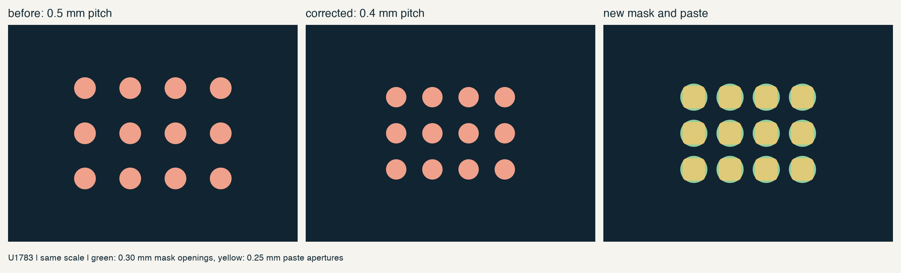
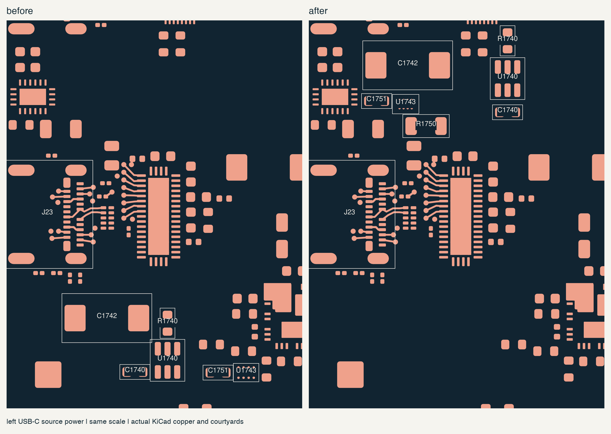
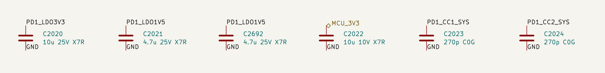
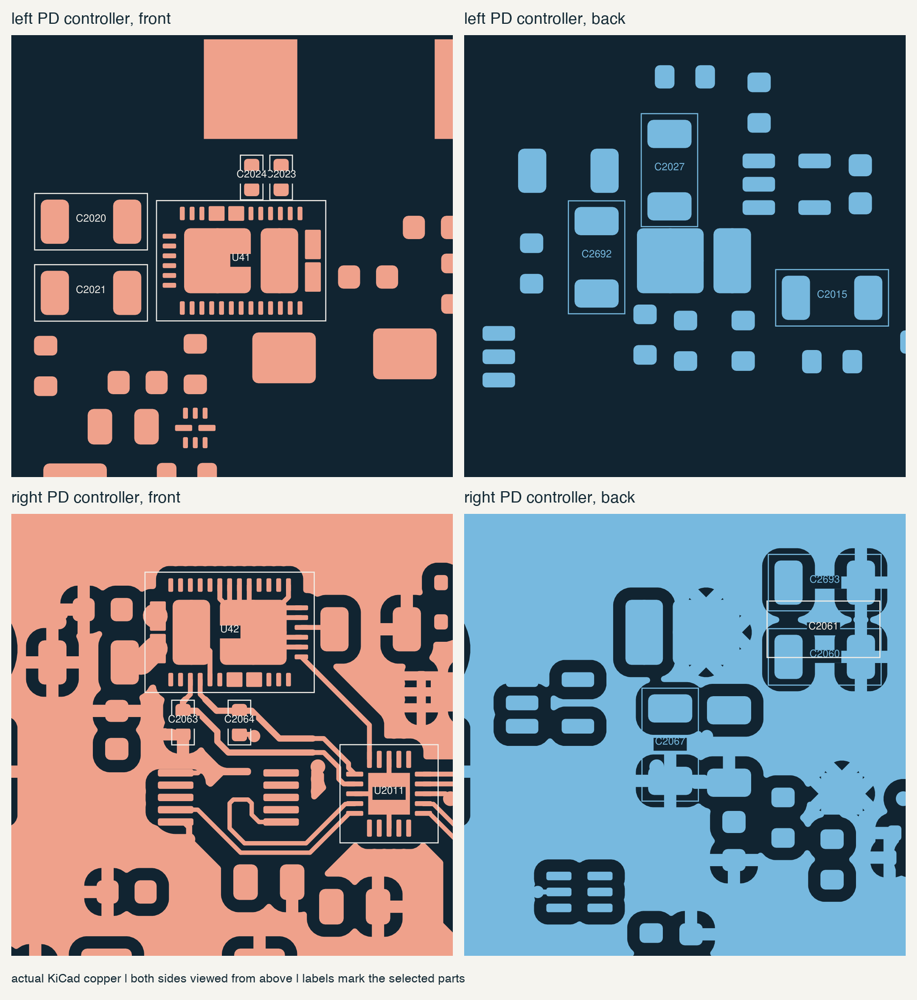

# main-board power placement

16 october 2026. went through the local power placement across all three
main boards. this includes the system 3.3 V and left USB 5 V capacitor
changes, both PD controllers, the left J23 power circuit and the standby
inputs. 31 existing parts moved and five capacitors were added. connector
positions, board outlines, mounting points and the three inner ground
planes stayed the same.

## USB protection footprints

U1743, U1783 and U1763 had a 0.5 mm ball grid. the TPD1S514 uses a 0.4 mm
grid. corrected all three placed footprints and replaced the library
footprint, so the old spacing cannot come back from the schematic generator.

the new pattern follows TI's YZ0012-C01 drawing 4221703/A: 0.225 mm copper
lands, 0.300 mm mask openings and separate 0.250 mm rounded-square paste
openings. the paste corner radius is 0.050 mm. the drawing uses a 0.100 mm
reference stencil; confirm the final stencil process with the assembler.
the maximum component height is 0.625 mm. pad names and nets are unchanged.

[TI TPD1S514 datasheet](https://www.ti.com/lit/ds/symlink/tpd1s514.pdf),
pages 25-27, supplies the package and land dimensions. the checker reads
both the library and all three saved board footprints. six tests cover
the old pitch, wrong copper, mask, paste and missing balls.

## port power and PD controllers

the J23 current limiter, reservoir capacitor, overvoltage protection and
discharge resistor now sit together above the connector. this removes the
long connection between the limiter below the port and the protection
chip off to its right. the USB data routes remain in place.

brought the PD regulator capacitors and local PP5V bypasses closer to their
controller pins. moved the left raw-VBUS bulk capacitor beside U41 and
the right PPHV bypass beside U42. the connector-side protection stays at
the connector. the right PP5V bulk capacitor stays near its downstream
breaker; the small local ceramic provides the controller's nearby bypass.

replaced the two regulator capacitor selections with documented Murata
parts. each LDO3V3 output now uses 10 uF, `GRM31CR71E106KA12L`. each
LDO1V5 output uses two 4.7 uF parts, `GRM31CR71E475KA88L`, giving 9.4 uF
nominal. the extra parts are C2692 and C2693.

the 1.5 V output allows 4.5-12 uF effective capacitance. a single 10 uF
part at +10% initial tolerance and +15% temperature variation could reach
12.65 uF. the pair reaches 11.891 uF at that same upper corner. the 3.3 V
output allows 5-25 uF, so its 12.65 uF upper corner is within range.
the lower limits still depend on DC bias and aging. the calculation
records the required retained capacitance; it does not substitute for
the selected parts' bias curves or measurement.

the CC capacitors stay on the front with the controller. repaired the two
existing right-side CC paths so each passes through its local capacitor
connection without a layer change. both reach U2011, and both capacitor
ground pads connect to the controller ground. the repair replaces 17
segments with 27 segments and one tented ground via. it includes two
obsolete ground stubs and the moved capacitor's return. all other tracks
and vias are unchanged.

[TI TPS25751A](https://www.ti.com/lit/ds/symlink/tps25751a.pdf), sections
6.4 and 9.4, defines the capacitance limits and placement guidance.
route the rear regulator capacitors with at most one layer transition
from each supply pin. give PP5V and PPHV their specified parallel vias.

## standby and remaining rails

added C2689-C2691, 100 nF 50 V X7R, at the three LM74700 source inputs.
each uses `GRM188R71H104KA93D` and returns to local ground. these sit on
the back beside the input pins. the source wires between boards make
local input bypassing necessary. [LM74700-Q1 sections 11 and 12](https://www.ti.com/lit/ds/symlink/lm74700-q1.pdf)
describe the remote-source bypass and short return.

the [converter placement notes](converter-placement.md) cover C46,
C790/C791 and the four left USB5 capacitor moves. U6 SYS_5V and U773
endpoint power keep their existing placements. their feedback, sense,
gate and local-return routes still need the care described in the
[power routing notes](power-routing.md).

## saved checks

| board | footprints | native unconnected | physical DRC errors | other DRC warnings |
| --- | ---: | ---: | ---: | ---: |
| center | 870 | 1,798 | 0 | 259 |
| left | 334 | 948 | 0 | 16 |
| right | 174 | 331 | 0 | 38 |

the center warnings are 174 dangling vias, 83 dangling tracks and two
silkscreen graphics. the left has 16 existing library differences. the
right has three dangling tracks, eight dangling vias, one silkscreen edge
warning and 26 library differences. these are still layout boards.
native connectivity supplies the unconnected totals because the DRC list
can stop at 499.

all three boards match their schematics. the electrical-rule reports have
no errors or unexplained warnings. all 545 power-wiring checks, 177
electrical calculations and 2,079 center pin checks pass. the saved
component exports contain 212 power-group parts and 1,378 total parts.

checked the 57 component changes since the saved flush-case snapshot
against its solid geometry, including service space and lid positions
through 135 degrees. no intersections were found. this uses component
courtyards and documented height allowances; the complete case has not
been rebuilt from these boards. the PCB underside is at H3.9 and the
floor at H1.2 in that study. the 1.8 mm underside capacitors leave 0.6 mm
after the 0.3 mm assembly allowance.

[positions, source hashes and checks](../../verification/mainboard-power-placement.json)
record this pass. routing, actual capacitor behaviour, startup, switching
between supplies and warm load tests still need to be completed before
the laptop is ready to build and use.
