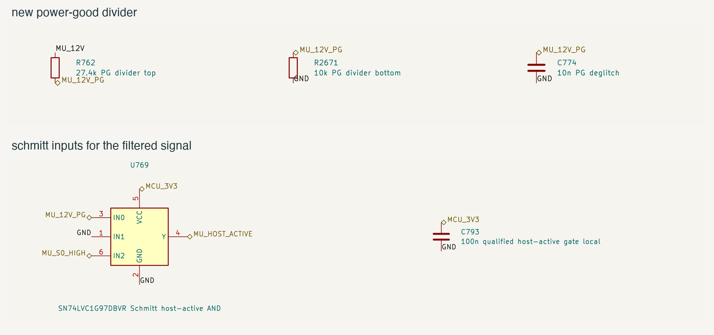

# mu power-good

16 october 2026. fixed the Mu rail's status circuit before routing it.
the center board still has 1,786 native unconnected items.

PE15 had an internal pull-down enabled against R762's 100 kohm pull-up.
using the STM32's typical 40 kohm value gives about 0.94 V at a 3.3 V
supply. that cannot report a valid high to the existing AND gate. the
pull-down is now disabled. PE14 also uses its existing external PSON
pull-up without an internal pull-down fighting it.

R762 is now 27.4 kohms from the actual MU_12V output. the new 10 kohm
R2671 returns the signal to ground. this keeps it low when the rail is
absent even if the regulator's open-drain output is released. the regulator
can still pull it low during a fault. C774 remains 10 nF.

the old SN74LVC1G08 required an input transition no slower than 10 ns/V
at 3.3 V, which the filtered signal could not meet. U769 is now an
SN74LVC1G97DBVR with Schmitt inputs. pin 1 is tied low, pin 3 receives
power-good, and pin 6 receives Mu S0. its mux truth table then gives the
same AND function. pins 2, 4 and 5 are ground, output and 3.3 V.

## calculated limits

these use the full 11.4 to 12.6 V rail envelope, independent 5% resistor
environment allowances and 8.1 microamps of combined input/output leakage.

| check | result |
| --- | ---: |
| lowest asserted high | 2.768 V |
| highest asserted high | 3.684 V |
| high-impedance output with the 12 V rail absent | at most 0.085 V |
| regulator sink-current load | at most 0.492 mA |
| filter time constant | at most 0.100 ms |
| R762 dissipation with PG low | at most 6.10 mW |

the high-level screen uses the gate's 2.74 V threshold bound at 4.5 V as
an intentionally conservative comparison for its 3.0 to 3.6 V supply.
that is an engineering screen, not an added manufacturer guarantee. the
STM32 input is five-volt tolerant; its internal pulls must stay disabled.
the calculated maximum remains below its VDD + 4 V absolute limit even
with VDD absent. scope the real startup and discharge waveforms before
enabling the hardware operating profile.

## saved changes and checks

R2671 is on B.Cu at X150.129602, Y112.315074 mm, next to C774 and R762.
R762 keeps its previous position. U769 keeps X287.2375, Y77.55 mm on
F.Cu and changes from SOT-23-5 to SOT-23-6. all other footprints, tracks,
vias, zones and board geometry are unchanged. the affected nets still
need routing. the source hashes and exact checks are in
[the saved record](../../verification/mu-power-good.json).

the center has zero ERC errors and zero schematic parity findings.
all 406 library warnings match checked symbol templates, including the
new gate's six-pin mapping. the board has zero physical DRC errors;
its 344 existing warnings are identical to the starting report.

all 173 electrical calculations, 478 power wiring assertions, seven
power-good regression tests and 47 firmware host tests pass. the EC ARM
build succeeds. the GPIO test runs the actual initialization against RAM
registers and catches the previous code. the firmware's stuck-high,
startup timeout and lost-power-good responses remain in place.

the charger review covered its reset state, charge inhibit, input-limit
reload, watchdog and source-change handling. no charger register changes
were made in this pass. the existing charge and power qualification
flags remain off. startup timing, hot restarts, transfer, fault response,
loop stability and installed temperatures still need hardware tests.

## sources

- [ST STM32F405/407, DS8626 rev 12](https://www.st.com/resource/en/datasheet/dm00037051.pdf): PE15 pin type, input limits, leakage and internal pull resistors.
- [TI TPS552882, SLVSFC5](https://www.ti.com/lit/ds/symlink/tps552882.pdf): PG thresholds, sink/leakage limits and shutdown behavior.
- [TI SN74LVC1G08, SCES217AA](https://www.ti.com/lit/ds/symlink/sn74lvc1g08.pdf): input transition limit for the previous gate.
- [TI SN74LVC1G97, SCES416N](https://www.ti.com/lit/ds/symlink/sn74lvc1g97.pdf): Schmitt thresholds, truth table, pin map and power-off input tolerance.
- [Renesas ISL9241, FN8945 rev 6](https://www.renesas.com/en/document/dst/isl9241-datasheet): charger startup, inhibit, current limits and register behavior.
