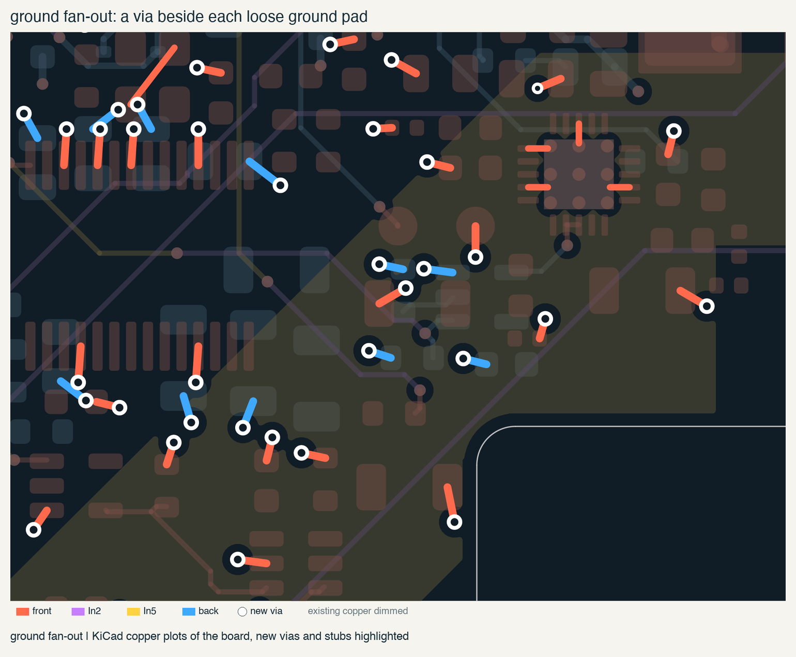
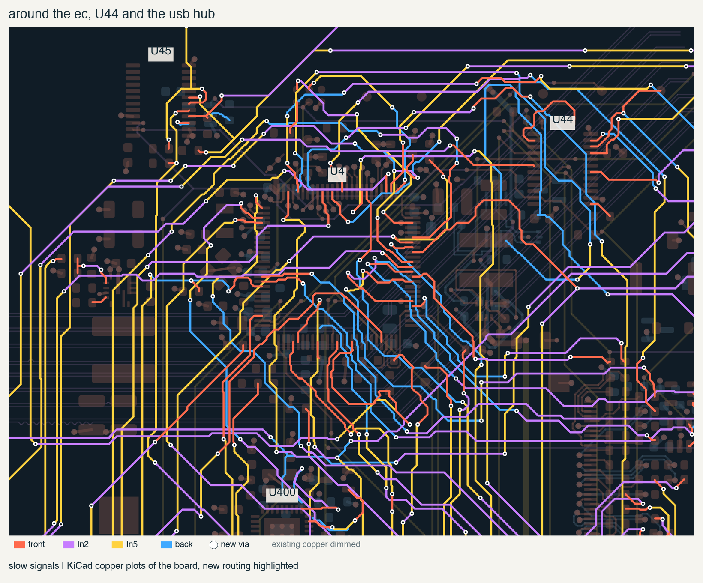

# slow signals and ground fan-out

12 november 2026. two passes over the open nets on the center board:
the ground fan-out, then the rest of the slow digital lines. the
special-attention nets apart from ground are still open; they get
routed by hand.

## ground fan-out

ground had 364 open connections: pads sitting on their own, with nothing
taking them down to the ground planes. each one now gets a via right beside
the pad on a short 0.3 mm stub.

- the via has to land on the ground plane right next to the pad's side
  (In1 for the front, In6 for the back), well inside the fill.
- it's the board's usual 0.6/0.3 mm ground via where it fits, then
  0.5/0.25 and 0.45/0.2.
- it sits at least 0.15 mm off its own pad (no via in a solder pad) and
  within 0.9 mm of it (1.6 mm for four of the ec's decoupling caps).
- a ground pin right next to its chip's exposed ground pad gets a short
  stub to that pad instead of a via.
- no vias under the body of a chip with an exposed pad.
- no via inside another part's escape ring (see below). a part's own
  ground pins may have theirs there.
- the microphone MK430 is left out: its ground ring sits around the
  acoustic port, which has its own clearance rule and keep-out.
- every via and stub is checked against the board rules with exact
  geometry, including the vias placed before it.

324 pads got a via or a stub, and ground went from 365 separate pieces to
49. these 44 pads are left for hand work:

| pads | why |
| --- | --- |
| C903 to C915, C935 | maker mcu decoupling on the back under U901: the only spots are under the chip body, between the pins and the exposed pad |
| C202, C208, C209, U4.20, U4.27 | around the ec: no spot outside its escape ring within 1.6 mm |
| SW1, SW2, SW3, SW901 pin 2 | the second of two pads with the same number |
| J16, J2073, J420, J53, J54 mounting pads | through-hole or mechanical pads, left for a look by hand |
| MK430.2, MK430.4 | the microphone, by hand |
| C29, C39, C444, C445, C781, C2283, Q62, Q901, U44.21, U771.2, U2300.2, U2302.3, U2303.5, U2305.2, U901.47 | no spot that clears everything, or a keep-out in the way |

## slow signals

the rest of the slow group: 232 nets with 341 open connections. the
ground vias were already in place, so the routes go around them.

new rules since the ec pass:

- escape rings: within 0.7 mm of the pads of a fine-pitch part (12 or
  more pads at 0.65 mm pitch or finer), only nets with a pin on that part
  may route or put vias. without this, other nets ran along the pin rows
  of the ec and the maker mcu and walled their pins in.
- rule areas inside footprints now count, like the shell copper
  exclusions on FPC102 and FPC103 and the via keep-outs on J4 and J902.
- no tracks inside the pin ring of a chip with an exposed pad, and no
  vias under its body. a QFP like the ec has no exposed pad, so routing
  under it stays allowed, the same as the ec pass.
- the extra costs near special-attention pads, high-speed tracks and
  switch nodes now add up instead of multiplying, and the total is
  capped at six times the plain cost. multiplying them made a couple of
  short nets loop around the whole board.
- the straight-line path between pieces of a still-split special
  signal net (pairs, sense lines, crystals, audio, rf) costs more, so
  the slow routes leave it open.
- a via inside another part's courtyard costs extra.
- afterwards, every special-attention pad that still needs routing was
  checked for via room within 1.5 mm. where the slow routes took the
  last spot, that spot was reserved and the slow nets in the way were
  rerouted around it.
- a final pass with clean costs picked up the connections that failed
  late in the congestion passes.

| | result |
| --- | ---: |
| open connections at the start | 341 |
| routed | 239 |
| nets now fully connected | 134 of 232 |
| track | about 10.7 m |
| vias | 610 (median 3 per net, most 20) |
| length against the shortest tree, median | 1.22 |

## reroute with fan-outs first (13 november)

i went in to move the parts in front of the walled-in pins, but checking
each pocket showed that placement was rarely the real problem:

- most pins were walled in by routing order. nets that happened to route
  first took the escape room next to U4, U901 and the fpc connectors, and
  the pins routed later had nowhere left to go.
- the pins on FPC102 and FPC103 already had a short stub and a via each
  from earlier work, but the router only started from pads, and the pads
  themselves are boxed in by their neighbours.
- six of U4's bottom pins open into a closed triangle inside the QFP,
  formed by two ec routes and two vias, with the inner layers under it
  full.

so instead of moving parts, i ripped up the 105 slow nets that had copper
near the dense parts and routed them again in a better order:

- fan-out first: every slow pin on those parts that is still on its own,
  with its partner more than 4 mm away, gets a stub and a via before
  anything else routes there. on a QFP like the ec the via may go under
  the body. 74 found a spot; the 43 the router didn't end up using were
  removed again.
- a net can now start from the vias already wired to its pads, not only
  from the pads.
- via spots within 1.5 mm of a net's own pads are checked exactly instead
  of with the grid allowance.
- every special-attention pad that lost its last via spot against the
  board before this pass got that spot reserved, and the nets in the way
  were rerouted. 116 spots are reserved in total.
- the board outline's arcs (the BMS cutout corners) are now followed
  properly; before, one route came too close to a curved corner.

| | before | after |
| --- | ---: | ---: |
| open slow connections | 102 | 62 |
| slow nets fully connected | 134 of 232 | 171 of 232 |
| native unconnected items | 700 | 660 |

## not routed

62 slow pads are still on their own:

| part | open pins | what's in the way |
| --- | ---: | --- |
| U4 (ec) | 16 | the closed pocket inside the QFP formed by the MU_12V_PG and PD2_VALID_N routes, and R2310, R2320 and C209 right under the bottom row |
| U901 (maker mcu) | 9 | the bottom row faces R906 and R919 0.6 mm away, with R918 and the crystal Y900 behind them; the left pins sit behind U910 and their own fan-outs |
| U400 (usb hub) | 3 | the strap resistors R402 and R403 sit 0.4 mm from their pins |
| others | 34 | single pins or resistor ends in tight spots |

these are the real placement problems. the ones at U4 and U901 involve
the crystal and debug resistors and the ec's existing routes, so they
need a decision rather than a blind move.

## checks

| check | result |
| --- | --- |
| physical DRC | zero new findings against the board before each pass, refilled the same way. after the reroute, two older escape vias (KB_COL8, MAKER_GPIO5) are back to touching copper on one layer only, as they were before the slow pass |
| exact clearance | no problems, all new copper against the old and itself, arcs checked as arcs |
| native unconnected items | 1,255 before, 700 after the first pass, 660 after the reroute |
| schematic parity | passes: 870 parts, 3,372 physical pads, no net, value or footprint changes |
| via nets | all new vias keep their nets after refill (917 in the first pass, 653 in the reroute) |
| placement exports | regenerated; only the board hash changed, all 212 power rows and 1,378 component rows still match |
| case | no parts moved, so nothing new to screen |

## weak spots

- after the first pass, 19 special-attention pads had no via spot within
  1.5 mm any more, mostly to the ground fan-out: the ec's crystal pins
  U4.12/13 and usb pins U4.70/71 with R200, decoupling pads C24, C30,
  C909, C911, C913 and a few others. the reroute took the last spot of 6
  more that it couldn't give back: C908.1, C913.2, R907.2, U2300.2, U46.5
  and U901.30. the crystal and usb lines will likely run on the surface
  anyway, but the power pads need a look before routing them.
- 333 track pieces under 0.15 mm, mostly one-cell jogs at vias and pads.
- ground stubs run straight from the pad to the via at whatever angle
  that is, not on 45 degree lines.
- 16 slow nets are more than twice their shortest length, and some nets
  change layers a lot (up to 20 vias).
- nothing reserves room for the power feeds and the other rails yet;
  they come with the In4 power map.
