# slow signals and ground fan-out

12 november 2026. two passes over the open nets on the center board:
the ground fan-out, then the rest of the slow digital lines. the
special-attention nets apart from ground are still open; they get
routed by hand.

## ground fan-out

ground had 364 open connections: pads sitting on their own, with nothing
taking them down to the ground planes. each one now gets a via right beside
the pad on a short 0.3 mm stub.

- the via has to land on the ground plane right next to the pad's side
  (In1 for the front, In6 for the back), well inside the fill.
- it's the board's usual 0.6/0.3 mm ground via where it fits, then
  0.5/0.25 and 0.45/0.2.
- it sits at least 0.15 mm off its own pad (no via in a solder pad) and
  within 0.9 mm of it (1.6 mm for four of the ec's decoupling caps).
- a ground pin right next to its chip's exposed ground pad gets a short
  stub to that pad instead of a via.
- no vias under the body of a chip with an exposed pad.
- no via inside another part's escape ring (see below). a part's own
  ground pins may have theirs there.
- the microphone MK430 is left out: its ground ring sits around the
  acoustic port, which has its own clearance rule and keep-out.
- every via and stub is checked against the board rules with exact
  geometry, including the vias placed before it.

324 pads got a via or a stub, and ground went from 365 separate pieces to
49. these 44 pads are left for hand work:

| pads | why |
| --- | --- |
| C903 to C915, C935 | maker mcu decoupling on the back under U901: the only spots are under the chip body, between the pins and the exposed pad |
| C202, C208, C209, U4.20, U4.27 | around the ec: no spot outside its escape ring within 1.6 mm |
| SW1, SW2, SW3, SW901 pin 2 | the second of two pads with the same number |
| J16, J2073, J420, J53, J54 mounting pads | through-hole or mechanical pads, left for a look by hand |
| MK430.2, MK430.4 | the microphone, by hand |
| C29, C39, C444, C445, C781, C2283, Q62, Q901, U44.21, U771.2, U2300.2, U2302.3, U2303.5, U2305.2, U901.47 | no spot that clears everything, or a keep-out in the way |

## slow signals

the rest of the slow group: 232 nets with 341 open connections. the
ground vias were already in place, so the routes go around them.

new rules since the ec pass:

- escape rings: within 0.7 mm of the pads of a fine-pitch part (12 or
  more pads at 0.65 mm pitch or finer), only nets with a pin on that part
  may route or put vias. without this, other nets ran along the pin rows
  of the ec and the maker mcu and walled their pins in.
- rule areas inside footprints now count, like the shell copper
  exclusions on FPC102 and FPC103 and the via keep-outs on J4 and J902.
- no tracks inside the pin ring of a chip with an exposed pad, and no
  vias under its body. a QFP like the ec has no exposed pad, so routing
  under it stays allowed, the same as the ec pass.
- the extra costs near special-attention pads, high-speed tracks and
  switch nodes now add up instead of multiplying, and the total is
  capped at six times the plain cost. multiplying them made a couple of
  short nets loop around the whole board.
- the straight-line path between pieces of a still-split special
  signal net (pairs, sense lines, crystals, audio, rf) costs more, so
  the slow routes leave it open.
- a via inside another part's courtyard costs extra.
- afterwards, every special-attention pad that still needs routing was
  checked for via room within 1.5 mm. where the slow routes took the
  last spot, that spot was reserved and the slow nets in the way were
  rerouted around it.
- a final pass with clean costs picked up the connections that failed
  late in the congestion passes.

| | result |
| --- | ---: |
| open connections at the start | 341 |
| routed | 239 |
| nets now fully connected | 134 of 232 |
| track | about 10.7 m |
| vias | 610 (median 3 per net, most 20) |
| length against the shortest tree, median | 1.22 |

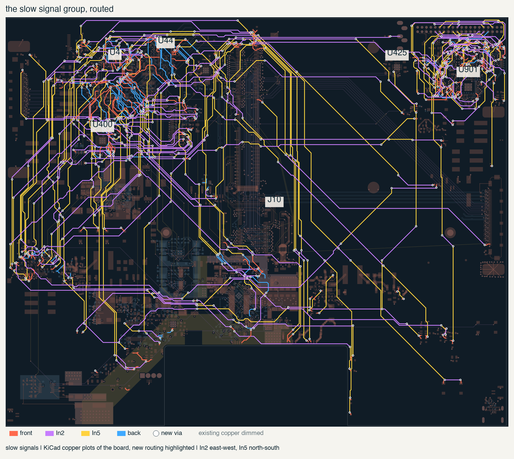

## reroute with fan-outs first (13 november)

i went in to move the parts in front of the walled-in pins, but checking
each pocket showed that placement was rarely the real problem:

- most pins were walled in by routing order. nets that happened to route
  first took the escape room next to U4, U901 and the fpc connectors, and
  the pins routed later had nowhere left to go.
- the pins on FPC102 and FPC103 already had a short stub and a via each
  from earlier work, but the router only started from pads, and the pads
  themselves are boxed in by their neighbours.
- six of U4's bottom pins open into a closed triangle inside the QFP,
  formed by two ec routes and two vias, with the inner layers under it
  full.

so instead of moving parts, i ripped up the 105 slow nets that had copper
near the dense parts and routed them again in a better order:

- fan-out first: every slow pin on those parts that is still on its own,
  with its partner more than 4 mm away, gets a stub and a via before
  anything else routes there. on a QFP like the ec the via may go under
  the body. 74 found a spot; the 43 the router didn't end up using were
  removed again.
- a net can now start from the vias already wired to its pads, not only
  from the pads.
- via spots within 1.5 mm of a net's own pads are checked exactly instead
  of with the grid allowance.
- every special-attention pad that lost its last via spot against the
  board before this pass got that spot reserved, and the nets in the way
  were rerouted. 116 spots are reserved in total.
- the board outline's arcs (the BMS cutout corners) are now followed
  properly; before, one route came too close to a curved corner.

| | before | after |
| --- | ---: | ---: |
| open slow connections | 102 | 62 |
| slow nets fully connected | 134 of 232 | 171 of 232 |
| native unconnected items | 700 | 660 |

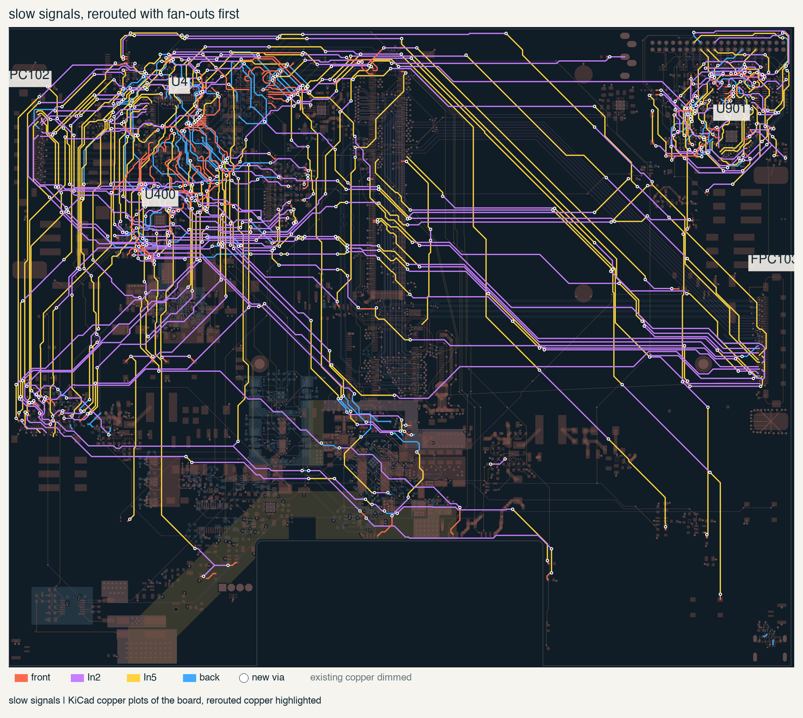

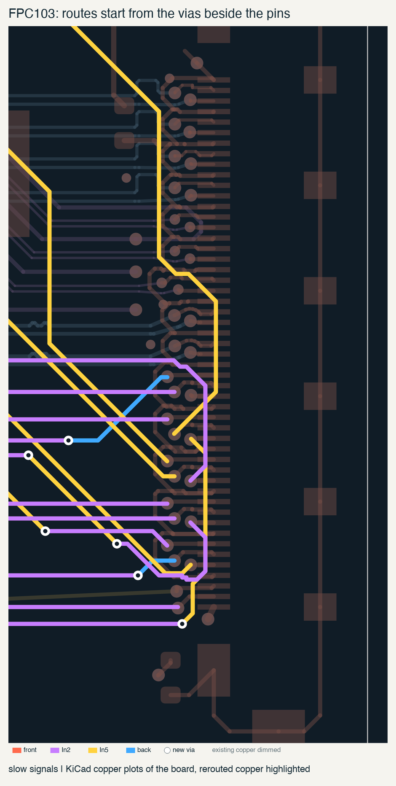

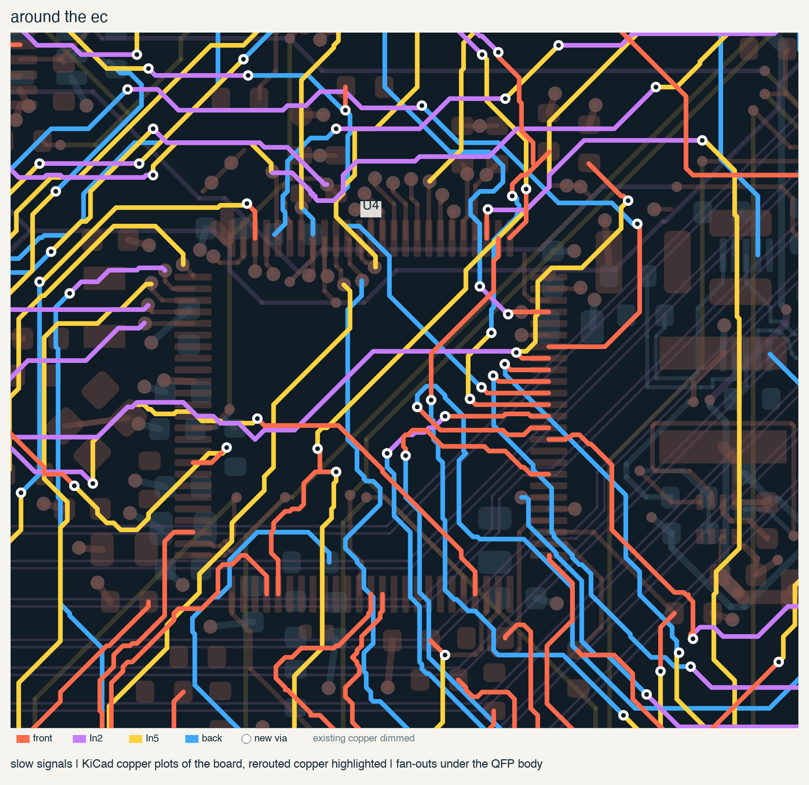

## clean reroute (13 november, second pass)

the routes above connected, but they looked messy: staircases, long runs
on the outer layers, routes hopping between layers, and nets wandering
around instead of running in neat lanes. the older routing on these nets
had the same problem. so i took all of it out and routed the slow group
again with a different method, written up in
[how the slow lines get routed](routing-method.md). in short:

- everything the router had put down since the ec pass came out, ground
  fan-out included. the older slow runs from before the power routing
  stayed but got straightened in place, and the hand fixes for the boxed-in
  ec pads stayed as they were.
- fan-out vias sit on a 0.5 mm grid and only where they have free lanes out
  on the inner layers. older escape vias next to boxed-in pins (FPC102,
  FPC103) get a short inner stub to the nearest free lane.
- long runs go on In2 east to west and In5 north to south on that grid, so
  they line up as buses. nets share lanes at a rising price for 20 rounds
  before the rest is settled one at a time.
- what the grid can't do goes to the fine router, with the outer layers
  four times the price away from the pads and bends and vias costed.
- the 48 worst nets by a cleanliness score got routed again with strict
  costs, in groups that don't overlap; a net only kept the new route if it
  connected as much and was clearly cleaner. two more fill passes then went
  after the connections that were still open.
- every run between two fixed points is replaced by the simplest 45 degree
  shape that clears the rules, or a version with fewer bends found in a
  narrow corridor around it. dead ends, unused fan-outs and 47 exact
  duplicate track pieces (some on GND, VSYS, CHG_SRN and CHG_BIAS_OR, left
  over from earlier work) are gone.
- via room next to special-attention pads is kept free the whole way: 231
  reserved escape spots (pads, stubs and via spots) are keep-out areas for
  every step, and a repair loop reserves and clears any pad that still lost
  its last spot. the first try skipped this and took the last via spot of
  64 special pads, including the usb pairs on FPC102, which is why it
  didn't go in.
- no new vias in outer-layer pours of other nets. one ground via split the
  small SEL_STAGE2 pour on the back in two; the check caught it.

| | committed board | now |
| --- | ---: | ---: |
| native unconnected items | 660 | 649 |
| open slow connections | 62 | 68 |
| slow nets fully connected | 187 of 248 | 182 of 248 |
| open ground connections | 48 | 31 |
| slow-net track | 17.9 m | 20.2 m |
| bends per 100 mm of track | 23.3 | 15.9 |
| track on the outer layers | 15% | 13% |
| track pieces under 0.3 mm | 1,120 | 512 |
| vias per 100 mm of track | 5.7 | 6.2 |
| special pads with no via spot left | | 5 |

the slow group ended up six connections short of the committed board, but
the board as a whole has eleven fewer open items, mostly ground, and every
special pad but five still has the via room it had on the committed board.
the extra vias per length mostly come from the lane grid changing layer
at its turns.

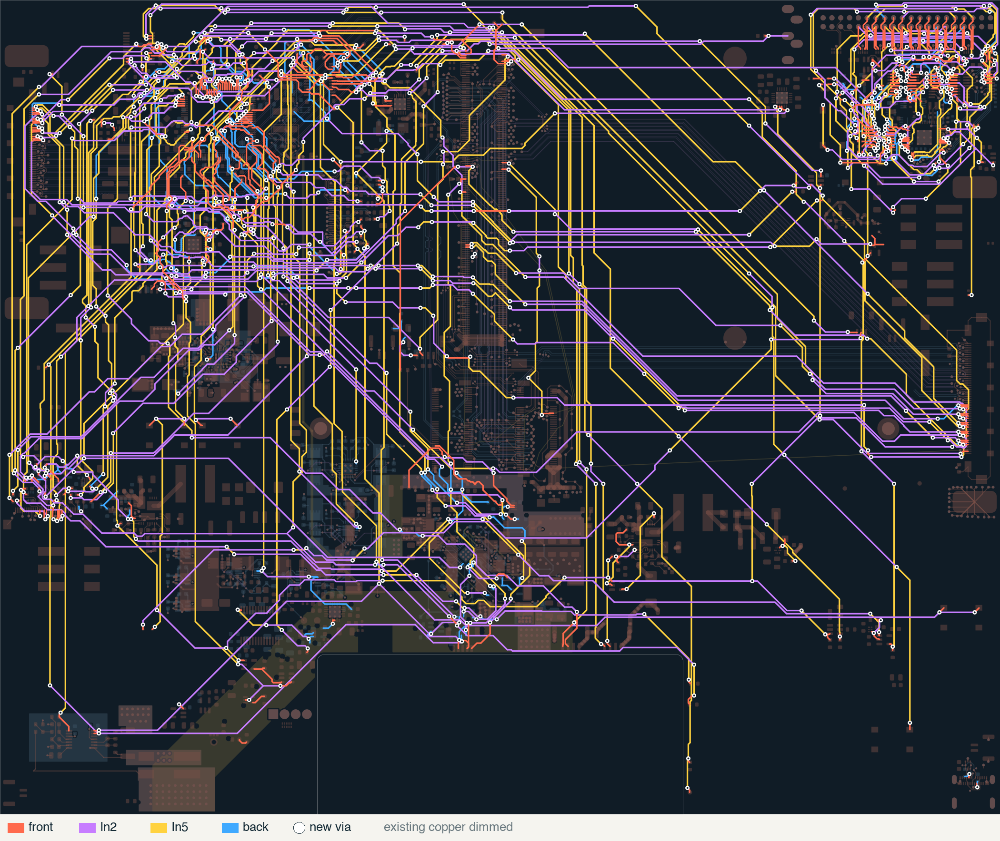

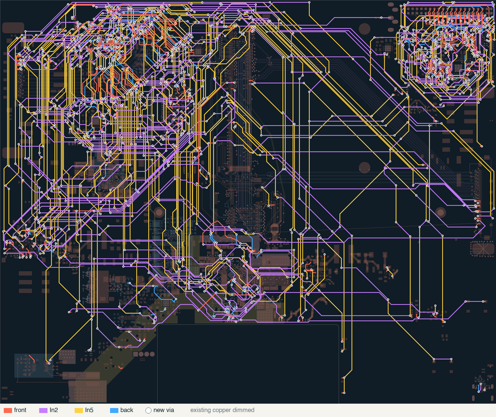

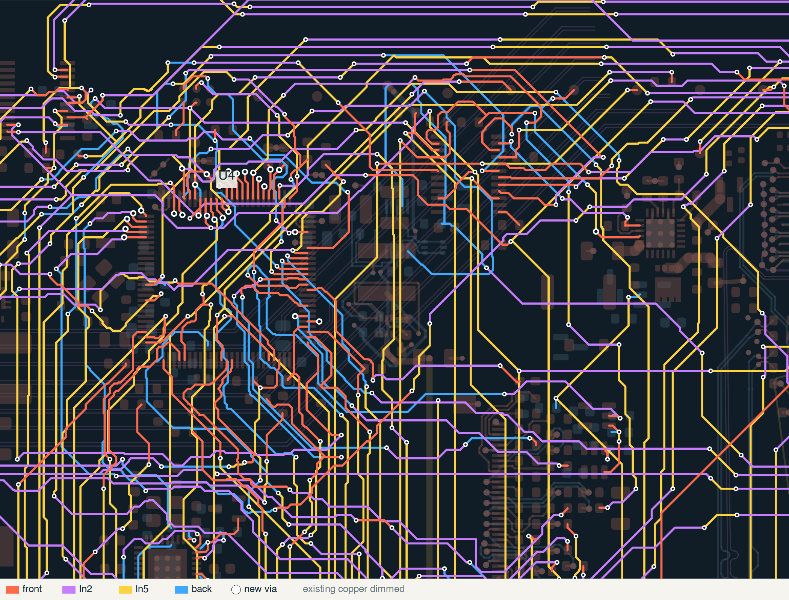

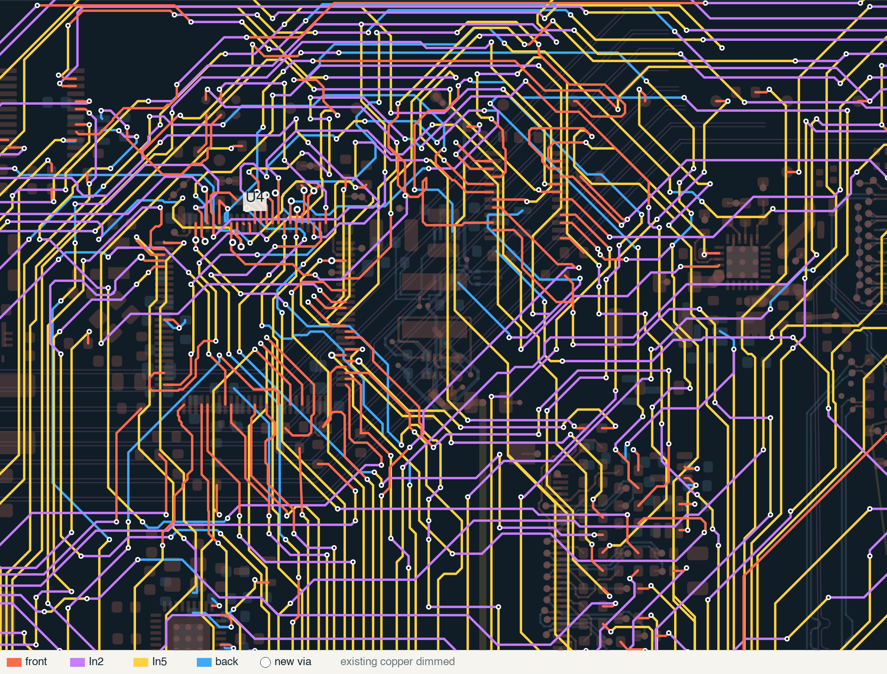

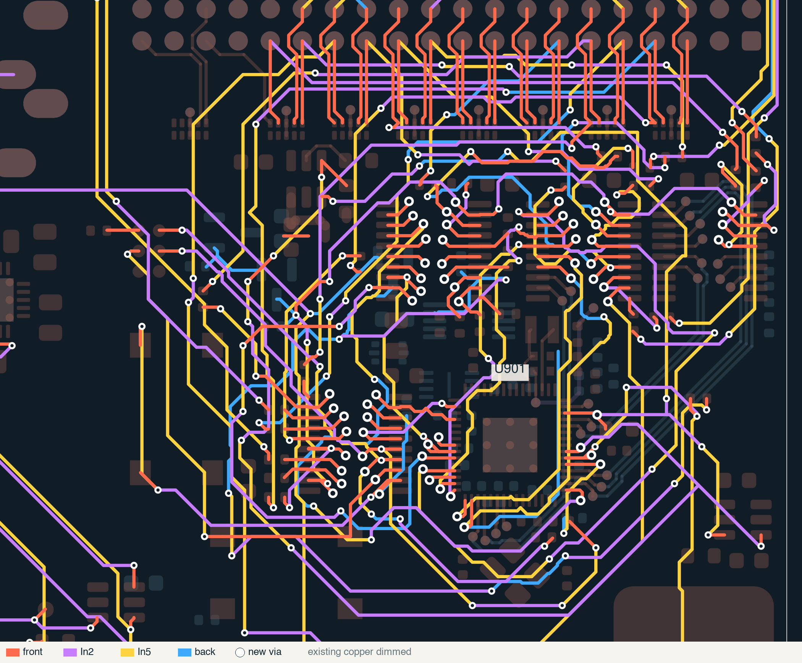

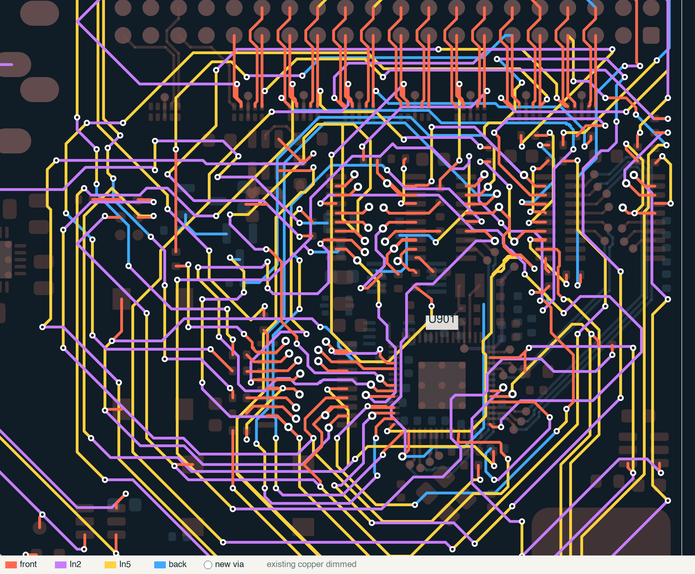

## closing the gap (14 november)

the clean reroute left the slow group six connections behind the board from
before it. those connections had been made there, so a way through existed.

- for each of the 31 nets that was connected before and isn't now, the old
  route near the open pin shows where its escape has to go. the slow nets
  whose new copper sits within 4 mm of that pin, on that old path, were
  ripped (39 nets), the open pins routed first, then the ripped nets.
- that alone fixed 21 nets but broke more among the ripped ones, so
  two fill passes followed: one with the usual costs and one in the
  router's negotiated mode, where all open nets route together and push
  each other aside. after those, no net was worse than before the rip.
- a second round of this got stuck for hours on one net and was stopped.
- the five keyboard nets with the most vias were redone on their own; that
  took a few vias off, but the via-room repair afterwards put most of them
  back.
- 9 of the 10 pieces still clearly off 45 or 90 degrees got squared into a
  straight leg and a 45 degree leg.
- every new step keeps the escape reservations; the repair loop ran again
  at the end and only 3 special pads are short of via room now.

two cleanups came out of the checks:

- the module and connector shells (A1, J16, J53, J54, J420, J2073) and the
  switches (SW1, SW2, SW3, SW901) have several pads with the same name. the
  ground step couldn't tell which one was loose, so every repair round
  stacked another stub and via on the first one, up to eleven on a pad. 95
  of those stacked stubs are gone, one stays where it lands on the plane,
  and pads that share a name are now skipped and left for hand work.
- 153 short pieces of slow-net track lay entirely inside their own pad,
  left over from older stubs, and are gone. they didn't connect anything.

| | before the clean reroute | after it | now |
| --- | ---: | ---: | ---: |
| native unconnected items | 660 | 649 | 646 |
| open slow connections | 62 | 68 | 61 |
| slow nets fully connected | 187 of 248 | 182 | 187 |
| open ground connections | 48 | 31 | 31 |
| bends per 100 mm of track | 23.3 | 15.9 | 14.8 |
| track pieces under 0.3 mm | 1,120 | 512 | 417 |
| track on the outer layers | 15% | 13% | 13% |
| vias per 100 mm of track | 5.7 | 6.2 | 6.4 |
| pieces clearly off 45/90 degrees | 1 | 13 | 1 |
| special pads with no via spot left | | 5 | 3 |

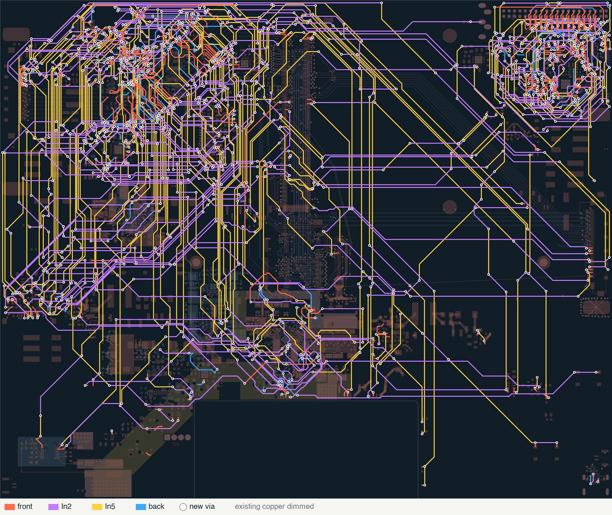

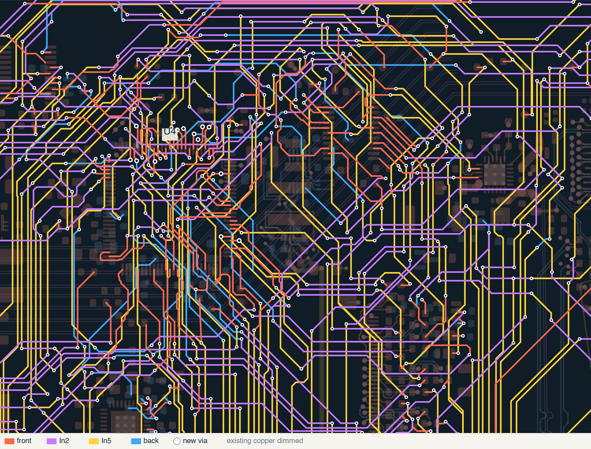

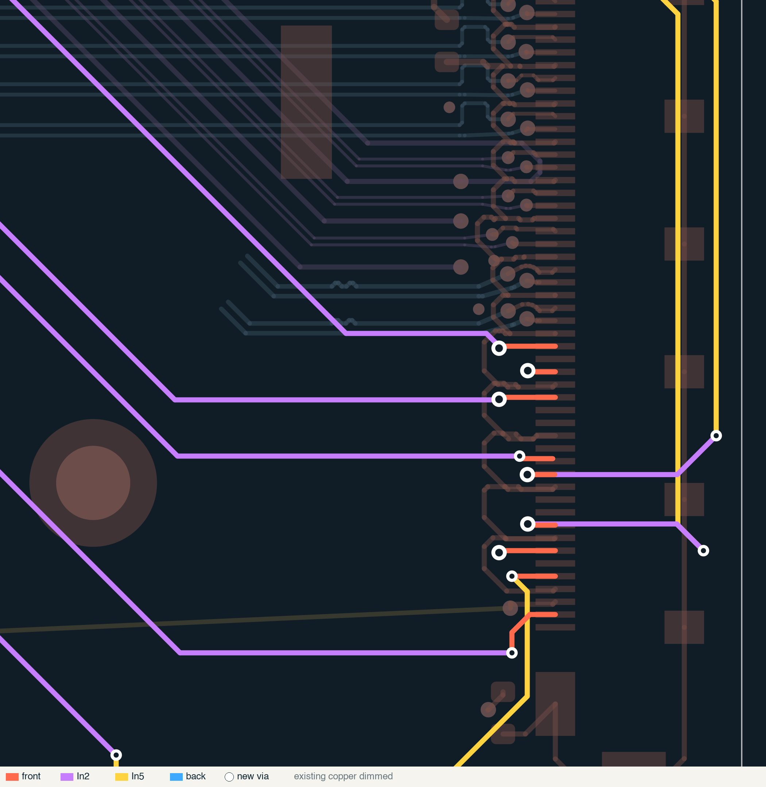

## not routed

61 slow connections are still open:

| part | open pins | what's in the way |
| --- | ---: | --- |
| U4 (ec) | 17 | no fan-out spot with a free lane out, and no free way out on the surface |
| FPC103 | 8 | boxed in by their neighbours on the front |
| U911 | 5 | no fan-out spot with a free lane out |
| U400 (usb hub) | 4 | the strap resistors R402 and R403 sit 0.4 mm from their pins |
| J2300, U901 | 2 each | no fan-out spot with a free lane out |
| others | 23 | single pins or resistor ends in tight spots |

ground still has 31 loose pads: the maker mcu decoupling on the back
under U901 (C903 to C908, C912, C914, C915, C935), the shared-name pads on
A1, J16, J53, J54, J420, J2073, SW1, SW2, SW3 and SW901, the mounting hole
H2, the microphone MK430 and C444, C445, C2283 and U60.

## checks

| check | result |
| --- | --- |
| physical DRC | zero new findings against the board before the clean reroute, refilled the same way |
| exact clearance | no problems: all copper that wasn't on that board (4,841 track pieces, 1,455 vias) checked against everything, arcs checked as arcs, track to hole included |
| native unconnected items | 660 before the clean reroute, 646 now |
| special-pad via room | 787 special pads checked against the board before the clean reroute: 3 have no via spot within 1.5 mm |
| schematic parity | passes: 870 parts, 3,372 physical pads, no net, value or footprint changes |
| via nets | every new via keeps its net after refill |
| placement exports | regenerated; only the board hash changed, all 1,378 component rows still match |
| case | no parts moved, so nothing new to screen |

## weak spots

- three special pads have no via spot within 1.5 mm: C909.2 (ground, left
  for hand work), U901.22 (MAKER_XOUT, a crystal pin, which usually stays
  on the surface) and U906.8 (MAKER_USB_DN, which had 17). the maker usb
  pair needs a look before it gets routed.
- the keyboard matrix nets run from the ec to the keyboard resistors
  through the busiest part of the board. KB_ROW5 and KB_ROW6 have 15 and
  16 vias, and some multi-pin nets have more (I2C_SCL 36, I2C_SDA 33).
- vias per length went up a little: the lane grid changes layer at its
  turns.
- the ec pin ring needs a decision: either move some of the hand-fixed
  pads' copper or accept surface routing for the last ec pins.
- nothing reserves room for the power feeds and the other rails yet;
  they come with the In4 power map.
