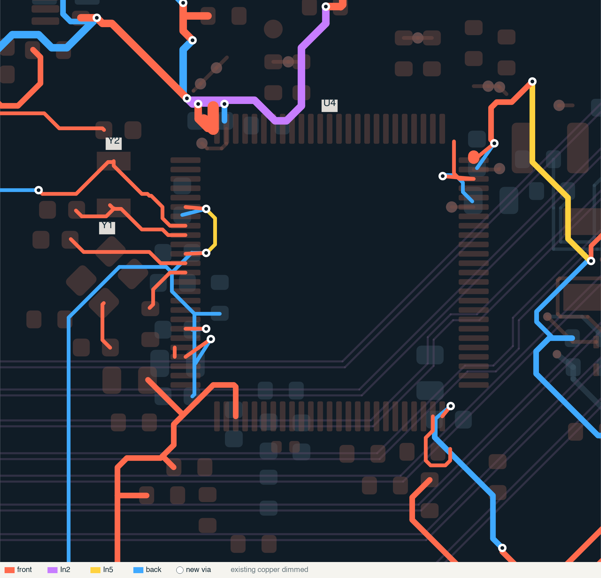
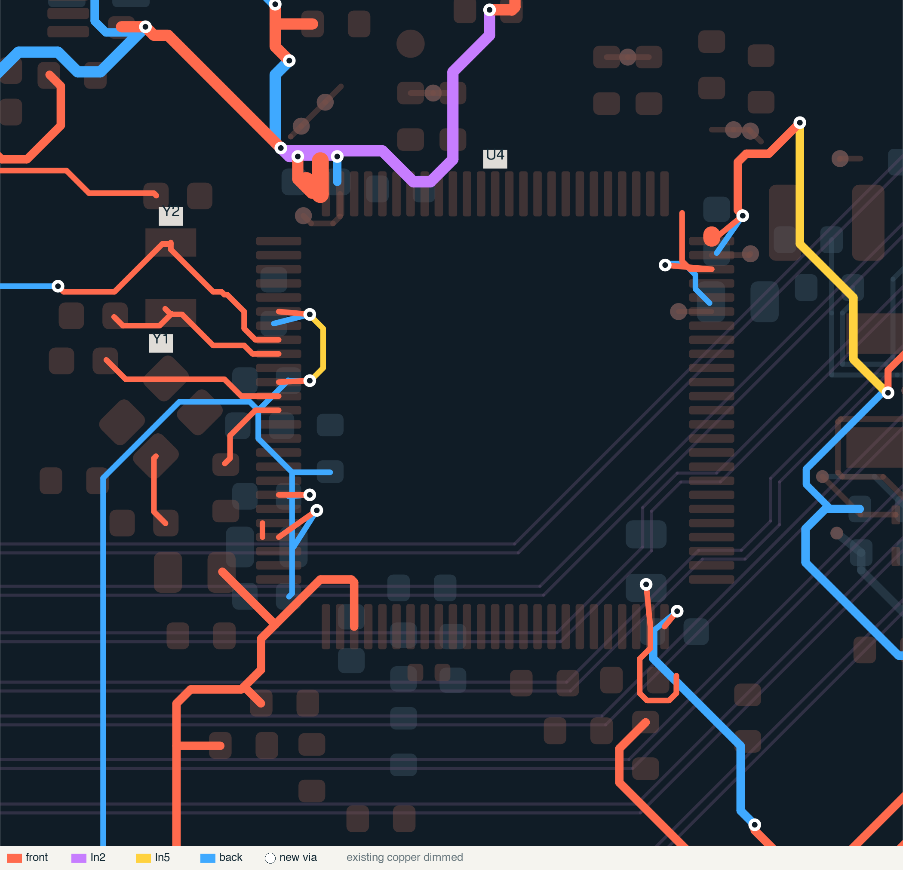
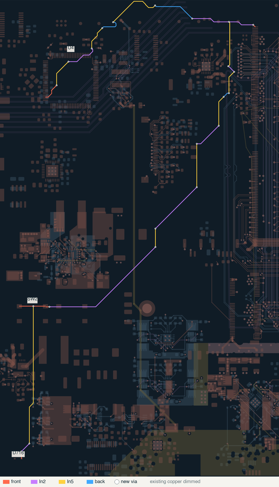
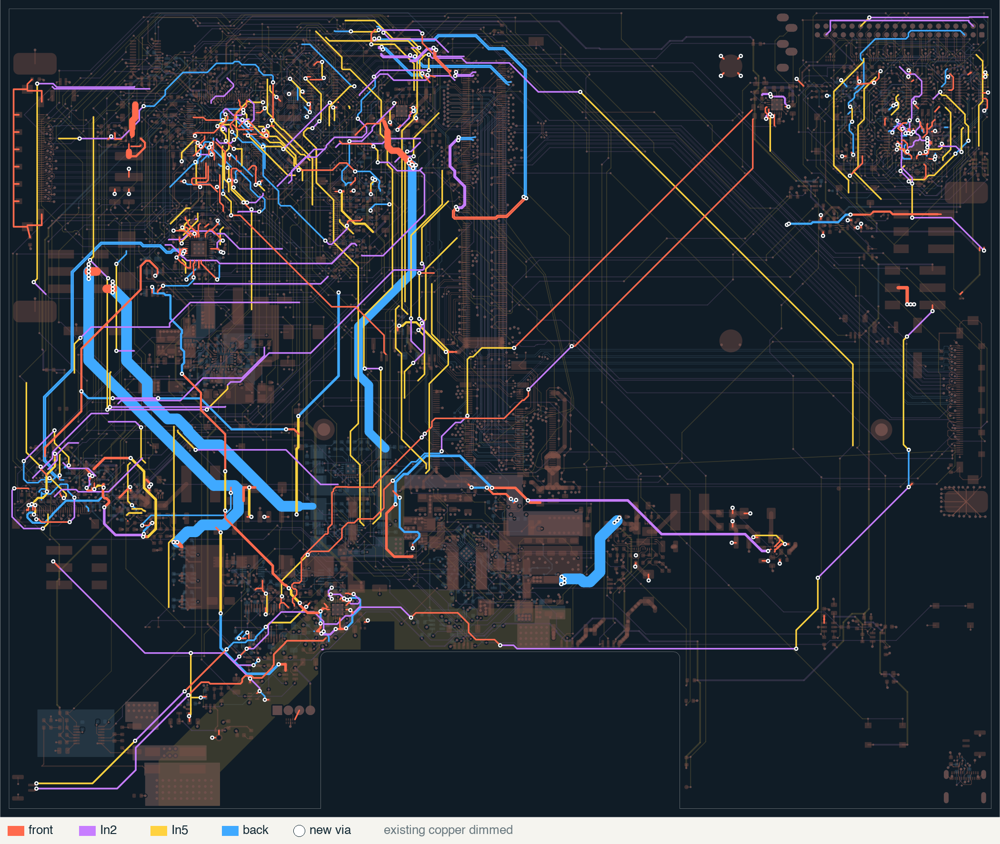
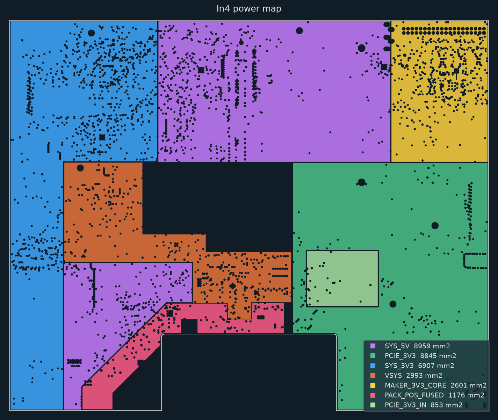
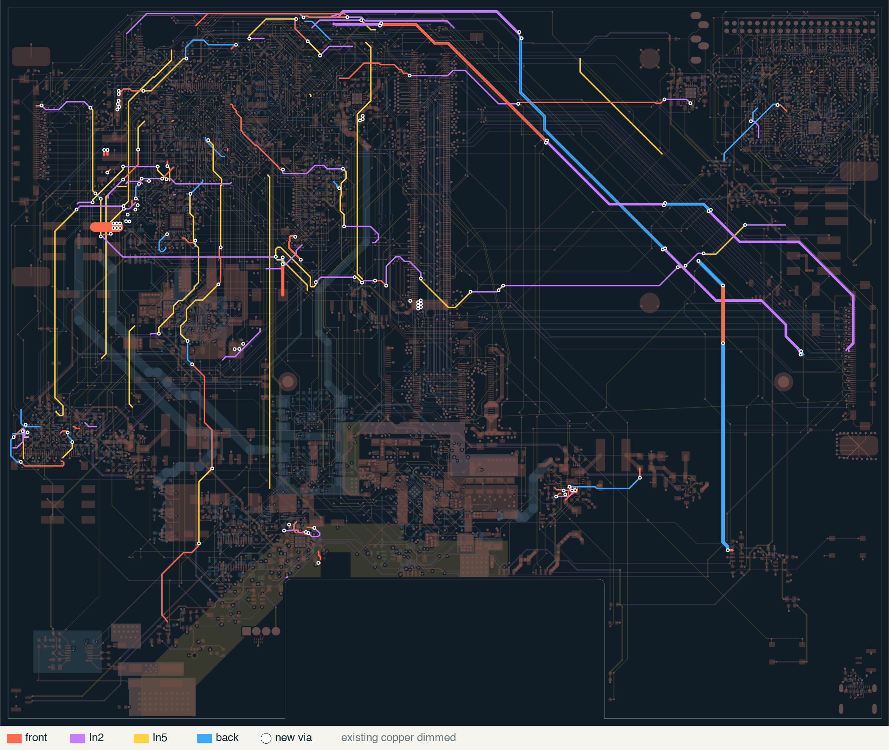
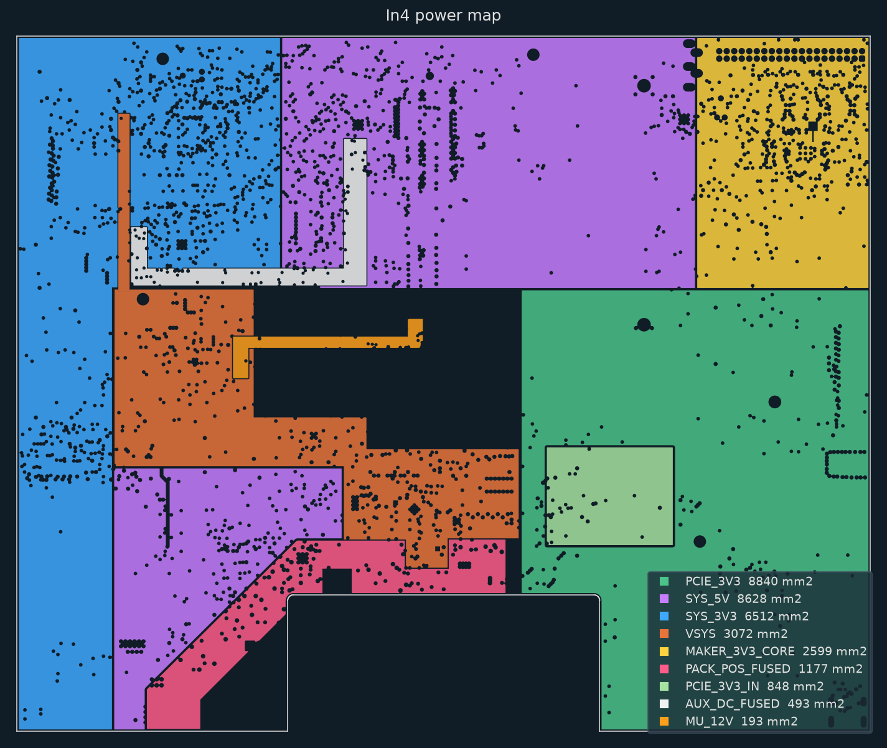

# special nets: local links, light rails and sense lines

15 november 2026. after the slow lines, most of what was still open on the
center board were special-attention nets: crystals, decoupling and filter
caps, current-limit and bias resistors, the light power rails and the
sense lines. most of those connections are short, a pin to its own cap or
series resistor a few millimetres away, so they can be routed safely in
bulk as long as each kind gets its own rules. this pass does that. pairs,
the heavy rails and the converter power stages are left for their own
passes.

## the rules per group

| group | what | width | vias | layers |
| --- | --- | ---: | --- | --- |
| crystals | crystal to its load caps and the chip pins | 0.2 mm | very dear | any, short only |
| pair resistors | usb series resistors and similar short pair links | 0.1796 mm (the DIFF_90 outer width) | very dear | front and back only |
| amp outputs, fan, wi-fi supply | class-d outputs to their ferrites, the 12 V fan feed, the M.2 wi-fi 3.3 V | 0.5 mm | normal | any |
| supply pins | vcap, codec and maker supply pins to their caps, local supply nets | 0.3 mm | normal | any |
| signals | sense dividers, filters, current-limit and bias resistors, qspi to its flash | 0.2 mm | normal | any |
| light rails | MCU_3V3, MAKER_3V3_CORE, MAKER_5V_CORE, TPAD_5V, the usb vbus feeds | 0.3 to 0.4 mm | normal | any |

- first only links up to 8 mm long, so every cap and resistor gets its
  short path before anything long is laid; then the long ones.
- a route is dropped when it runs more than about twice as long as the
  straight distance it covers (two and a half times for the rest), so a
  crystal never ends up wandering round the board.
- the long sense lines (thermistor and divider inputs to the ec, the dac
  and headphone outputs, the maker adc inputs) keep at least 2 mm away from
  every switch node and power inductor on every layer: SW1/SW2, BUCK_SW,
  BUCK33_SW, BUCK5_SW, BUCKPE_SW, MU12_SW1/SW2, MAKER_3V3_SW, MAKER_VREG_LX,
  the amp outputs, and L1, L3, L4, L5, L750, L900, L901, L1702.
- the light rails carry half an amp or less. with 35 um copper, 0.4 mm of
  track is about 0.12 ohm per 100 mm, so the drop stays at a few tens of
  millivolts. the bigger loads (AUDIO_5V for the amp, RADIO_DB_5V,
  KB_FFC_5V for the rgb) need their 0.6 mm netclass width or a pour; they
  didn't fit as tracks and wait for the In4 power map.

## a bug that boxed in the special pads

the via reservations keep a via spot and the stub to it free next to every
special pad that still needs routing. the keep-outs they put in the
routing copy applied to every net, the pad's own net included. while only
slow lines were routed that didn't matter, but once the special nets
themselves were routed, each pad was walled in by its own reserved stub:
the router saw a single free grid cell next to the crystal pads with
nothing physical in the way. the special passes now lift a group's own
reservations while that group routes, and every other reservation stays.
that alone joined another 53 connections.

## results

| | committed before | now |
| --- | ---: | ---: |
| native unconnected items | 606 | 386 |
| power class (light and heavy rails) | 289 | 174 |
| sense, feedback or analog | 67 | 31 |
| power pins | 46 | 27 |
| power rails (local supply nets) | 26 | 17 |
| crystals | 24 | 11 |
| inductor, fuse or shunt nets | 15 | 8 |
| audio | 14 | 2 |
| usb and superspeed pairs | 57 | 50 |
| slow lines | 39 | 39 |
| ground | 8 | 8 |
| vias on the board | 2,853 | 3,010 |

(the class rows count open links per net, so they add up a little
differently from KiCad's native count.)

MCU_3V3 is now one tree of 81 pads that includes its source, the always-on
buck's output at L3. the farthest pads on it are about 0.6 ohm away, 60 mV
at 100 mA; those are pull-ups and small logic that draw microamps, and the
J2073 feed is at 0.62 ohm. the ec's own supply pins that are connected sit
0.2 to 0.4 ohm from L3, which is a longer way round than it needs to be.

tried and dropped:
- ripping the slow copper along every still-open special link and routing
  the special links first: it only won 5 special links and the slow lines
  didn't fill back cleanly.
- a priority redo of the ec's crystal area and supply pins: it connected
  two more supply pins but lost four slow lines, so the board stayed as it
  was.

## checks

| check | result |
| --- | --- |
| physical DRC | zero new findings against the board before the clean reroute, refilled the same way |
| exact clearance | no problems: all copper that wasn't on the committed board (968 track pieces, 157 vias) checked against everything, arcs as arcs, track to hole included |
| native connectivity | 606 on the committed board, 386 now; no net has fewer connections than before |
| switch nodes | 245 mm of new sense, analog, crystal and audio track; 2.5 mm of it lies within 2 mm of a switch node, at the amp's own input pins next to its outputs |
| special-pad via room | the known pads plus U420.19 (below); R31.1 is listed too but it's connected now |
| schematic parity | passes: 870 parts, 3,372 physical pads, no net, value or footprint changes |
| placement exports | regenerated; only the board hash changed, all 1,378 component rows still match |

## weak spots

- **the ec has one special pin open:** the usb D+ (pin 71) is boxed in by
  C30's ground pad and the D- leg's own via, so it goes with routing that
  pair properly.
- two slow ec lines are open where the supply escapes went:
  SOURCE_MGR_INT_N (pin 7) and RADIO_UHF_RF_SEL_3V3 (pin 18). each one
  shares the only gap under the pins with a line that's routed (KB_ROW6 and
  MU_PWRBTN_N), so by hand they'll need one of the supply vias moved or a
  trace squeezed between pins at 0.1 mm.
- MCU_3V3 takes the long way from L3 to the ec. a short direct strap from
  L3's output to the ec's cap cluster would make the ec's supply path much
  shorter.
- the amp's left input pair: AMP_IN_LP is routed and took the path that
  AMP_IN_LN needed, so LN is open and its pin U420.19 has no via spot left.
  routing that pair together by hand fixes it.
- CODEC_XTI, LSE_IN, HUB_XI and a few short links were dropped because the
  only routes found wandered too far.
- RADIO_CODEC_USB_VBUS_HOST only found a 119 mm detour for a 4 mm link,
  so it stays open.

## the ec's own pins (15 november, later)

the ec (U4) had its supply, vcap and crystal pins open: the caps sit right
under the pins on the back, so each pin only needs a via at its end, but
the slow lines' fan-out vias held those spots. this pass did it pin by pin:

- for every open supply, vcap and usb pin, every via spot within 2 mm was
  checked against the board rules: the via itself, the stub from the pin
  and the stub on the back to the cap. whatever was in the way got sorted
  into slow copper (can be ripped and routed again), ground fan-out (can be
  re-escaped) and fixed copper (pads, special nets, earlier hand work).
- spots with nothing fixed in the way got a 0.2 mm stub, a via and a stub to
  the cap, placed directly and checked exactly. VREF+ (pin 21) is strapped
  to VDDA (pin 22) on the front, since they're the same rail.
- the crystal paths were cleared of a ground via and a slow line that had
  been routed in front of Y2, and the crystals routed first.
- the slow lines that were moved were routed back, the ground pads that
  lost their via got a new one.

two more things turned up on the way:
- 192 of the 298 via reservations were for pads that had been connected
  since. they still kept their spots free for nobody, and one of them sat
  right where LSE_IN had to leave pin 8. reservations are now only kept for
  pads that are still open, and the via room repair drops them the same
  way.
- the hand-routed RADIO_VHF_PTT_N segment under pin 50 could be moved and
  routed again.

| | before | now |
| --- | ---: | ---: |
| native unconnected items | 386 | 362 |
| open ec pins | 27 | 20 |
| ec supply pins open (VDD, VREF+, VDDA) | 7 | 0 |
| ec crystal pins open | 3 | 0 |
| vcap pins open | 2 | 1 |
| MCU_3V3 open links | 30 | 14 |

the ec's supply pins are 0.1 to 0.47 ohm from L3 now, so 10 to 47 mV at
100 mA.

this traded four slow ec lines that are now boxed in where the supply
escapes went: SOURCE_MGR_INT_N (pin 7), MU_PWRBTN_N (pin 23), KB_COL8
(pin 55) and KB_COL7 (pin 88). they're ordinary escapes to route by hand,
unlike a via right under a supply pin.

### the old ground traces on In4

the via spots next to VCAP1 were all blocked by a 0.2 mm ground track on
In4. it belonged to a 1,390 mm network of 182 ground traces from 16
september, when the usb pairs still ran on In4 and a ground trace between
them replaced the stitching vias. the pairs have since moved to F, In2 and
B, so the traces guarded nothing any more, and 15 of their 20 ends stopped
in open space. they're all removed: no net loses a connection (ground
neither, it has three solid planes), DRC has no new findings and 13 of the
old dangling-track warnings are gone. In4 is now free apart from the VSYS
island, the battery strip and a few short VSYS and wi-fi pieces, ready for
the power map.

that freed VCAP1: a via just inside the pin ring with a straight stub to
C29 on the back. a slow line that had to move for it routed straight back,
and with In4 clear the router also got KB_COL7 and KB_COL8 back and
connected RADIO_UHF_RF_SEL_3V3 (pin 18) and TRACKPAD_FAULT_N (pin 36).

| | before | now |
| --- | ---: | ---: |
| native unconnected items | 362 | 357 |
| open ec pins | 20 | 15 |
| vcap pins open | 1 | 0 |
| open slow connections | 41 | 37 |

### MU_PWRBTN_N back on its old path

MU_PWRBTN_N (pin 23) is how the ec turns the Mu on. it lost its connection
when its first segment had to move for the VDDA via, and the rest of its
route was pruned as a dead end. its old route from two commits back still
fit almost everywhere: 47 of its 48 pieces went back, eight newer slow
pieces that had moved into that corridor were taken out and routed
elsewhere, and a short bridge goes round the VDDA via.

that bridge and RADIO_UHF_RF_SEL_3V3 (pin 18) need the same gap just inside
the pins, between the VDD and VDDA vias, and only one of them fits; the
other ways out are blocked by pin 20's ground pad and the crystal routes.
MU_PWRBTN_N keeps it.

SOURCE_MGR_INT_N (pin 7) and KB_ROW6 (pin 5) are the same story one corner
up: pin 6's VDD via leaves room for one of them under the pins. routed
together, either one connects but never both, so KB_ROW6 keeps its route.

## not routed by the first pass

most of this got done in the push below; what's still open is listed at
the end.

- usb and superspeed pairs: they need coupled routing at the exact pair
  gap. when the two legs of the codec usb pair were routed one at a time
  they ended up side by side at the wrong gap, so that pair was taken out
  again.
- the heavy rails (the POWER_HI netclass, AUDIO_5V, RADIO_DB_5V,
  KB_FFC_5V): the In4 power map and the converter layouts.
- the converter power stages (U6 and U7 switch, boot, feedback and sense
  nets) and the kelvin sense pairs: routing order step 5 in
  [power routing](power-routing.md).
- the speaker lines: they should run as pairs.
- FPC102_SHELL, the connector shell network.

## the power map and the rest of the special nets (15 and 16 november)

this was one long push from 357 to 125 unconnected items, in three
stages: power islands on In4, then short exact links, then four jobs
that ran in parallel (power, the maker corner, slow and sense lines, usb
pairs). each job worked on its own copy of the board under the same
rules, and every result was replayed onto the newest merged board and
checked again before the next one went on.

### In4 is the power map now

each rail got a pour on In4 under the parts it feeds, and every pad of
that rail above the pour drops to it with a short stub and a via:

| island | area |
| --- | ---: |
| SYS_5V (top island north, source island at the SYS5 buck) | 8,959 mm² |
| PCIE_3V3 (east) | 8,845 mm² |
| SYS_3V3 (west) | 6,907 mm² |
| VSYS (existing) | 2,993 mm² |
| MAKER_3V3_CORE (maker corner) | 2,601 mm² |
| PACK_POS_FUSED (battery strip, existing) | 1,176 mm² |
| PCIE_3V3_IN | 853 mm² |

the drops alone took SYS_3V3 from 36 open to 23, MAKER_3V3_CORE from 19
to 3 and SYS_5V from 22 to 18. the light rails between the drops were
laid as local trees after that: 0.3 mm for supply pins, 0.4 mm for the
usb vbus feeds and the wi-fi 3.3 V, 0.5 to 0.6 mm for AUDIO_5V,
RADIO_DB_5V and KB_FFC_5V.

this is the one trade in the push: the MAKER_3V3_CORE drops took the via
spots of four maker slow lines. two came back later; MAKER_SPI_MOSI (U911.4)
and MAKER_GPIO4 (U912.2) are still open. they're the only
nets that ended up worse than where the push started.

### exact links

the loose pieces of a net were joined with short A* links on the exact
board, shortest first, every link checked against everything already
placed. where a link had to cut a slow line, the slow copper was ripped
and routed again, and for each link it was checked which slow lines
didn't come back; only those links were dropped. that joined the
FPC102 shell tabs along the free strip on the left (11 open to 0), the
codec and hub crystals, the hub filter pins and a batch of short power
and signal pieces.

SYS5_PRE_SENSE is the 4.5 A path from L4 to the shunts RS2360/RS2361, so
it got an F pour instead of thin links. the kelvin line from RS2360.1 to
U6.11 goes round L4 on the back, clear of the inductor and its switch
node. VSYS drops sit at the SYS5 buck's input caps.

### the four parallel jobs

**power.** AUDIO_5V went from 13 open to 1 (the amp feed from F400 is
0.6 mm, 30.9 mm, about 25 mohm), MCU_3V3 from 14 to 1, and RADIO_DB_5V,
both RADIO_CODEC_USB_VBUS rails and WIFI_3V3 are joined. the high current
paths that didn't need an island change are built as wide copper:
- PD1_VBUS_RAW and USB_PD_SELECTED: 2.5 mm strips on the back from the
  left power connector J2430 to the ideal diodes and the selector, 90 and
  78 mm, side by side so they never cross.
- VSYS to the U773 input caps: 2.5 mm on the back from the In4 VSYS
  island. the U7 input caps (C790, C46, C791 and U7.8) are joined on F,
  but not fed yet (see below).
- AUX_DC_PROTECTED from Q23 to U12: 2.0 mm on the back for 73 mm, five
  vias, 1.5 mm on F, then a 0.95 mm neck for the last 2.3 mm into C722.1
  (the gap between Q2644 and R739 is 1.29 mm). about 24 mohm end to
  end, 72 mV at 3 A.
- the SYS_5V top island now has a 0.6 mm feed from the source island
  (55 mm, mostly In5 under the two strips, about 0.75 A of load).
- the boot and switch nodes of both bucks, the U12 efuse pins, U400.29
  (the hub crystal line now runs straight between Y400's pads) and
  U61.10 are connected, and the loose ground pads dropped to the planes.

**maker corner.** the qspi flash lines SS, SD0, SD2 and SD3, the crystal
(3.7 mm against 3.4 mm straight), MAKER_1V1, MAKER_VREG_AVDD, the header's
3.3 V output, PCIE_3V3 at J2452 and the SYS_5V feed to the right
connector. the rest of U901's pins are walled in by the hand-routed
fan-out and the 1V1/3V3 copper under the chip; a full re-plan of that
copper lost 11 lines for 2, so it stayed as it was.

**slow and sense lines.** SOURCE_MGR_INT_N and RADIO_UHF_RF_SEL_3V3 (the
two ec lines from the weak spots above), KB_COL0, KB_RGB_PWR_EN,
RADIO_UHF_UART_RX, HUB_RBIAS, both dac outputs (0.15 mm, about 173 mm
each), HP_INP_R, the left speaker lines (0.4 mm, 0.25 mm at the pads),
AMP_OUT_LP and AMP_IN_RN, and one piece each of THERM_MU_ADC and
AUX_DC_ADC. four of its lines (I2C_SCL, AUX_DC_DIV, AUDIO_MIC_EN,
GNSS_UART_RX) collided with the pairs at merge and were left out, so they
stay open for now. 9 mm of amp input track sits within 2 mm of the amp's
own output pins, which are neighbouring pins on the same chip; everything
else keeps the 2 mm.

**usb pairs.** routed as coupled pairs at the exact DIFF_90 width and gap,
on F, In2 and B only:

| pair | length P / N | vias per leg |
| --- | ---: | ---: |
| USBC1 | 111.6 / 114.6 mm | 4 |
| RADIO_CODEC_USB_HOST | 83.4 / 84.9 mm | 1 |
| USBC2_SSRX | 32.9 / 32.8 mm | 1 |
| USBC2_SSTX | 15.7 / 15.9 mm | 2 |
| USBC1_SSTX | 13.9 / 14.6 mm | 1 |
| USBC1_SSTX_RAW | 5.5 / 4.4 mm | 1 |

the short pair links at the series resistors and esd parts (CODEC_USB,
MCU_USB_DP, RADIO_CODEC_USB_DB_DP, one TPAD_CONN_DP leg) are separate
legs at the exact width. USBC1 has to go round the east side of the Mu
socket A1; its columns are a wall on F, In2 and B from y 45 to y 140.

KiCad 10's diff pair gap check compares every parallel P/N segment pair
on a layer, at any distance (a 3.5 mm gap still gets flagged). three new
fan-out segments (on CODEC_USB_DN, RADIO_CODEC_USB_DB_DP and USBC1_DN)
ran exactly parallel to their far-away other leg, more than twice the
pair gap apart, so they have a 4 to 10 um bend that makes them not
count as a coupled run. that changes nothing electrically; coupled runs
are always at the exact gap.

### checks

| check | result |
| --- | --- |
| physical DRC | zero new findings against the reference report, refilled the same way |
| exact clearance | every merge's new copper checked against the board it landed on, arcs as arcs: no problems, no track to hole problems |
| native connectivity | 357 before the push, 125 now; 79 nets better, 2 worse (the MAKER_3V3_CORE trade above) |
| schematic parity | passes: 870 parts, 3,372 physical pads, no net, value or footprint changes |
| placement exports | regenerated; only the board hash changed |
| copper | 13,404 straight track sections, 51 arcs and 3,202 vias, from 11,706, 51 and 2,879 |

the via counts are KiCad's own count. the earlier numbers on these pages
(3,044 before this push) counted 165 `(via` entries in the file that
aren't vias.

vias in pads: U310.1 drops straight into C322.1 under it on the back,
and C2283.2, C39.2 and C208.2 (for U44.21) got vias in their ground
pads. the board already had 59 of those, mostly ground cap pads.

### what's left, and what needs a decision (16 november)

the second push below took care of part of this list.

these need a design call before they can be routed well:
- **VSYS to U7** (the SYS_3V3 buck, about 3 A in) and the VSYS pin of
  J2430: the clean way is a 3 mm VSYS strip carved out of the SYS_3V3
  island on In4 (x 129 to 132, y 64 to 104). SYS_3V3 stays one piece.
  carving the islands was avoided so far, so it waits.
- **MU_12V** from its converter to A1: a 3 mm strip carved out of the VSYS
  island along y 118; on F or B it crosses the pcie pairs.
- **the AUX_DC input chain** (AUX_DC_RAW, AUX_DC_FUSED at 5 open): F190,
  D190 and the R191 divider are spread over 80 x 110 mm away from U12 and
  Q13. moving them next to U12 is better than routing up to 5 A that far.
  AUX_EFUSE_DRV needs C721 or R711 moved about 0.5 mm.
- **PD2_VBUS_RAW and PD2_VBUS_GATED** come in on the right connector but
  their ideal diodes sit on the left: swap the harness pinout or move
  Q2621/U2621.
- **AUDIO_5V for the headphone amp U425** is 150 mm from the rest of that
  rail; feeding it from SYS_5V through its own ferrite is a schematic
  change.
- **test pads** TP2, TP3, TP5 and TP13 are far from their rails; moving
  them is better than routing them.
- **C445 and C444** sit in the H24 mounting hole keep-out, so C445.2 (the
  last open ground pad) can't be connected where it is.
- **small part moves** that would free walled-in pins: R900/R901 about
  1.5 mm east (qspi SD1 and SCLK), R959 to R961 about 2.6 mm west (the J901
  adc lines), R918 1.2 mm south (SWCLK_MCU), R2349 (RADIO_UHF_SQL_DB), and
  swapping C434 and C435 (AMP_IN_LN).
- **hand-routed copper** that walls in pins: U773.11 (PCIE_PRE_SENSE) and
  U773.12 inside the BUCKPE_CONFIG/RT fan-out, U6.14 (BUCK5_RT) between the
  BUCK5_CONFIG and BUCK5_COMP stubs, U2300.9 (RADIO_DB_ILM) behind pin 8's
  ground via.

still open but routable in a later pass: USBC2 (it routes, but only by
cutting RADIO_UHF_PD_N, whose ec end can't escape again), HUB_DS1 and
HUB_DS4 (centerlines found, the end joins need work), USBC2_SSTX_RAW (the
legs swap sides between the caps and A1), the four lines left out at the
last merge, the FPC103 lines and right speaker lines into the maker
corner, and the ec pins that are one-or-the-other with a neighbour
(HSE_XTAL_OUT, KB_COL11, KB_COL3, PD1_VALID_N, HUB_CFG_SEL0). no pair has
skew tuning yet: USBC1's DP is 3.0 mm shorter than DN and
RADIO_CODEC_USB_HOST's 1.5 mm, mostly from the inside leg at the bends.

## second push: the island carves and the rest of the power (19 november)

125 to 103 unconnected, with the design calls from the list above made
as follows.

### two strips carved into In4

- **VSYS for U7:** a 3 x 47 mm VSYS strip at x 129 to 132 runs from the
  VSYS island up to U7's input caps, laid over the SYS_3V3 island with a
  higher priority. U7's input group connects through 6 vias, and the VSYS
  pin of J2430 through a 2.5 mm stub and 6 vias. SYS_3V3 is still one
  piece; two of its drops that sat in the strip moved next to it. about 8
  to 9 mohm, so under 30 mV at 3 A.
- **MU_12V:** a 3 mm strip carved out of the VSYS island from the 12 V
  converter's output along y 116.5 to 119.5 to the Mu socket's 12 V row.
  VSYS stays one piece. about 11 to 12 mohm. the via banks are 5 at the
  converter and 7 at A1, which is boxed in by the pcie pairs.

VSYS, MU_12V and the test pad TP3 are fully connected now.

### the aux input

- **AUX_DC_FUSED** runs as a 4.2 to 6 mm In4 strip from F190 along y 98.4
  to 102.9, just under the VSYS island's edge, to Q13 at x 189 to 195.
  any lower band would cut off a SYS_3V3 pocket next to the U7 strip.
  about 12 mohm, 60 mV at 5 A. the strip has 5 vias at F190 and 3 at Q13.5.
- **the divider:** R191 and R192 moved next to F190.2, and AUX_DC_DIV was
  rerouted from there.
- **still open** (AUX_DC_FUSED went from 5 open to 2):
  - U12's input pins: no via spot next to them, and the F link to Q13.5
    doesn't fit even at 0.4 mm.
  - the D711 standby branch: it routes, but cuts 11 slow lines.
  - AUX_DC_RAW from J2450 to F190: the F190 end is boxed in by the
    USB_PD_SELECTED strip and the U7 strip.
  - AUX_EFUSE_DRV.

### local fixes and small moves

- U773: C2283 moved 0.25 mm south, BUCKPE_CONFIG and BUCKPE_RT were
  redone at 0.2 mm, and U773.12 is joined to R785.1. the PCIE_PRE_SENSE
  kelvin runs from U773.11 to the shunt pad RS2281.1 at 0.15 mm, 2.4 mm
  from L1702's courtyard.
- C434 and C435 swapped places, which untangles the amp inputs
  (AMP_IN_LN). R2349 moved 5.5 mm west (RADIO_UHF_SQL_DB).
- C445 moved out of the H24 mounting hole keep-out, so its ground pad,
  the last open one, is connected. GND is one piece now.
- the other small moves from the list didn't fit once checked:
  - R900/R901 with C910: their courtyards would overlap.
  - R959 to R961: they'd land on the adc fan-out vias.
  - R918: it would land on Y900's pad.
  - C2363: it would land on R40.
- SYS_5V reaches U770 now: 0.9 mm, 78 mm, about 21 mohm, from the top
  island. MCU_3V3's last two caps (C174/C175) are joined, so MCU_3V3 is
  one tree.

### the hub's long pairs

HUB_DS1 and HUB_DS4 go from the hub all the way to FPC103 as coupled
pairs at the exact DIFF_90 width and gap: 179.5 / 180.3 mm and
172.8 / 173.5 mm, 4 vias per leg. HUB_DS1 needed a fix in how the pair
router joins a pair's ends when it arrives on a layer the end pads
aren't on.

### signals

I2C_SCL, AUDIO_MIC_EN and GNSS_UART_RX are back (they were left out at
the last merge), plus AMP_IN_LN and RADIO_UHF_SQL_DB through the moves
above.

### tried and not taken

- **the right speaker lines:** both legs only fit past the charger, 0.49
  to 1.26 mm from its sense lines (CHG_SRN, CHG_DCIN, CHG_NTC_HOT_GATE).
  class-d switching that close to a current sense line isn't worth it,
  and there's no other way from the amp to J421: the battery pour fills
  In5 along the south edge.
- **a joint re-plan of the ec's escapes:** a slot planner placed escapes
  for 63 of 69 pins, but every run left 10 to 18 other ec lines with no
  route. the bottom-left corner of U4 (pins 23 to 30) is walled in by
  MCU_3V3 and ground decoupling copper and the HUB_DS4 pair. it needs
  lanes reserved for the far ends and room for a few pins, which means
  moving some decoupling.
- **THERM_SKIN_ADC's run from J54:** it routed on an earlier board but
  ran into the new pairs at merge.

### checks

| check | result |
| --- | --- |
| physical DRC | zero new findings against the reference report, courtyards included |
| exact clearance | every merge's new copper checked against the board it landed on: no problems, no track to hole problems |
| native connectivity | 125 to 103; 18 nets better, none worse |
| schematic parity | passes: 870 parts, 3,372 physical pads, no net, value or footprint changes |
| placement exports | regenerated; the board hash and the seven moved parts changed (C434, C435, C445, C2283, R191, R192, R2349) |
| copper | 13,751 straight track sections, 51 arcs and 3,297 vias |

### what's left after this push

needs a design call or a part move:
- **PD2_VBUS_RAW and PD2_VBUS_GATED:** swap the harness pinout, or move
  Q2621/U2621.
- **AUDIO_5V for U425:** feed it from SYS_5V through its own ferrite.
- **test pads TP2 and TP13:** they're 125 and 150 mm from their rails.
- **SPK_R:** needs room at the charger, or J421 closer to the amp.
- **the bottom-left corner of the ec:** move some decoupling so the slow
  pins there can escape.
- **FPC103:** its hand-placed fan-out vias and the ground comb leave no
  room for the six control lines that end there.
- **U12's input pins:** a placement look round U12 and Q13.
- **AUX_DC_RAW:** a second SYS_3V3 carve along x 123 to 127.6.
- **BUCK5_RT:** move the U6 SYS_5V In5 trunk about 0.5 mm west, or R40
  and C2363 together.
- **the maker corner pins:** QSPI SD1/SCLK, the J901 adc lines, SWCLK,
  and the MAKER_USB pairs.

copper only, ready for the next pass:
- TRACKPAD_USB and SYSTEM_DAC_USB: move the HUB_PLLFILT via about 1 mm
  north.
- WIFI_USB: re-net the dead stubs from an old pinout at A1.82/84.
- EC_HOST_USB: feed U60.5 from the west to free a via-pair spot.
- USBC2: it needs a RADIO_UHF_PD_N via, so it waits for the ec corner.
- THERM_SKIN_ADC's J54 run.
