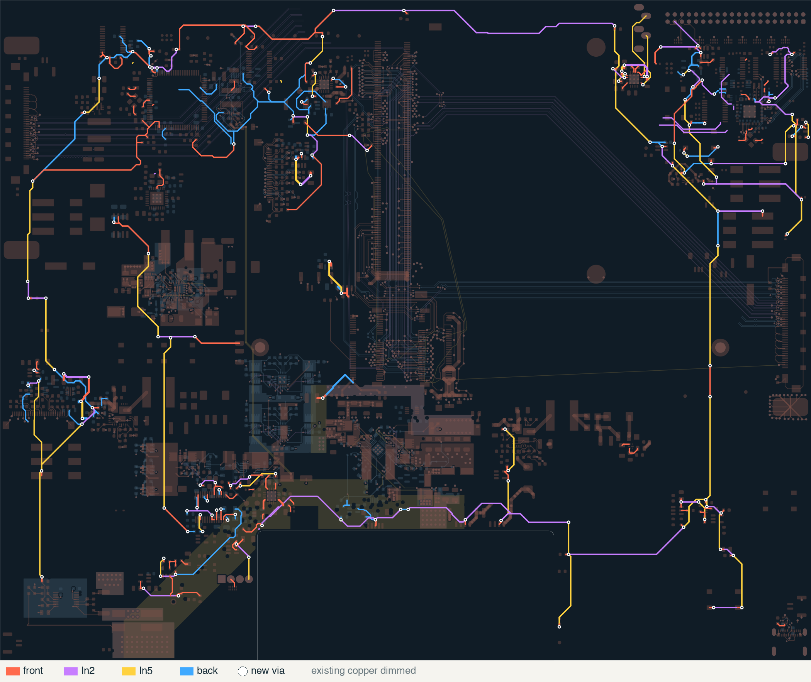
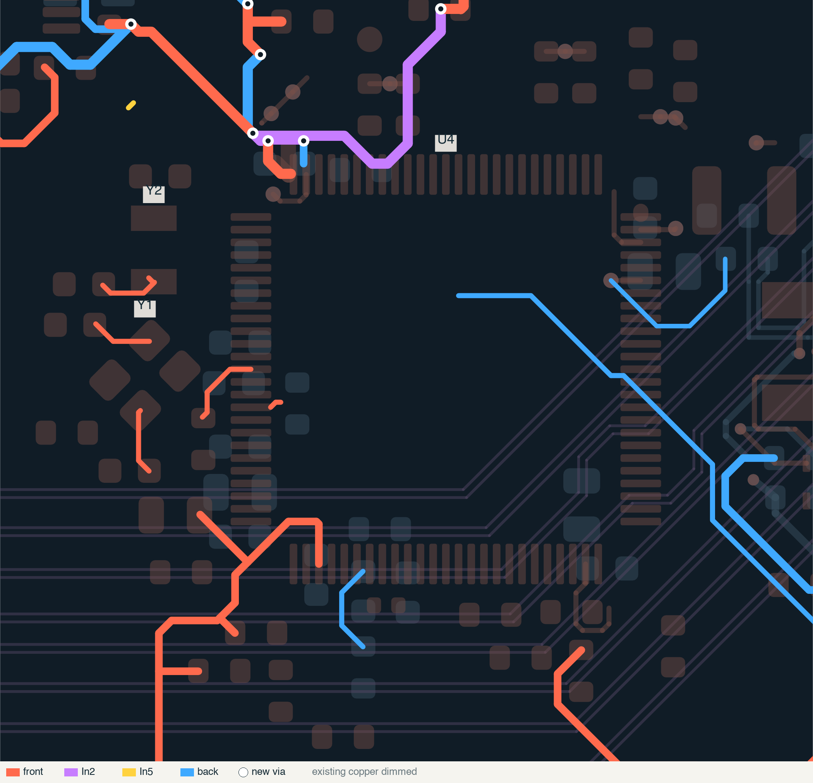
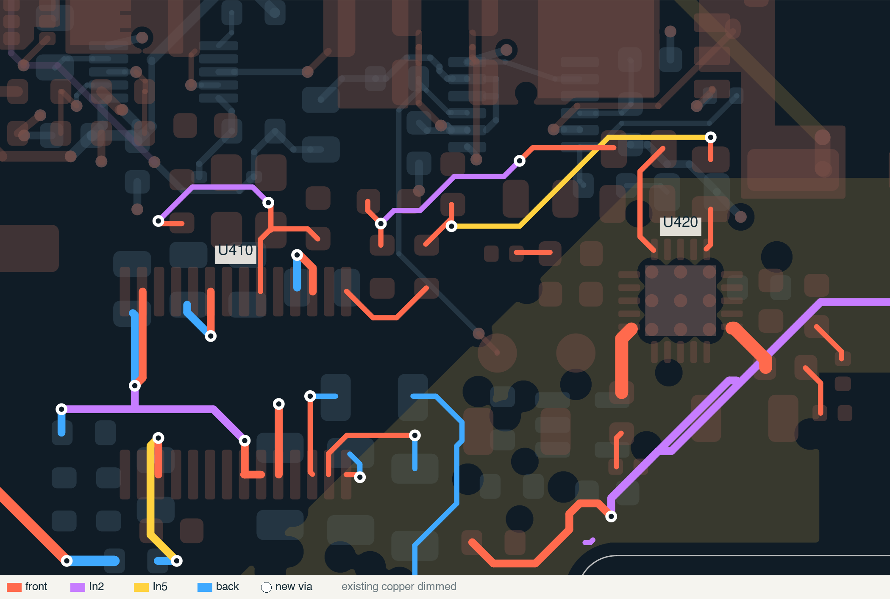
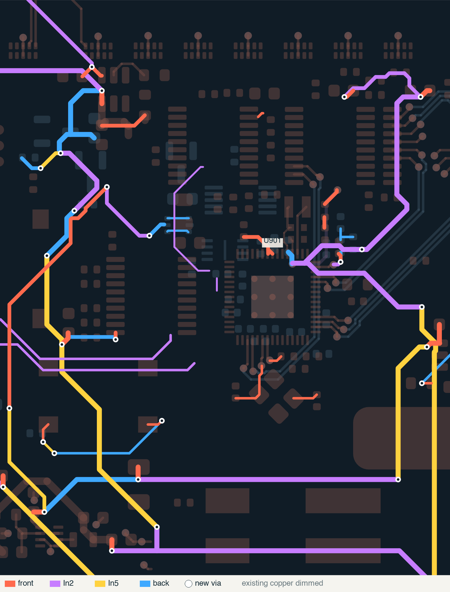

# special nets: local links, light rails and sense lines

15 november 2026. after the slow lines, most of what was still open on the
center board were special-attention nets: crystals, decoupling and filter
caps, current-limit and bias resistors, the light power rails and the
sense lines. most of those connections are short, a pin to its own cap or
series resistor a few millimetres away, so they can be routed safely in
bulk as long as each kind gets its own rules. this pass does that. pairs,
the heavy rails and the converter power stages are left for their own
passes.

## the rules per group

| group | what | width | vias | layers |
| --- | --- | ---: | --- | --- |
| crystals | crystal to its load caps and the chip pins | 0.2 mm | very dear | any, short only |
| pair resistors | usb series resistors and similar short pair links | 0.1796 mm (the DIFF_90 outer width) | very dear | front and back only |
| amp outputs, fan, wi-fi supply | class-d outputs to their ferrites, the 12 V fan feed, the M.2 wi-fi 3.3 V | 0.5 mm | normal | any |
| supply pins | vcap, codec and maker supply pins to their caps, local supply nets | 0.3 mm | normal | any |
| signals | sense dividers, filters, current-limit and bias resistors, qspi to its flash | 0.2 mm | normal | any |
| light rails | MCU_3V3, MAKER_3V3_CORE, MAKER_5V_CORE, TPAD_5V, the usb vbus feeds | 0.3 to 0.4 mm | normal | any |

- first only links up to 8 mm long, so every cap and resistor gets its
  short path before anything long is laid; then the long ones.
- a route is dropped when it runs more than about twice as long as the
  straight distance it covers (two and a half times for the rest), so a
  crystal never ends up wandering round the board.
- the long sense lines (thermistor and divider inputs to the ec, the dac
  and headphone outputs, the maker adc inputs) keep at least 2 mm away from
  every switch node and power inductor on every layer: SW1/SW2, BUCK_SW,
  BUCK33_SW, BUCK5_SW, BUCKPE_SW, MU12_SW1/SW2, MAKER_3V3_SW, MAKER_VREG_LX,
  the amp outputs, and L1, L3, L4, L5, L750, L900, L901, L1702.
- the light rails carry half an amp or less. with 35 um copper, 0.4 mm of
  track is about 0.12 ohm per 100 mm, so the drop stays at a few tens of
  millivolts. the bigger loads (AUDIO_5V for the amp, RADIO_DB_5V,
  KB_FFC_5V for the rgb) need their 0.6 mm netclass width or a pour; they
  didn't fit as tracks and wait for the In4 power map.

## a bug that boxed in the special pads

the via reservations keep a via spot and the stub to it free next to every
special pad that still needs routing. the keep-outs they put in the
routing copy applied to every net, the pad's own net included. while only
slow lines were routed that didn't matter, but once the special nets
themselves were routed, each pad was walled in by its own reserved stub:
the router saw a single free grid cell next to the crystal pads with
nothing physical in the way. the special passes now lift a group's own
reservations while that group routes, and every other reservation stays.
that alone joined another 53 connections.

## results

| | committed before | now |
| --- | ---: | ---: |
| native unconnected items | 606 | 386 |
| power class (light and heavy rails) | 289 | 174 |
| sense, feedback or analog | 67 | 31 |
| power pins | 46 | 27 |
| power rails (local supply nets) | 26 | 17 |
| crystals | 24 | 11 |
| inductor, fuse or shunt nets | 15 | 8 |
| audio | 14 | 2 |
| usb and superspeed pairs | 57 | 50 |
| slow lines | 39 | 39 |
| ground | 8 | 8 |
| vias on the board | 2,853 | 3,010 |

(the class rows count open links per net, so they add up a little
differently from KiCad's native count.)

MCU_3V3 is now one tree of 81 pads that includes its source, the always-on
buck's output at L3. the farthest pads on it are about 0.6 ohm away, 60 mV
at 100 mA; those are pull-ups and small logic that draw microamps, and the
J2073 feed is at 0.62 ohm. the ec's own supply pins that are connected sit
0.2 to 0.4 ohm from L3, which is a longer way round than it needs to be.

tried and dropped:
- ripping the slow copper along every still-open special link and routing
  the special links first: it only won 5 special links and the slow lines
  didn't fill back cleanly.
- a priority redo of the ec's crystal area and supply pins: it connected
  two more supply pins but lost four slow lines, so the board stayed as it
  was.

## checks

| check | result |
| --- | --- |
| physical DRC | zero new findings against the board before the clean reroute, refilled the same way |
| exact clearance | no problems: all copper that wasn't on the committed board (968 track pieces, 157 vias) checked against everything, arcs as arcs, track to hole included |
| native connectivity | 606 on the committed board, 386 now; no net has fewer connections than before |
| switch nodes | 245 mm of new sense, analog, crystal and audio track; 2.5 mm of it lies within 2 mm of a switch node, at the amp's own input pins next to its outputs |
| special-pad via room | the known pads plus U420.19 (below); R31.1 is listed too but it's connected now |
| schematic parity | passes: 870 parts, 3,372 physical pads, no net, value or footprint changes |
| placement exports | regenerated; only the board hash changed, all 1,378 component rows still match |

## weak spots

- **the ec still needs hand work on its own pins.** VDD pins 19, 21, 22,
  50 and 75, VCAP1 (pin 49) and VCAP2 (pin 73), HSE_IN (pin 12), LSE_IN
  (pin 8) and the usb D+ (pin 71) are open. their caps sit right under them
  on the back, 0.35 to 1.4 mm away (C21, C28, C23, C24, C29, C30); each one
  only needs a via at the end of its pin, but the slow lines' fan-out vias
  next to them hold every spot. the crystal inputs are boxed in on the front
  by the routes around Y1 and Y2. this is the most important hand job left:
  the ec doesn't run without its supply pins, vcap caps and crystal.
- MCU_3V3 takes the long way from L3 to the ec. a short direct strap from
  L3's output to the ec's cap cluster would make the ec's supply path much
  shorter.
- the amp's left input pair: AMP_IN_LP is routed and took the path that
  AMP_IN_LN needed, so LN is open and its pin U420.19 has no via spot left.
  routing that pair together by hand fixes it.
- CODEC_XTI, LSE_IN, HUB_XI and a few short links were dropped because the
  only routes found wandered too far.
- RADIO_CODEC_USB_VBUS_HOST only found a 119 mm detour for a 4 mm link,
  so it stays open.

## not routed by this pass

- usb and superspeed pairs: they need coupled routing at the exact pair
  gap. when the two legs of the codec usb pair were routed one at a time
  they ended up side by side at the wrong gap, so that pair was taken out
  again.
- the heavy rails (the POWER_HI netclass, AUDIO_5V, RADIO_DB_5V,
  KB_FFC_5V): the In4 power map and the converter layouts.
- the converter power stages (U6 and U7 switch, boot, feedback and sense
  nets) and the kelvin sense pairs: routing order step 5 in
  [power routing](power-routing.md).
- the speaker lines: they should run as pairs.
- FPC102_SHELL, the connector shell network.
