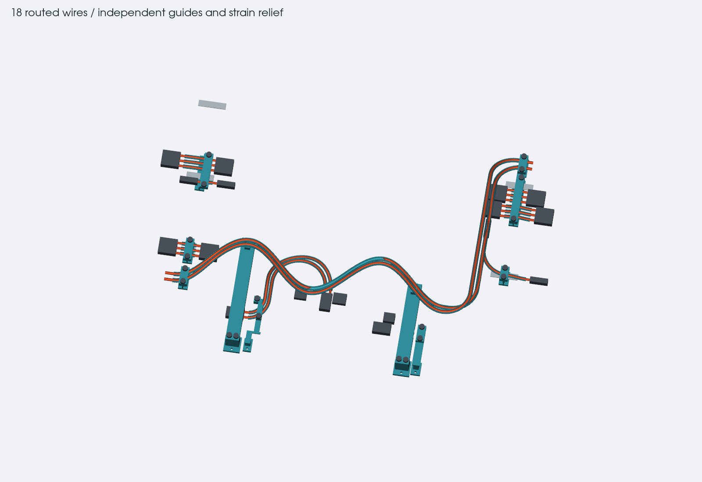

# case prototype

editable CadQuery case study using the saved WAGO power revision and the
80 mm BMS. `assembly.json` selects `guided-harness-study`, currently a
33.5 mm base to the deck surface. this is a packaging candidate, not a
verified complete minimum or a manufacturing release.

all 18 power-wire paths use the current connectors. the revised BMS pair
clears the board edge, J2074 and C797 without moving a PCB part. the case
has open guides, split clamps, braid windows and detachable USB rails.
fixed feet stay below the boards or between cells when a rail is removed.

the cooling study now has separate CPU and memory contact levels, the
three Mu Ultra mounting datums, a wider fin bank and a heatpipe path
around the fan. the fan stays at its original position because lower
trials hit the existing power parts. `cooling-fit.md` describes the geometry,
part-sourcing requirements and remaining measurements.

the saved model clears the wire, guide, braid, service and known-component
height screens, including the sampled hinge sweep. physical dimensions,
clamp strength, complete card and cable assemblies, signal cables and cooling
remain unqualified. use the model for inspection and fit coupons before a
complete case build.

the power-wire height screen now covers 189 crossings. manufacturer maxima
and chosen assembly reservations are recorded separately in
`component-heights.md` and `height-allowances.json`. the PD2 guide ends
2 mm earlier near right-board R2045; its wire path is unchanged.

the cooling screen covers 240 crossings over 154 footprints. all have a
height basis, with 27 footprints using explicit assembly reservations.
the narrowest margin is 0.2 mm above J53's reserved plug space. the
connector, screw and card stacks still need physical fit checks.

read `packaging.md` before printing. `harness-case-checks.json` records
solid intersections, conservative height screens and unverified dimensions.
`thickness-study.json` separates the stack calculation from a complete fit
claim. no thermal approval is implied for either Mu Ultra variant.

## rebuild

to rebuild this pinned case snapshot, use the existing environment:

```sh
.workbench/layout-env/bin/python mechanical/case-prototype/build.py
.workbench/layout-env/bin/python mechanical/case-prototype/thickness_study.py
.workbench/layout-env/bin/python mechanical/case-prototype/check_thinner_harness.py
.workbench/layout-env/bin/python mechanical/case-prototype/check_exports.py
.workbench/layout-env/bin/python mechanical/case-prototype/finalize_metadata.py
```

to deliberately replace the PCB snapshot, first review the board changes,
then run from the project root:

```sh
/Applications/KiCad/KiCad.app/Contents/Frameworks/Python.framework/Versions/Current/bin/python3 mechanical/case-prototype/inventory_boards.py
.workbench/layout-env/bin/python mechanical/case-prototype/audit_inputs.py
.workbench/layout-env/bin/python mechanical/case-prototype/export_pcbs.py
.workbench/layout-env/bin/python mechanical/case-prototype/freeze_boards.py
.workbench/layout-env/bin/python mechanical/case-prototype/build.py
.workbench/layout-env/bin/python mechanical/case-prototype/thickness_study.py
.workbench/layout-env/bin/python mechanical/case-prototype/check_thinner_harness.py
.workbench/layout-env/bin/python mechanical/case-prototype/check_exports.py
.workbench/layout-env/bin/python mechanical/case-prototype/finalize_metadata.py
```

`build.py --stage-only` makes a private BRep checkpoint. use
`inspect_case.py --checks`, `--views` or `--export` to work from that same
geometry without rebuilding it. the cache rejects a changed configuration
or inventory. a changed PCB requires a reviewed inventory refresh. the
scripts never save a PCB or change its routing, placement or outline.

## files

- `assembly.json`, `build.py`, `cables.py`, `harness_geometry.py`, `cad.py`
  and `hinges.py`: editable parameters and construction source.
- `component_heights.py`, `height-allowances.json`, `component-heights.md`:
  height calculations, explicit assembly space and source drawings.
- `cooling.py`, `cooling-datums.json`, `cooling_review.py`, `cooling-checks.json`:
  contact and mounting geometry, cooling-body and inlet checks, and each
  component's remaining height margin. these do not qualify thermal performance.
- `stack_geometry.py`: wire and open-guide height beneath the actual trackpad
  support area, including the guide ends and the 0.5 mm lower USB front run.
- `exports/ducktop2-assembly.step`: named assembly, open at 105 degrees.
- `exports/parts/`: separate manufactured STEP parts and P1S STL derivatives.
  split reinforcement STLs are fit gauges, not substitutes for continuous metal.
- `exports/hinge-tests/` and `drawings/`: the existing small Framework hinge
  coupons and dimensioned seating details.
- `mounting-schedule.csv`, `parts.json`, `fastener-summary.json`: mounts,
  materials, threads, lengths, insulation and fit status.
- `input-audit.json`, `source-bindings.json`, `board-inventory.json`:
  exact saved PCB hashes, source commits and transforms. accepted upstream
  hash differences have a recorded geometry-equivalence check.
- `installed-power-harness.json`: the case's adopted positive-height paths.
  the upstream `mechanical/power-harness.json` is not overwritten.
- `harness-height-study.json`: rejected USB lowering trials.
- `assembly-checks.json`, `harness-case-checks.json`, `thickness-study.json`
  and `export-checks.json`: different checks with different limitations.
- `inspection.html`: self-contained rotating/sectioning CAD viewer.
- `views/`: actual-CAD open, closed, exploded, harness and section views.

STEP uses installed X/Y with front +Y and Z positive down from the outside
bottom. the builder/viewer uses X,-Y,height. a 180 degree rotation about X
connects the frames. no imported part is mirrored.

the original Framework 13 3.3 kg kit is selected. the retained manufacturer
references, revision and CC-BY-4.0 license remain under
`reference/framework13/`. physical hinge matching, panel and battery
measurements, clamp fit and powered thermal testing are still required.


