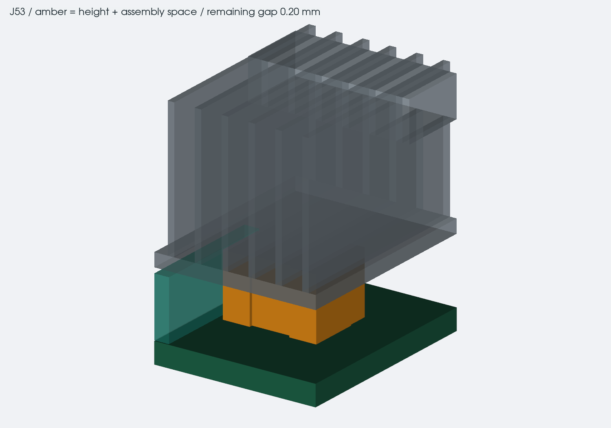

# cooling and trackpad fit

8 october 2026. this pass keeps the 33.5 mm deck while improving the cooling
layout beneath it. the trackpad's complete height is still needed before
lowering the deck. the cooling parts are a fit study, not a finished or
thermally tested heatsink.

## component heights, 8 october

the cooling screen now includes 247 crossings over 154 footprints. the
37 footprints that previously lacked a height basis now have either a
manufacturer maximum or a separate assembly reservation. 27 footprints
in the full screen still use reservations, including connectors, screw
stacks, bare pads and the MCU. those dimensions have to be met during
assembly; they are not measurements of finished hardware.

the check uses the actual underside of each cooling part above the saved
courtyard, including cutouts. it includes the fan screws and counts the
assembly allowance once. there are no missing height entries or negative
margins in the saved height pass. the boards and cooler mounting points
stay fixed; the stock heatpipe update below changes the pipe and fin slots.

| location | height including assembly space | remaining gap |
| --- | ---: | ---: |
| J53 hall-switch plug below fins | 4.60 mm reservation | 0.20 mm |
| FPC101/FPC102 below fins | 4.40 mm reservation | 0.40 mm |
| J40 socket below fan screw | 5.00 mm reservation | 0.50 mm |
| SW3 reset switch below fan screw | 4.50 mm maximum +0.30 mm | 0.70 mm |
| H1/H2 complete module fastening stack | 9.50 mm reservation | 0.737 mm |

the [JST GH drawing](https://www.jst-mfg.com/product/pdf/eng/eGH.pdf) lists
a nominal 4.25 mm side-entry header. J52, J53 and J56 use the existing
4.6 mm installed-plug reservation. the
[Molex connectors](https://www.molex.com/en-us/products/part-detail/5039084120)
have a nominal 3.75 mm mated height. their 4.4 mm reservation adds room for
seating and clearance. confirm the actual plugs and cable bends before
making the fin bank.

[SW3](https://components.omron.com/eu-en/system/files/2024-10/datasheet_pdf/A204-E1.pdf)
is 4.3 +/-0.2 mm high. the fan screw must still be cut to the recorded
length. extra screw length would consume the 0.7 mm margin. remove the
fan and cradle to operate the reset switch or service the Wi-Fi card.
the J40 result covers the socket only, not the complete card, antenna
plugs or its insertion path.

the [Mu standoffs](https://www.we-online.com/components/products/datasheet/9774055243R.pdf)
are 5.5 +/-0.1 mm above the PCB seating shoulder. H1/H2 reserve 9.5 mm for
the complete module and retaining screw stack. H4 reserves 6.3 mm for the
Wi-Fi retainer stack. choose the actual screws and check these complete
assemblies before machining the spreader. the module's three cooler
mounting points remain a separate fastening problem.

## blower and fin bank

the existing Delta BFB04512HHA-CZ0T stays at (122,52) in the installed top
view, with its bottom 15.7 mm above the case bottom. lower placements hit
the power capacitors, inductors or F190 fuse holder. a useful reduction in
fan height needs a separate electronics placement change. one cradle
anchor moves to leave room for the revised heatpipe.

the [Delta drawing](https://www.delta-fan.com/Download/Spec/BFB04512HHA-CZ0T.pdf)
gives 10.3 +/-0.3 mm thickness. the retained fan's upper envelope is 26.3 mm,
with 3.2 mm to the keyboard PCB. a separate 3 mm inlet
reservation must stay clear. the keyboard carrier has an opening around
the fan and its inlet, with support pads retained outside that opening.

the fin bank stays in front of the hinge line. putting it behind that line
interferes with the bezel when the lid opens. the new envelope is
110 x24 x11.2 mm, with 54 fins at 2 mm pitch and 0.5 mm thickness. the
shorter depth is offset by extra width and fin count. gross broad-face
fin area is 26,438 mm² before heatpipe slots, compared with 23,276 mm² in
the old 50 x46 x12 mm reservation. matching surface area alone does not
establish equal cooling: pressure drop, airflow distribution and the
bonded heatpipe contact still need checking.

the pipe candidate is now
[ATS-HP-F7L200S65W-018](https://www.qats.com/DataSheet/ATS-HP-F7L200S65W-018),
200 mm long and nominally 11.2 x3.5 mm. the catalogue gives +/-2% length,
+/-0.5 mm width and +/-0.5 mm height. the CAD reserves the full maximum
size, another 0.2 mm in plan and 0.3 mm above it. the fin slots use that
same envelope. those generous fit slots are not finished bond-joint
dimensions; machine the final mating surfaces to the measured formed pipe.

two 60 degree turns at 27 mm centreline radius retain the complete 200 mm
length. the hot end is at (240,55), the first tangent is (202,55), and
the nominal cold end is (58.444,13). length variation stays at the cold
end, with both sealed ends intact. the hot end avoids all three processor
mount reservations. the wider pipe changes neither the fan position nor
the 33.5 mm deck.

the catalogue's radius guidance does not approve this particular flat,
in-plane forming operation. get the supplier's bend method and finished
capacity before making it. the [route drawing](drawings/heatpipe-route.svg)
records the proposed shape. the nominal 0.1 mm gap above the spreader
reserves a metal-to-metal bonding layer.

`cooling-parts.json` records the exact candidates and their source links.
MX-6 ACTCP00080A is the removable CPU compound candidate. Tflex HD330
0.75 mm is the memory-pad sample candidate, cut into two 12.4 x7 mm pieces.
the model's 0.5 mm memory gap would compress nominal material by one third.
that is a geometry calculation, not an approved load. measure the actual
gaps and obtain the thin-pad force data before fitting it. the published
curves for thicker pads cannot establish that force.

MG Chemicals 8329TCM-6ML is the prototype pipe-to-metal adhesive candidate.
its current data sheet gives 1.3 W/mK. keep this bond on the separate
cooling assembly, away from the removable CPU and memory interfaces.
joint thickness, surface preparation and thermal cycling need a sample
test. it does not make the pipe or fins structurally self-supporting.

## Mu Ultra contact and mounting

the [official module and FIT1049 cooler models](https://github.com/LattePandaTeam/LattePanda-Mu-Ultra/tree/main/Mechanicals)
use different coordinate axes. their three mounting-hole centres match
within 0.0081 mm after rotation and translation. `cooling-datums.json`
retains the exact source revisions and the installed coordinates.

| mounting point | installed x | installed y |
| --- | ---: | ---: |
| left rear | 189.75 | 25.91 |
| left front | 189.75 | 62.56 |
| right | 230.38 | 44.24 |

the module holes are nominally 3.2 mm. the spreader study uses 2.2 mm
clearance holes on that pattern; the final spring, screw, bushing and
support stack still needs choosing. do not transfer the fan cradle's
fastener specification to the processor mount.

the [FIT1049 installation instructions](https://docs.lattepanda.com/content/mu_ultra_edition/get_started/)
show three spring screws engaging threaded posts on the cooler. the
instructions do not specify the spring rate, installed force, stop
geometry or allowable package load. FIT1049 is the reference assembly for
those measurements. do not replace it with ordinary screws or call the
custom mount finished. the current upper hardware reservations are 6.5 mm
in diameter at each mounting point, not selected fasteners or a checked
driver-access path. the cooler still mounts to the module before that
assembly is installed on the carrier.

the plate now has separate CPU and memory landings. the CPU landing
follows the official cooler's contact area and leaves a nominal 0.101 mm
gap in the reference geometry. the memory landings reserve 0.5 mm for
compressed pads. the main underside sits 0.5 mm above the tallest nominal
module components. these model gaps do not define pad compression,
flatness tolerances, allowable package pressure or PCB bending loads.

both the [226V](https://www.intel.com/content/www/us/en/products/sku/240960/intel-core-ultra-5-processor-226v-8m-cache-up-to-4-50-ghz/specifications.html)
and [256V](https://www.intel.com/content/www/us/en/products/sku/240954/intel-core-ultra-7-processor-256v-12m-cache-up-to-4-80-ghz/specifications.html)
are listed at 17 W processor base power and 37 W maximum turbo power.
the module's other losses are additional. this CAD work does not lower
either processor's power limit or establish that the proposed cooler can
hold those loads. qualify the complete heatpipe, fins, duct and fan on
both modules, with the lid at the intended operating angles.

## trackpad and local height budget

the user-confirmed purchase is
[AliExpress item 3256808869212952](https://www.aliexpress.us/item/3256808869212952.html).
the saved measured outline is 140 x105 mm. complete thickness, feet,
click mechanism, connector and plug projection remain unmeasured. the
5 mm body, 1 mm click travel and 2 mm underside allowance remain marked
as assumptions in `assembly.json`.

the stack calculation now considers only wires and guides that pass
beneath the trackpad support. it includes the open guide lips and checks
bare wire beyond each guide end. a high point elsewhere on a wire no
longer sets the trackpad stack height.

the USB front run is lowered by 0.5 mm in this candidate. its cut length,
separation and bend radius are recalculated, including curvature on the
actual fitted CAD edge. the original PCB geometry and all terminal
positions stay fixed. `thickness-study.json` and `harness-height-study.json`
record the resulting budgets; full carrier and part clearance comes from
the separate solid checks.

before lowering the deck, measure the full trackpad and its plugged-in
cable, then check the click motion and independent support. retain the
cell padding and swelling space. a clean case intersection report is
not a thermal qualification or a substitute for those measurements.
