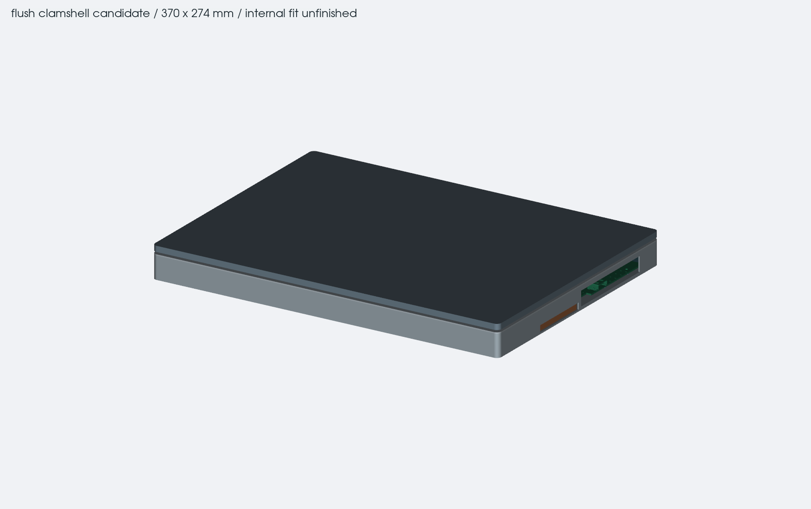
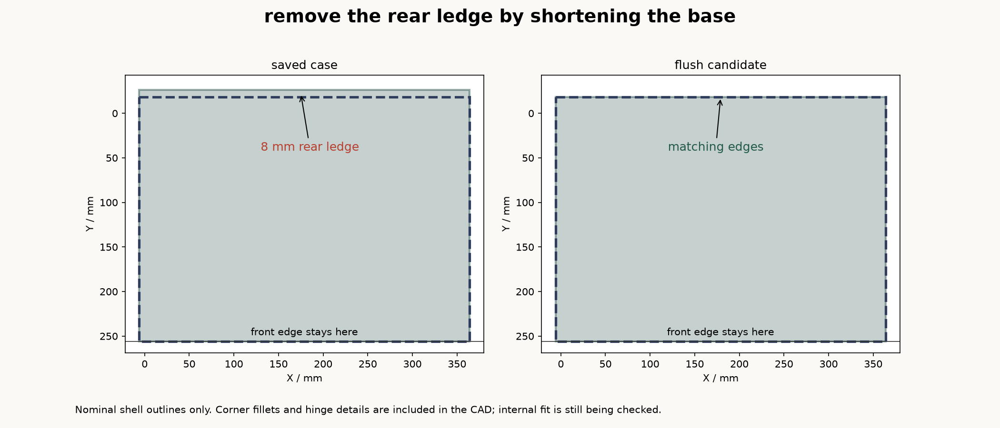
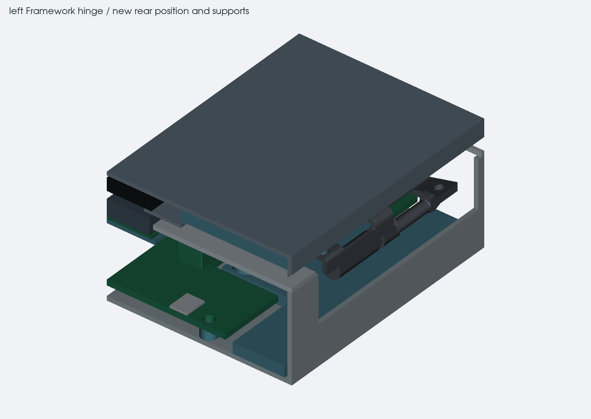
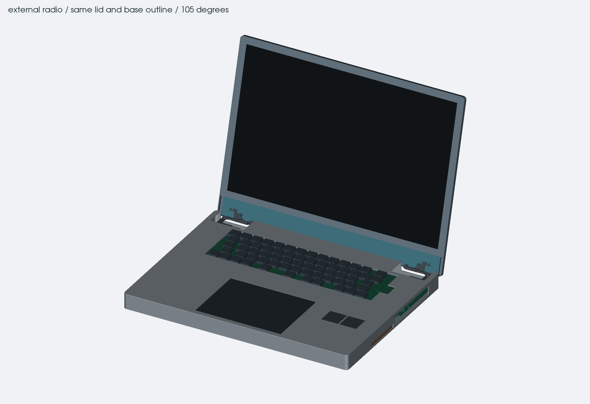
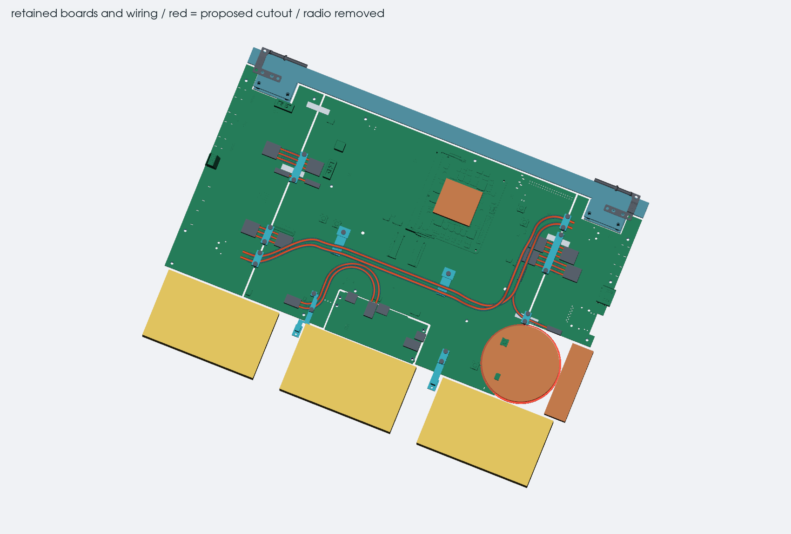

# flush case with an external radio

9 october 2026. the lid and base now use the same 370 x 274 mm rounded
outline. the front stays at Y256; the rear of the base moves from Y-26 to
Y-18. that removes the old 8 mm rear ledge without adding a front lip.
the keyboard and trackpad stay in their saved positions.

this is a separate case candidate. the earlier case and all six PCB files
are unchanged. the radio, GNSS receiver, radio audio codec, suspension and
radio fasteners are absent from this assembly. their external electrical
connection still needs designing; the saved radio schematic still uses
the internal 30-pin interface.

## shape and hinges

the Framework hinge axes move from Y-10 to Y-15. the purchased hinge solids
keep their shape. new base supports connect the hinge seat plates to a
rear reinforcement, and the lid uses one backing member in the former
plate plane. the backing member is trimmed inside the lid outline. there
are no external splice plates on this lid.

the rear wall has local openings for the hinge motion. a small bevel on
the lower rear lid rim gives it more room as it opens. the CAD is swept
from closed to 180 degrees in 2 degree steps. there are no detected rigid
overlaps through 142 degrees; the first is at 144 degrees. the lower rim
has 1.38 mm nominal clearance at 135 degrees and 0.62 mm at 140 degrees.
`checks.json` records detected overlaps above 0.01 mm³. these samples are
not a continuous-motion or manufacturing-tolerance proof.
the case geometry does not yet support using the OEM hinge's
full opening stop. an intended opening angle, a suitable mechanical stop
or further hinge enclosure changes still need resolving before manufacture.

the outline check uses the actual base and lid solids. it also checks all
new shell, support and hinge parts against that outline. a separate rear
projection check looks for a fixed platform behind the tilted screen at
normal viewing angles. the measured base/lid outline mismatch is zero,
and no retained modeled part protrudes outside it when closed. no fixed
rear platform projects behind the lid at the checked 90–140 degree views.
these geometric checks do not establish hinge
holding torque, lid stiffness, screw strength or cable flex life.

## thinner stack

the deck is 25 mm high and the closed model is 33.3 mm without feet. this
uses the earlier remote-cooler budget, a 1.2 mm bottom/deck and a 1 mm lid
skin. the screen has a nominal 2 mm gap above the keycap envelopes when
closed. cell padding and the 3 mm swelling space are retained.

**the internal assembly does not fit this height yet.** the two remaining
modeled overlaps are the fan pocket and the CPU cooler reservation.

the USB power run now passes behind the keyboard instead of looping under
the trackpad. the connector positions stay fixed. the calculated cut
lengths are 338.2 mm for ground and 348.9 mm for 5 V, including the same
provisional 2 mm inside each solder cup. the old 400–420 mm cutting range
is superseded for this case; the 420 mm electrical maximum stays in place.
fit the actual wires before treating these calculated lengths as a cutting
template.

the pair runs close to the same height under the keyboard. a local raised
crossover sits outside the keyboard and trackpad supports. the minimum
inside bend radii are 13.17 and 12.38 mm, above the 10.65 mm design limit
for the selected 16 AWG wire. all checked wire separations retain at least
0.5 mm after the position, curve and sampling allowances.

short removable brackets attach the guide rails to the keyboard-carrier
tabs at X130 and X225, Y105.5. the endpoint seam clamps still take plug
pull loads. the long cell-gap ribs and their posts are gone. all retained
clamp screw envelopes are now included. the rebuilt right carrier has
small pockets above U913 and C924, with 0.2 mm above their allocated
installed heights. the smallest remaining pilot-hole ligament is about
0.61 mm; its strength needs a printed pull test.

the revised USB assembly has zero detected solid overlaps, zero component
height-envelope conflicts and no unresolved height records in its screened
areas. the C924 allowance is deliberately conservative because only the
older TDK family table was available. physical component and fastener fit
still need checking. `usb-clearances.json` records the scope and limits.

the low right-side fan also overlaps the unchanged center board. the
[cooling comparison](../thin-layout/README.md) identifies the proposed
cutout, 11 affected footprints and 87 track/via items. the red cutout in
the viewer is only a proposed change. the STEP keeps the current board so
the conflict remains visible. the rough CPU-cooler volume also overlaps
module components and needs a properly stepped contact plate and mount.

the fan and fin volumes are reservations. there is no manufactured pipe
route, proven fan/fin pairing, CPU clamp-load specification or complete
thermal test. the side exhaust and bottom inlet are initial openings,
without a finished shroud or grille. normal port slots are deliberately
oversized until their mating plugs and service clearances are settled.

the packs still use the 11 mm listed thickness, the trackpad uses an
unmeasured 5 mm body and 1 mm click travel, and the display uses an
unmeasured 3.5 mm thickness. actual part measurements can change the
required height. the thin keyboard support is a space reservation, not
a qualified flat plate to place against its underside components. eDP
motion and strain relief need rebuilding around the new hinge positions.

## files

- `assembly.json`: dimensions and remaining assumptions.
- `build.py`: separate case construction and checks; it reads the verified
  earlier case cache and refuses changed PCB/source hashes.
- `checks.json`: outline bounds, opening sweep and remaining interferences.
- `usb-harness.json`, `usb-part-heights.json` and `usb-clearances.json`:
  revised paths, part dimensions/allocations and the USB fit results.
- `usb-bound-validation.json`: 20 sampled CAD checks covering the guide
  bounds and added carrier material; this is not a continuous-surface proof.
- `exports/closed.step`: the editable CAD assembly kept in git. the build
  also produces `exports/open.step` locally; that duplicate pose is ignored.
- `exports.json`: saved export hashes and STEP reopen results.
- `inspection.html`: interactive CAD viewer, including the retained wires
  and the unapplied board-cutout reservation.

run `build.py` using the project's CadQuery environment. `--cached` uses
the checked candidate BReps in `.workbench`; changed source or configuration
hashes require a fresh build. the viewer uses tessellated CAD for display,
while the intersection checks use the solid geometry.

remove the deck before accessing the USB clamp caps and carrier screws.
the guide rails detach from their keyboard tabs and locating feet. their
C-shaped channels rely on a tested snap fit, so print a short coupon before
threading or removing terminated wires. the fixed feet clear the modeled
connector service envelopes after the upper rails are removed. the dressed
harness and actual assembly sequence still need a physical check.

these exports are for inspection. the opening stop, two remaining cooling
overlaps, board changes, complete signal/raw-pack harnesses, support
stiffness and physical measurements need resolving before making the case.

Framework Computer Inc's original hinge geometry is used under CC BY 4.0.
the unmodified reference files, [source records](../case-prototype/reference/framework13/sources.json)
and [license](../case-prototype/reference/framework13/LICENSE) are retained
with the earlier case. the new supports and case parts are separate.
