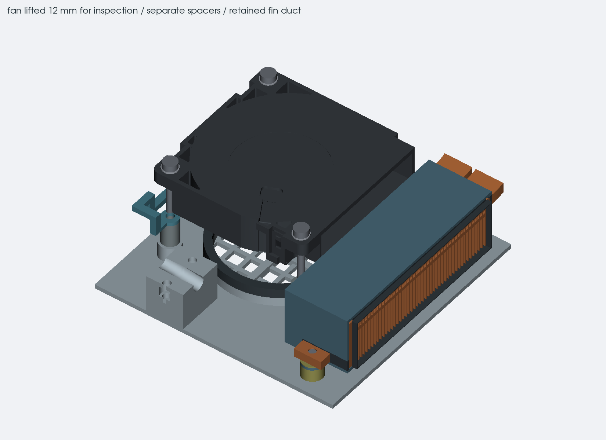
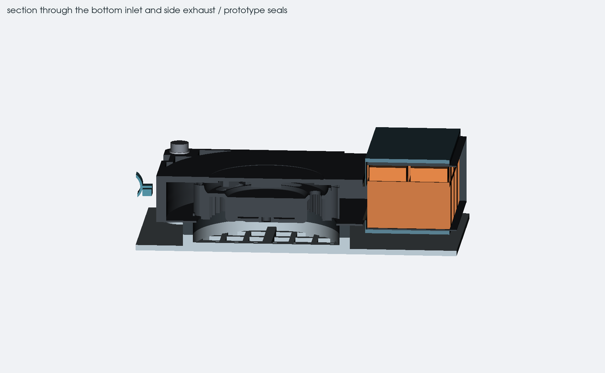

# right-side cooler

12 october 2026. this layout uses a smaller blower beside the center board
instead of cutting a large circular pocket into it. the case still has a
25 mm deck and a 33.3 mm closed-height target. the keyboard, trackpad and
board outlines stay in their existing positions.

## parts and placement

the fan candidate is Delta BFB04512HHA-DV52. its
[current drawing](https://www.delta-fan.com/Download/Spec/BFB04512HHA-DV52.pdf)
gives a 45 x 45 x 10.3 mm body, with 45.5 x 45.5 x 10.6 mm maximum dimensions.
the model uses Delta's own STEP, with a separate size and position allowance.
its rear-left corner is at X298.5, Y124 and its nominal bottom is H6.4.
the earlier orientation had its real outlet facing away from the fins.
rotating the fan around its installed Y axis fixes that and puts the inlet
underneath. the model is rotated, not mirrored. the base now has an intake
grille and a short gasketed boot below that opening.

the old CZ0T distributor listing was non-stocked with a large minimum
quantity. DV52 has a single-unit listing, although stock and price need
checking again before buying. the two suffixes are not treated as the same
part: the DV52 drawing, model and electrical requirements were checked
separately. the reference model's source and file hash are in
`reference/delta-fan-source.json`.

the heatpipe candidate is two
[ATS-HP-F6L250S50W-023](https://www.qats.com/DataSheet/ATS-HP-F6L250S50W-023)
pipes, each 250 x 8 x 3 mm. the model includes the stated +/-5 mm length
and +/-0.5 mm width and height tolerances. both sealed ends remain intact.
opposite turns lead from the processor to the right-side fins. the two
lanes have 25.5 and 34.5 mm centerline bend radii, giving 21.25 mm minimum
inside radius at maximum width. the supplier's general 18 mm radius table
does not approve this particular flat-pipe forming operation.

the copper plate has separate CPU and memory contact faces taken from the
existing Mu/FIT1049 registration. recessed pipe channels leave 0.7 mm of
copper above the main underside. the nominal metal-to-pipe bond space is
0.1 mm. these are prototype dimensions: plate stiffness, bond thickness,
flatness and the actual thermal-interface gaps still need testing.

a rounded 1.7 mm edge relief now leaves room beside the display connector
for its locking bar and access at both ends. the CPU and memory contacts,
pipe channels and three mounting reservations remain intact. the nearest
screw hole keeps 2.62 mm of edge material. this relief is included in the
full case export. [display-plug fit and removal](display-plug.md)

the custom fin stack occupies X344.5–362.5, Y123–175, H5.9–20.0. its 48
copper fins are 0.3 mm thick and share a continuous 1 mm collector. that
connects the fins past the end of a shorter pipe too. the pipe slots are
clearance envelopes, not finished solder joints. a separate cowl, inlet
baffle and removable foil bridge now join the fan outlet to the fins.
the top, bottom and case-exit seals close those bypass routes in the model.
split seals fill the openings around the pipes and mounting tabs after
assembly. seal materials and leakage still need testing on the real cooler.

## mounting and air path

three short bosses in the base hold M2 inserts. separate 7.7 mm tubular
spacers support the fan ears, with M2 x 14 screws and washers from above.
the narrower spacers clear the fan casing. the nominal thread engagement
is 2.5 mm, leaving 2 mm after a 0.5 mm stack allowance. insert dimensions,
pilot fit, screw torque and heated pull strength still need checking.

two M2 x 8 screws enter from underneath and engage solid copper tabs on
the fin stack. each stack has a 3.6 mm insulating spacer, a 0.8 mm duct
ear and a 0.3 mm insulating washer. this retains the duct without relying
on tape. the front floor slot helps alignment; it is not a free thermal
expansion joint once tightened. the supports need a heated creep and
thermal-cycle test before choosing final materials and torque.

the base grille has 432.2 mm² of open area, about 52% of its circular
opening. the rib above it leaves at least 3.7 mm under the fan within the
current height allowance. the outlet window is 255 mm², the fin exit has
516.3 mm² of open area and the corresponding case opening has 733.2 mm².
these are CAD sections, not measured airflow. the inlet still needs at
least 3 mm underneath the laptop. five 4.1 mm SJ5344 feet now provide a
3.1 mm conditional gap after the stated tolerance, compression and floor
deflection budgets. the loaded gap needs measuring. the body remains
33.3 mm without feet, or 37.4 mm nominal including them.

the intake gasket has 2.0 to 3.4 mm of installed space across the fan
height allowance. a 4 mm closed-cell silicone sheet would compress by
15 to 50%. the actual grade and force curve must support that range
without distorting the fan or losing the seal.

the fin/pipe assembly slides into the cowl from the exhaust side on the
bench, before fitting the baffle and installing the cooler. 41 positions
at 0.5 mm spacing show no nominal interference. fan replacement needs the
deck and both OLED modules removed, plus access under the keyboard to
disconnect J52 and release the carrier guide. remove the fan-end clamp
cap and peel back the foil bridge. the three fan screws are then accessible, and 16
sampled positions over a 30 mm lift show no collision. these sampled
checks do not prove continuous movement or tolerance fit.

hardware sources, coordinates and the CPU measurements still needed are
in [cooler-mounts.md](cooler-mounts.md). `cooler-checks.json` contains the
open-area, access and component-height results.

## wiring and keyboard clearance

the USB power pair keeps its existing connector positions and drops locally
under the pipes. the bend and component-height checks still apply to the
whole wires. calculated cutting lengths include the same provisional
2 mm hidden at each solder cup; fit a dressed sample before cutting a batch.

shallow reliefs in the underside of the keyboard-carrier reservation give
the pipes room at maximum size. this does not qualify a thin flat sheet as
a finished keyboard support. its material, remaining thickness, insulation,
underside component clearances and stiffness all need checking together.

the fan uses four JST GH pre-crimped 28 AWG extension leads and individually
insulated splices to its 150 +/-10 mm, 32 AWG factory wires. a guide beneath
the keyboard carrier and a separate removable floor clamp support the
loom. [fan wiring and feet](fan-wiring.md) records the pin map, parts,
dressing limits and remaining physical checks.

the DV52 requirements match the existing J52 circuit: fused 12 V, up to
0.26 A, open-drain 25 kHz PWM and open-collector tachometer output at two
pulses per revolution. the wire order remains black ground, red supply,
white tach and yellow PWM. the existing startup routine already raises a
low duty command to the fan's 35% starting threshold. no firmware or circuit
change was made in this mechanical pass. the saved electrical endpoint
still names CZ0T and must be updated when the cooler selection is released.

## thermal target

the working heat budget is 40 W: the 37 W processor maximum turbo figure
plus a provisional 3 W local allowance. it does not change either CPU's
firmware power limits. including the fan's maximum 3.12 W input, the
exhaust must carry 43.12 W. at an assumed 35 C inlet and a 30 C bulk air
rise, that requires about 2.64 CFM of delivered airflow.
`airflow_budget.py` records the calculation and its assumptions in
`cooler-airflow.json`.

the fan's free-air flow is not its flow through these fins. the supplier
25 C curve gives roughly 56 Pa at that airflow, but this is only a reading
from the typical curve, without a temperature correction. it is not a
guaranteed pressure budget. measure flow,
temperatures and noise with the complete shroud, inlet and outlet in place.

the heatpipe comparison uses the supplier's current 9.34 W m value and
idealized contact spans. it does not establish the formed pipes' capacity,
especially after bends, flattening, joint losses or changes in orientation.
get the forming process and capacity confirmed before making the cooler.

## what is still needed

the fan and fin-stack supports now have a complete nominal mounting stack,
but their materials, loads and fit are untested. the CPU mounting pattern
is known, but the FIT1049 spring, screw, stop dimensions and allowable
package load are still needed. the reference cooler is not on hand yet.
the custom plate is not ready to clamp onto the module.

the complete cooler needs a heater test before trying it on the module,
followed by testing with both processor variants and the assembled laptop.
hinge travel, the display cable, actual pack and input-device thicknesses,
and the external radio connection remain separate unfinished parts of the
case. this is a fit model, not a manufacturing release.
