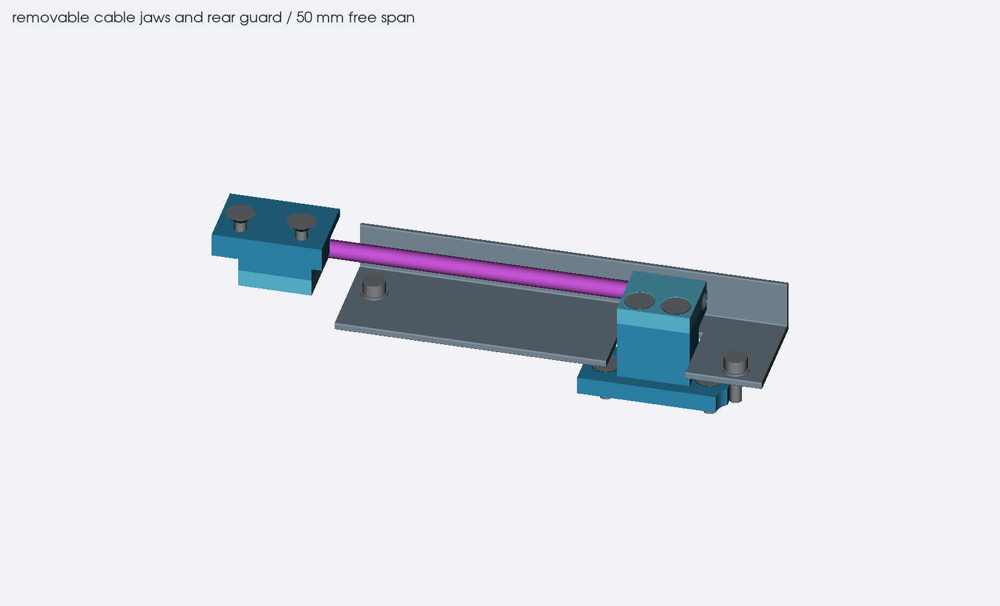
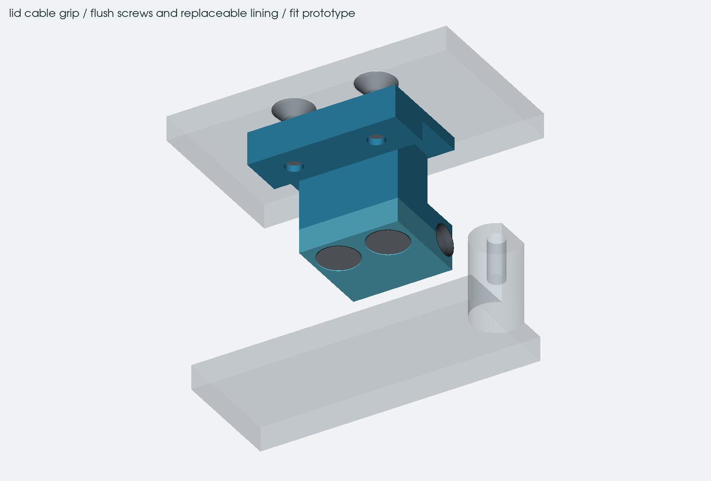

# display cable mounts and rear guard

the cable study now has removable jaws, mounting screws, split lining and
a rear guard around the straight section. the fixed jaw stays at X225 and
the lid jaw stays at X163, both on Y-15, H19.3 when closed. the 12 mm jaws
still leave 50 mm between their inner edges. these parts belong to the
separate display study; the full case export has not been cut for them.

## mounts and lining

the fixed pedestal has a wider foot, with two countersunk screws into
raised bosses on the rear base reinforcement. the moving saddle has a
thicker steel mounting tongue under the lid backing. its two screws go
in from the outer side of the backing before the lid skin is fitted.
the PCB carries none of these mounts.

each jaw has two flush cap screws and faces that meet when it closes.
the cap can be removed without feeding either terminated cable plug
through a hole. the split lining has a 3.7 mm outside diameter and a
3.1 mm inside diameter, with flared entrances contained within the 12 mm
grip length. the first lid bend remains outside the jaw.

there is deliberately 0.1 mm diametral clearance around the 3 mm cable
budget. this is a lining fit prototype, not a finished friction clamp.
the lining material, thickness and compression need choosing with the
actual dressed cable and its maker's crush and pull limits. closing the
metal faces must not depend on crushing the conductors. there is no
rated pull retention yet.

the full route uses a 0.3 mm cable-position allowance. that larger space
overlaps the lining inside the jaws, so those specific interfaces also
use a separate 3 mm cable gauge. the nominal gauge must clear all four
liner halves, including as the caps come off. the larger cable space
is still checked against the other hardware and the case.

## hardware

all coordinates below are installed X, Y and height above the base bottom
in millimetres, with the lid closed. the STEP files use Z = -H.

| screws | quantity | centres and head face |
| --- | --- | --- |
| M2 x 8 countersunk, fixed cap | 2 | X222 / 228, Y-8.5, H22.2; fitted downward |
| M2 x 8 countersunk, lid cap | 2 | X160 / 166, Y-8.5, H16.4; fitted upward |
| M2 x 6 countersunk, fixed pedestal | 2 | X216.5 / 233.5, Y-8.5, H9.2 |
| M2 x 6 countersunk, lid mounting tongue | 2 | X158 / 168, Y-2.8, H32.3 |
| M2 x 6 socket head, rear guard | 2 | X178, Y-10.5 and X239, Y-3.5; under-head H15.5 |
| M2 small stainless washers | 2 | beneath the guard screws; 4.5 mm outside, 2.2 mm inside, 0.3 mm nominal thickness |

the [ISO 10642 drawing](https://www.westfieldfasteners.co.uk/Standards/ScrewBolt-SHCsk-M.pdf)
is the countersunk screw reference. the model covers its theoretical head
profile; match the actual countersink to the purchased screws. the caps
use 8 mm screws with 5.1 mm nominal engagement. both reinforcement mounts
have 3 mm nominal engagement. allowing for screw length and a separate
0.3 mm seating/stack budget leaves 2.46 mm at the lid mount, with 0.46 mm
before the bottom of its tongue.

the guard uses the [ISO 4762 head dimensions](https://www.westfieldfasteners.co.uk/Datasheets/ScrewBolt_SHCap_M.pdf)
and the [DIN 433 washer dimensions](https://ratnaveer.com/washer.asp?id=31).
its screws have 4.5 mm nominal engagement. screw grade, tightening torque,
locking, incomplete end threads and the final metal parts still need
checking. these stack lengths are not a load rating.

the threaded joints use 2.05 mm assembly cavities to show the installed
screws. those are not tap-drill sizes. the provisional M2 x 0.4 pilot is
1.6 mm, to be matched to the material and chosen tap before manufacture.

## removing the guard and caps

the guard sits inside the closed outline, with rounded edges and a
notch around the fixed pedestal. it covers the straight section without
joining the moving jaw. the opening around the moving tail remains
unsealed; a final boot or other closure depends on the selected cable.

the screw and washer positions matter during removal. the first right
mount crossed the cable bend as the washer lifted out, even when the
installed hardware looked clear. the revised mount sits farther forward.

1. Open the lid to 105 degrees and remove the deck. Undo both guard screws
   and take out their washers.
2. Close the lid. Slide the guard 20 mm straight rearward, clear of the
   cable and the mounting posts. The cover must not be lifted through the
   cable. Reopen the lid to work on the jaws.
3. Remove the relevant cap screws. The fixed cap lifts upward; the lid cap
   moves away from its saddle on the underside of the open lid. Keep the
   matching liner half with the cap. The checked travel is 8 mm.
4. Expose the lid backing before removing the lid mounting screws. They
   are covered by the lid skin in the assembled case.

the access study reserves a straight 3 mm tool shaft, 30 mm long, with
an 8 mm diameter handle. it checks screw and washer withdrawal over
12 mm, cap removal over 8 mm, and guard removal over 20 mm, all in 0.5 mm
steps. it also checks the material added to the rear reinforcement, not
just the detached jaw and cover parts.

the saved run has no unwanted opening, screw-access, extraction or removal
contacts at its sampled positions. all 42 geometry regression tests pass.

the full opening sweep remains 0 to 135 degrees in 2 degree steps plus
the exact endpoint. the case outline, height, PCB positions and cable
centreline stay unchanged. the report separates those nominal geometry
results from untested pull strength, lining pressure and repeated flexing.

## files

- `display-grip-hardware.json`: dimensions, hardware references and limits.
- `display_grips.py`: jaws, lining, guard and the local reinforcement changes.
- `display_grip_checks.py`: fit, screw access, extraction and cap/guard removal.
- `test_display_grips.py`: regression checks for the lining, jaw closure,
  screw removal and the opening above the fixed cap.
- `display-hinge-checks.json`: the combined route and mounting results.

the exact panel, full cable construction and mating plug still need
confirming before the harness can be ordered. use the real cable to set
the lining fit, then check pull retention, conductor damage and flex life.
