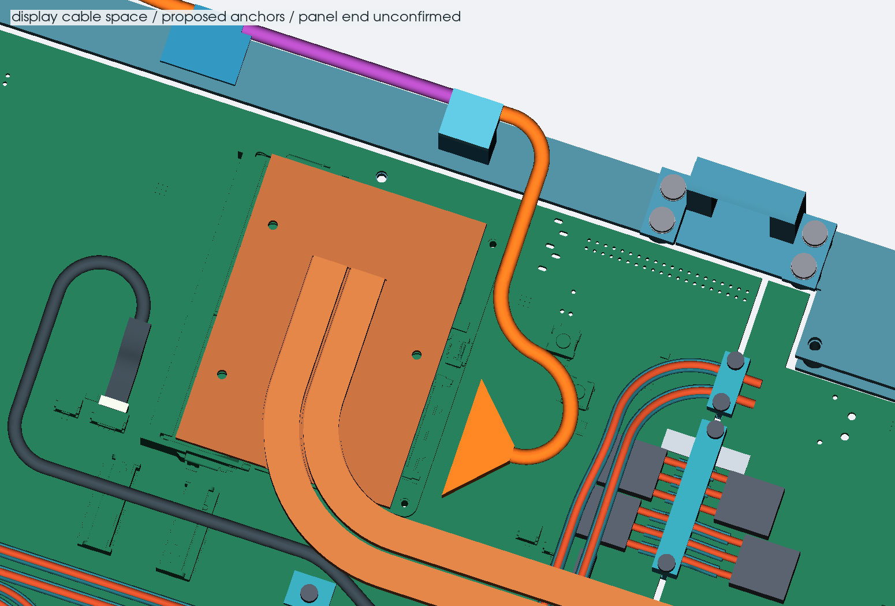
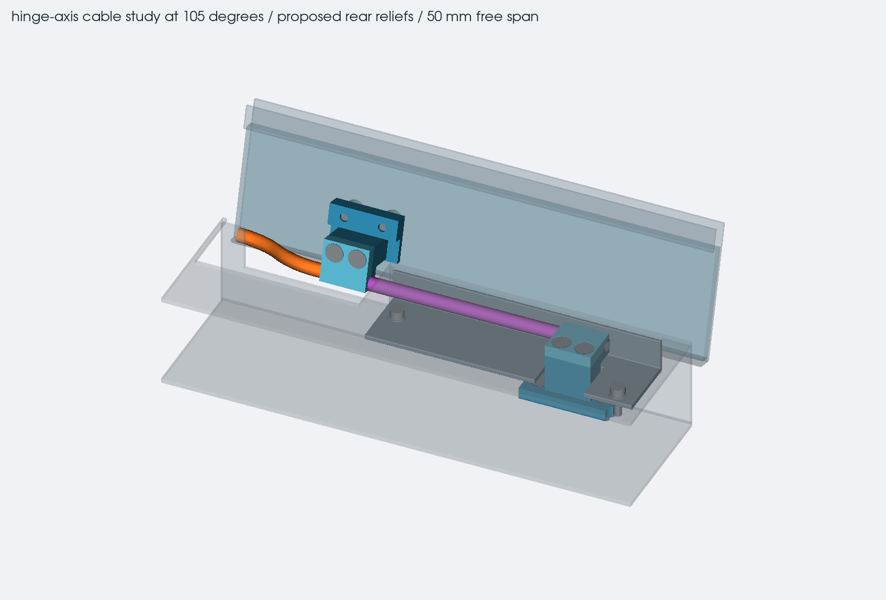

# display cable around the hinge

this is a partial route from the Mu Ultra toward the lid. it includes the
space for the cable, two strain-relief concepts and the rear openings they
would need. the panel connector position and the finished harness are not
confirmed, so there is no full cable length or released cable drawing yet.

## module end and base route

all 40 contacts match the original Mu map. the reference is now checked
against the [Mu Ultra pinout](https://github.com/LattePandaTeam/LattePanda-Mu-Ultra/blob/8dbe7f9f4fec959ac0394cef9a78c958e5154067/Electricals/Pinouts/README.md),
including the 3.3 V logic supply and backlight supply that follows module
input voltage. the panel-side map and voltage limits are still separate
requirements. [electrical and connector notes](../../docs/hardware/display-direct-edp.md)

the connector shell is located from the official module model within the
saved PCB export. its nominal installed bounds are X235.82 to 239.77,
Y45.42 to 71.67 and H12.24 to 13.29. the cable exits toward +X. the model's
supplier name differs from the published I-PEX reference, so the exact
installed suffix and pin-1 orientation still need checking.

the first route hit the USB power wire and its support. the revised path
turns nearer the Mu and uses two 14 mm-radius bends to pass left of J901
and J422. this matters because J422's actual jack body is 12.50 mm tall,
with a 0.20 mm drawing tolerance. the former route crossed its courtyard below that height, so it could
not pass the conservative component-height check.

the tapered fanout and 3 mm dressed bundle are space limits for a harness
maker to check. a 0.3 mm position allowance is included. the shape does
not specify how to gather the wires or prove their individual bend radii.
the complete mating plug, pull bar and unplugging motion also need their
own model. do not order a cable from these centerline points.

## moving section

the proposed fixed grip is centered at X225, Y-15, H19.3. the lid grip is
at X163 on the same hinge axis when closed. their centers are 62 mm apart;
the two 12 mm grips leave 50 mm of cable free between their inner edges.
the lid tail stays straight through its grip and for another 2 mm before
the first bend. the clamps are split concepts for a soft lined grip.
their liners, fasteners, grip pressure and mounting strength are unfinished.

the cable centerline on the hinge axis stays in the same place as the lid
rotates. the cable material still twists. over the 0 to 135 degree study
range, the average relative rotation is 2.7 degrees per millimetre of free
cable. a simple outer helix at 1.5 mm radius would need about 0.125 mm more
length than the axis. that is an illustration of why a fixed centerline
is not proof of zero conductor strain. actual wire lay, slack, sliding
and concentrated strain at the grip edges all matter.

the old 8 mm bend radius was an assumption. the
[I-PEX plug drawing](https://www.i-pex.com/sites/default/files/downloads/pdf/2D_CABLINE-VS_PLUG_CABLE_ASSEMBLY_20453C38.pdf)
says to confirm bend radius with the harness maker. the
[handling manual](https://www.i-pex.com/sites/default/files/downloads/pdf/MANUAL_CABLINE-VS_HIM-08004-08EN.pdf)
requires restraint to keep pulling and repeated bending away from the
connector termination. this layout needs an assembly specifically checked
for the proposed twisting motion, followed by a cycle test with the actual
grips. a static bend rating alone is not enough.

## rear openings in this study

the ring-shaped cable reservation from the earlier case would reach about
9.5 mm past the shortened rear edge if placed at the new axis. the axial
layout stays within the closed outline, but needs a deck opening and local
rear-wall reliefs. these are applied to a copy of the case in this study.
the complete case export still has its previous wall and deck geometry.

| proposed cut | installed extent, mm |
| --- | --- |
| rear deck opening | X130 to 173, Y-19 to -4.5, H23.5 to 25.3 |
| opening for the lid-side anchor and tail | X135 to 173, Y-18.1 to -16.6, H12.25 to 24.25 |
| inner wall relief beside the axis section | X161 to 236, Y-17.0 to -16.7, H17.2 to 21.4 |

the last cut removes 0.2 mm from the existing inner wall face, leaving
1.0 mm of wall outside the through-opening. the grip has an open rear
profile rather than requiring a deeper pocket behind the cable. edge
rounding, a cover or boot over the opening, pull retention and structural
strength still need designing around the selected harness. no extra front
lip, rear platform or case height is added by this study.

`display-hinge-checks.json` records solid contacts through 135 degrees in
2 degree steps, with the 135 degree endpoint added, component-height crossings, source hashes and output
hashes. the range now matches the case stop prototype. the stop load and
assembled opening tolerance still need physical checks. the samples do not establish continuous-motion
clearance, fatigue life, or fit under manufacturing tolerances.

the saved study has no detected static, opening-motion or internal solid
contacts at those samples. all 13 component-height crossings clear their
manufacturer maximums plus the assembly allowances; the smallest calculated
gap is 1.18 mm. the base centerline is 118.57 mm long, ending at the fixed
grip center. that is only part of the harness. the separate STEP is reopened and checked after export.

## files and remaining information

- `display_hinge_study.py` rebuilds the route, proposed reliefs, checks,
  close-up views and separate STEP from the saved case.
- `display-hinge-study.json` records the cable-space assumptions and anchor
  datums. the construction details also live in the Python source.
- `display-part-heights.json` records five exact-part height limits used
  in the route check, separately from assembly allowances.
- `exports/display-hinge-study.step` contains the partial cable geometry,
  grip concepts and the local case sections with proposed openings.

to finish the cable, obtain the exact panel drawing and contact map, logic
and backlight current limits, connector position, and the selected
harness maker's bend and twist limits. agree the wire construction and
power-conductor sizes before freezing the fanout, clamps or full length.
then check the full plug and panel tail, service access, the mechanical
opening stop, continuity and isolation, image stability at 2560x1600
120 Hz, and repeated lid movement. the PCB files and component positions
are unchanged by this work.
