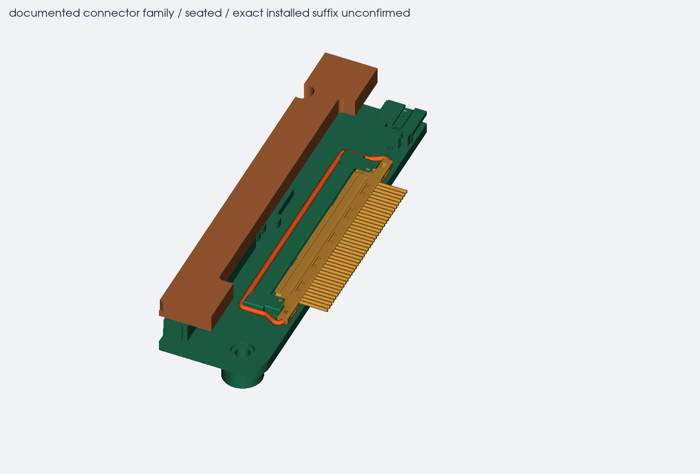
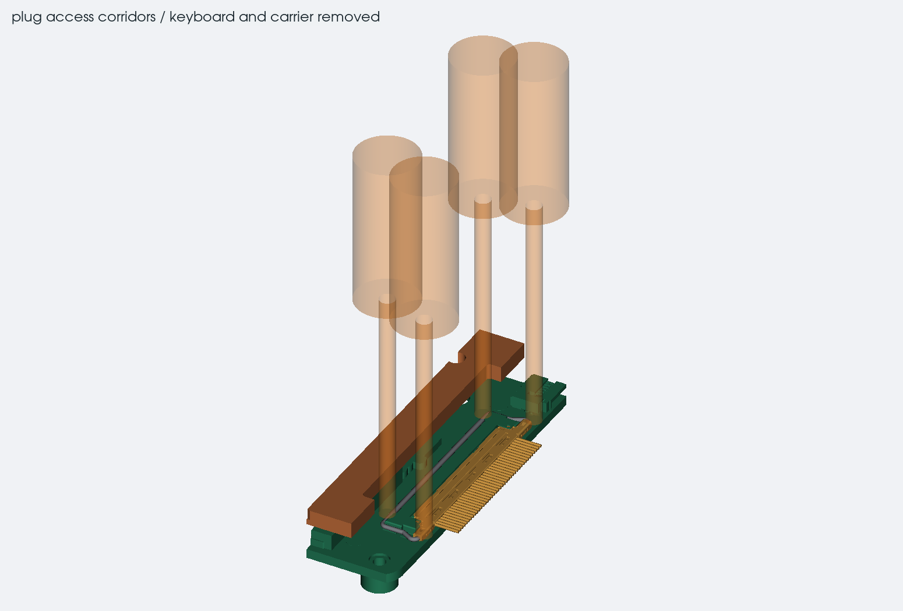

# display plug beside the cooling plate

12 october 2026. the module-side plug now has a separate fit model, including
its locking bar and removal space. this uses the documented I-PEX CABLINE-VS
family. the Mu Ultra is not on hand yet, so its actual connector suffix,
pin-1 orientation and compatibility with this plug are still unconfirmed.

## what the source models contain

the official module model contains a socket solid labelled
`LV0504-40-0010RA-G3_9_1`. its `LV0505-401GB` plug assembly is an empty
placeholder. those names do not establish which connector is fitted to
the purchased module. the published Mu Ultra pinout names I-PEX 20455-040E.

the plug body and coated bar come from the manufacturer's
[40-position CAD archive](https://www.i-pex.com/sites/default/files/downloads/zip/40p_CABLINE-VS_STEP.zip).
that archive is dated 2012; its main dimensions were compared with the
current plug, socket and bar drawings. the socket solid in the archive
fails the CAD validity check, so it is not substituted into the case.
the original module socket remains in the model. the reference socket's
26.25 x 3.95 mm outer plan matches it, but the native model is 0.05 mm
taller. matching outer dimensions alone does not prove interchangeability.

the plug body and bar are valid solids. the bar is separated from the
with-bar assembly by subtracting the matching body. its rotation uses a
drawing-derived wire centre; internal latch flex and release force are
outside this enclosure check. `reference/display-connector/sources.json`
records the files, hashes and rejected socket geometry.

## plate relief and cable exit

the original cooling plate occupied the extra space above the bar and
both bar-end access corridors. a rounded edge relief now removes 1.7 mm
from that edge, between Y43.5 and Y73.5, with 0.5 mm inside corners. this
change is included in the main case and cooler exports.

the cut leaves the CPU and both memory contact areas, both heat-pipe
envelopes and all three mounting reservations intact. the nearest screw
hole keeps 2.62 mm of copper to the relieved edge, and its larger mounting
reservation keeps 0.47 mm. plate stiffness, clamping load and thermal
performance still need testing.

the cable-space model now starts at the reference plug's wire ends,
X243.92, Y58.54, H12.772. it stays straight for 1.98 mm before rising gently
to the existing H13.3 fanout. the later route and both hinge grips retain
their positions. this is space for a cable maker to work within; it does
not specify the finished wire lay or approve repeated twisting.

## access and removal

the enclosure study rotates the reference bar from one horizontal position
to the other in 2 degree steps. that is a clearance study, not an instruction
to force an actual bar through 180 degrees. follow the connector supplier's
handling instructions on the confirmed part.

the service layout uses a 105 degree lid opening. remove the deck and
keyboard first, then support and unfasten the five fan guides and two USB
brackets before lifting the carrier. [keyboard removal details](keyboard-service.md)
release the display cable's fixed jaw
and free the loom before unplugging it. the finished keyboard retention,
FFC route and dressed-cable handling still need a physical check.

with the bar raised, the plug moves 5 mm along +X. eleven positions at
0.5 mm intervals check that path. at the last position, the plug body is
2.23 mm clear of the socket in X. only the native socket is excluded from
the mating check; the module PCB and its other components remain checked.

four access corridors cover the two shell ends and two bar ends, using
2 mm shafts and 8 mm handles. these describe available space, not approved
tool contact points or operating forces. hold the intended plug ends and
withdraw parallel to the module; do not pull on individual wires. the
[I-PEX handling manual](https://www.i-pex.com/sites/default/files/downloads/pdf/MANUAL_CABLINE-VS_HIM-08004-08EN.pdf)
gives the handling sequence and cautions for the confirmed connector.

the results are part of `display-hinge-checks.json`. the tests cover the
seated parts, bar swing, extra room above the bar, withdrawal and tool
corridors. sampled nominal clearance does not establish tolerance fit,
connector compatibility, safe handling force or continuous-motion clearance.

## saved files

- `display-plug.json` holds the placement, bar pivot, access and removal limits.
- `display_plug.py` places the reference parts and identifies the native socket.
- `display_plug_checks.py` checks the surrounding geometry and draws the close-ups.
- `exports/display-plug-study.step` is the separate inspection model.
- `test_display_plug.py` and `test_display_plate_relief.py` check the transforms,
  cable join, socket exclusion and protected plate features.

the case remains 33.3 mm closed without feet, with the same lid and base
outline. none of the PCB files changed. the complete cable still needs the
actual panel connector, its contact map and voltage limits, a vendor-approved
construction and length, then continuity, isolation, display and hinge-cycle
tests. the harness release record remains pending.
