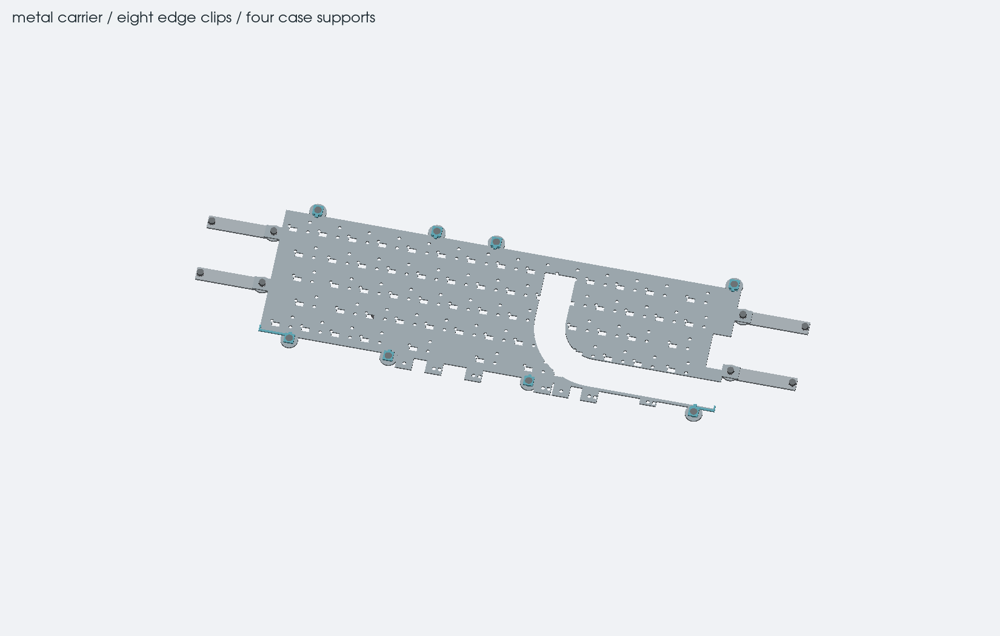
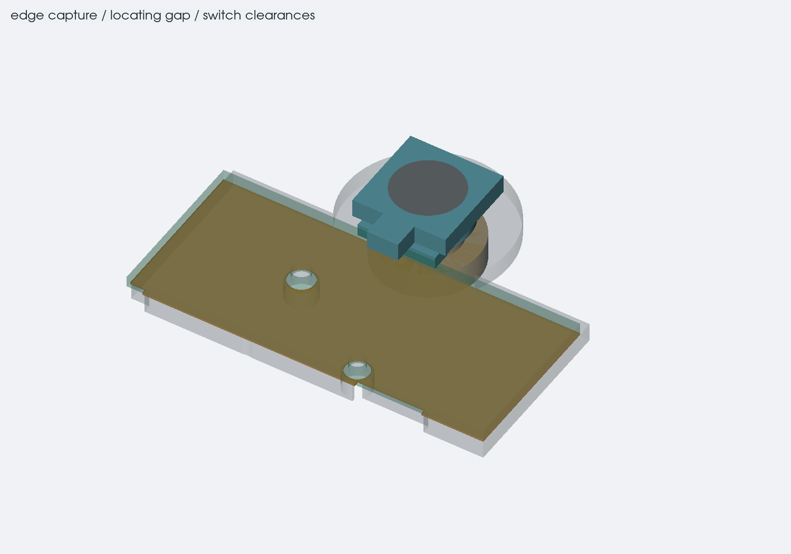
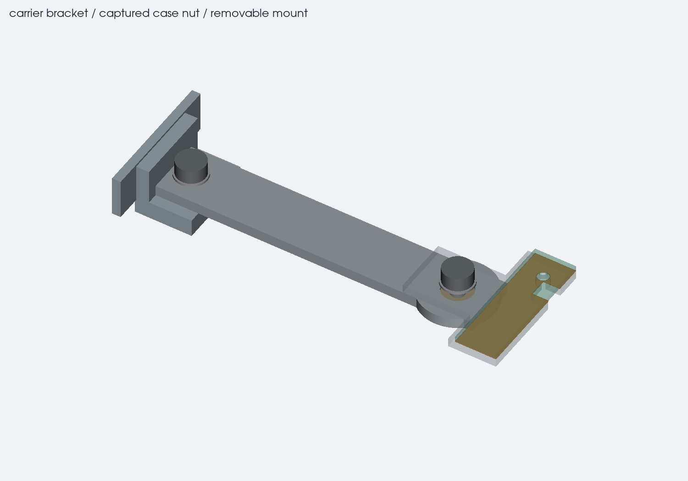
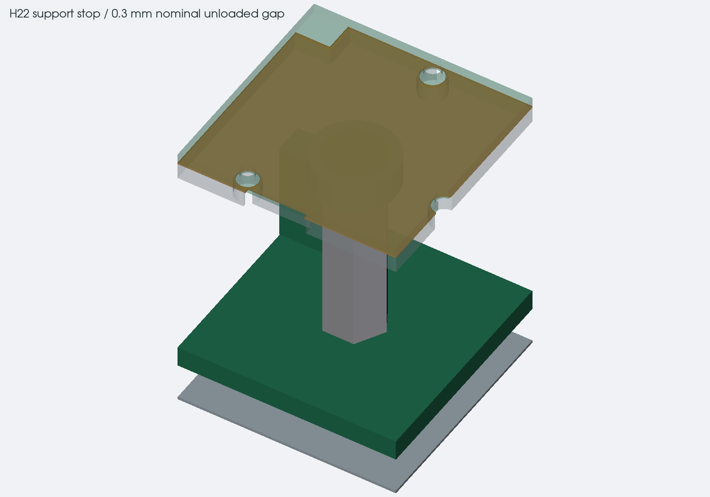
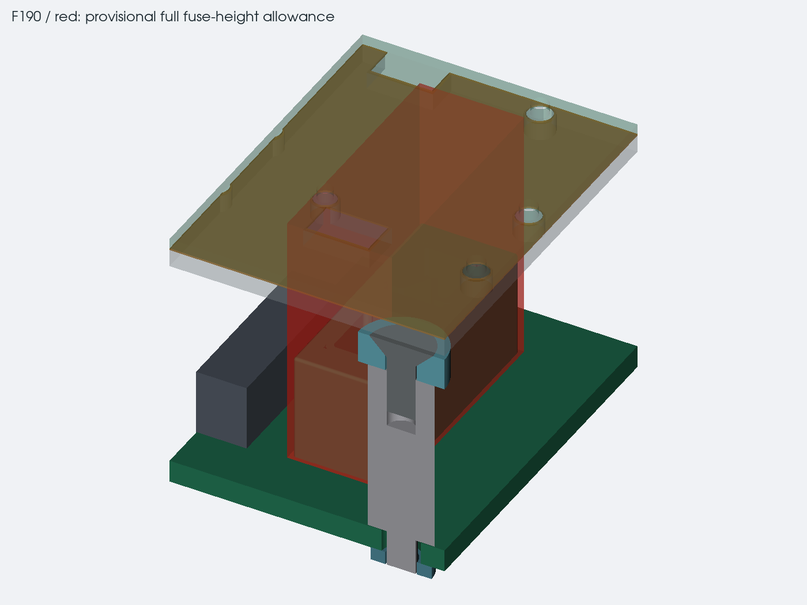
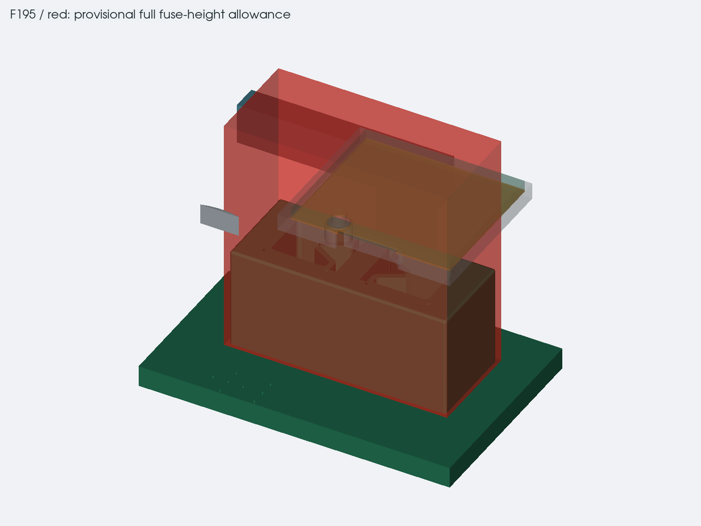

# keyboard carrier and mounts

15 october update: F190/F195 have been replaced on the working boards.
their [local fit check](../../docs/hardware/aux-input.md) clears the carrier.
the complete model and images on this page retain the 12 october PCB
snapshot. the switch-pin measurement and physical load tests remain open.

12 october 2026. the keyboard now has eight removable edge clips, four
brackets to the case and a center stop. the carrier is a 1.2 mm stainless
sheet with a separate 0.127 mm insulating film. this is still a fit
prototype. the two upright AUX fuses and the unknown switch-pin projection
prevent releasing it for manufacture.

## carrier and insulation

the plate uses annealed 304 stainless, with HRB 90 maximum for the selected
PEM SP-M2-1 nuts. all eight nut sites retain the specified 4.8 mm minimum
center-to-edge distance. the sheet stays in one connected piece after
cutting the heat-pipe windows and switch openings. its modeled mass is
about 184 g, excluding clips, fasteners and the side brackets.

all 195 switch locating holes continue through the sheet and film. the
steel openings add 0.4 mm radially; the film adds 0.25 mm. all 65 mechanism
areas also have openings, based on the saved switch-footprint exclusion
rectangles. those rectangles are a conservative starting point for the
carrier, not a manufacturer-approved backing-plate design.

the two pipe windows go through the steel. a 0.5 mm lateral cut allowance
joins the narrow gaps between them and removes disconnected metal scraps.
the separate Kapton 500HN film has no added adhesive thickness in this
stack. deburr every edge and check the film for cuts, trapped solder and
movement before fitting the keyboard. the plate's electrical bonding and
long-term insulation still need deciding and testing.

the keyboard PCB bottom is at H21.327, 0.327 mm above the previous case
position. its XY position, components, tracks and holes are unchanged.
the case stays 33.3 mm closed without feet, or 37.4 mm with them. the
nominal screen-to-key gap reduces from 2 mm to 1.673 mm. actual keycap
height, board warp, screen deflection and typing loads still need checking.

## edge clips

| edge | screw centers X, Y in mm |
| --- | --- |
| rear | 60, 16.5; 132, 16.5; 168, 16.5; 312, 16.5 |
| front | 60, 103.5; 120, 103.5; 205, 103.5; 305, 104.5 |

each insulating clip uses an M2 x 6 DIN 965 countersunk screw and a pressed
SP-M2-1 nut. the front corner clips also locate the board sideways. nominal
edge clearance is 0.25 mm and the gap above the PCB under each toe is
0.073 mm. that small gap is a fit target, not a production tolerance.
adjust the clip seating height to the measured board and liner instead
of forcing a warped or thicker PCB flat.

the rear-right clip moved to X312 to clear the full headphone-jack height.
the front-right clip sits 1 mm farther forward so the clinch nut keeps its
required distance from the heat-pipe window. the checked populated
keyboard courtyards do not intersect the clips.

## case brackets and center stop

four 1.5 mm aluminum brackets join the plate to internal case bosses.
their centerlines are Y35 and Y70 on the left, Y35 and Y73 on the right.
the case screws sit at X-0.5 and X358.5; the carrier screws sit at X37 and
X321. nothing extends the front or rear outline.

each root uses an M2 x 4 pan screw, a 0.3 mm washer and a captive DIN 934
M2 nut. each inner end uses an M2 x 5 pan screw, the same washer allowance
and a PEM S-M2-1 nut. the aluminum must meet that nut's HRB 80 maximum.
the CAD includes the screw length tolerances, heads, washers and nut bodies.
the hole diameters and sheet hardness must follow the purchased fasteners;
the displayed threaded bores are installed envelopes, not tap-drill instructions.

a Harwin R20-3001202 M2 spacer replaces the ordinary screw at center-board
H22, at X105, Y70. its insulating cap has a nominal 0.3 mm unloaded gap to
the carrier. the existing mounting pad is backed by the case post. set the
cap from the actual stack and check the threaded engagement before use.
this gives a local deflection stop; it does not prove the whole keyboard
will stay stiff under typing or a palm load.

## fit issues to finish

the following describes the old F190/F195 assemblies in this snapshot. the
Keystone 3568 holder is nominally 7.37 mm high and the Littelfuse 297
plastic fuse body is 8.8 mm above its blades. adding those gives 16.17 mm
before tolerances, but the exact seating overlap still needs confirmation.
the check uses a conservative 17.5 mm installed allocation. there is only
14.5 mm from the motherboard top to the carrier and 15.827 mm to the
keyboard PCB. using the bare holder height would hide this conflict.
the next change should resolve these assemblies without increasing the
case height; no fuse or PCB replacement is included in this pass.

the switch pins also need measuring. the smallest screened allowance is
0.69 mm below the keyboard PCB after leaving a 0.2 mm gap. this comes from
columns at the locating holes, enlarged by 0.2 mm radially, against retained
CAD including the pipe size/position envelopes. it is not a measured pin
length or a full switch-motion check.

after those fit issues, test the actual populated keyboard, clip material,
steel edges, insulation, carrier deflection and warm assembly. the full
FFC route and a safe way to support the released cable guides also remain
unfinished. [removal order and access](keyboard-service.md)

## saved checks

`keyboard_mount_checks.py` compares the new solids and hardware with the
retained assembly, checks installation access and screens component heights
under the full carrier. manufacturer maximums and provisional installed
allocations are separate in `keyboard-part-heights.json`. the report stays
failed while the fuse allowances conflict; passing the modeled-solid check
alone is not a complete fit result.

`test_keyboard_mounts.py` checks connected sheet material, clinch edge
distances, populated keyboard courtyards, PCB capture and fastener fit.
`keyboard_service.py` checks the lift and screw-removal sequence. the
separate STEP is `exports/keyboard-mounts.step`; `keyboard-mount-checks.json`
records its sources and image hashes.
