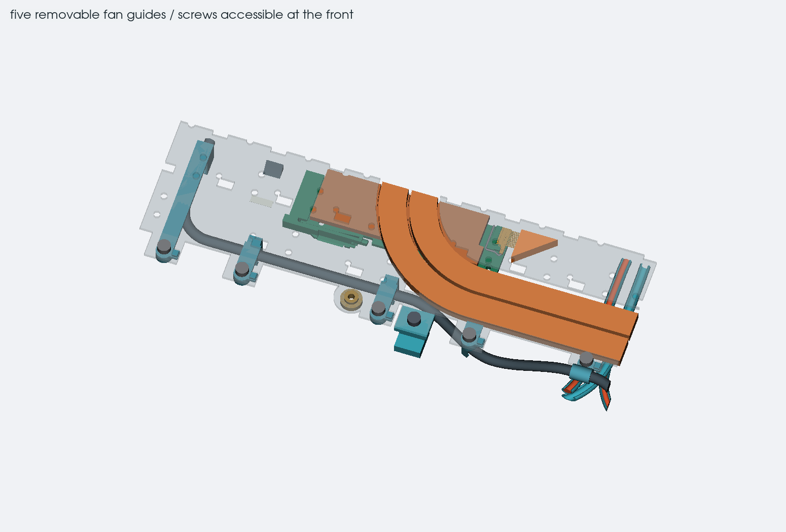
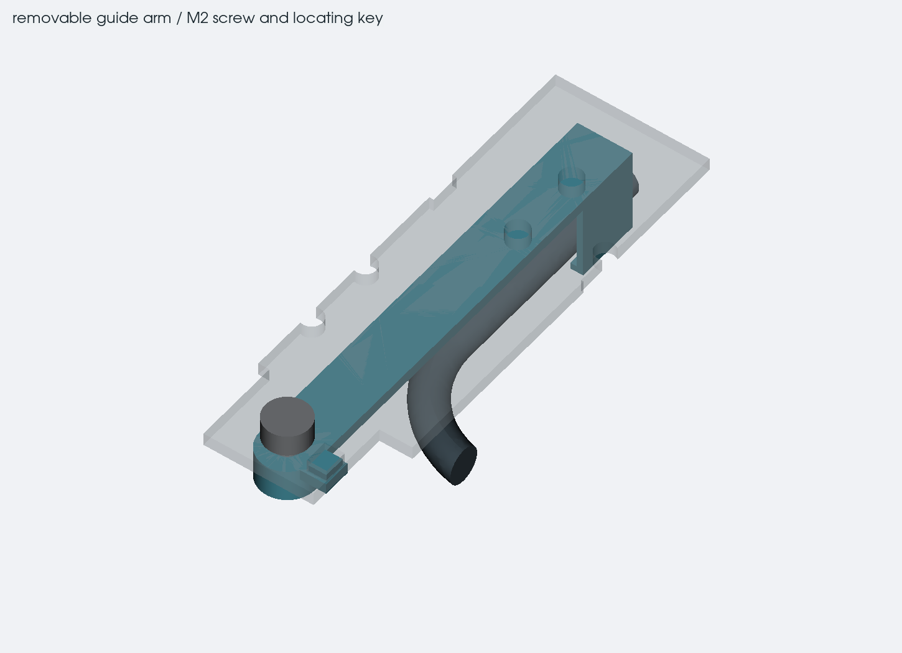
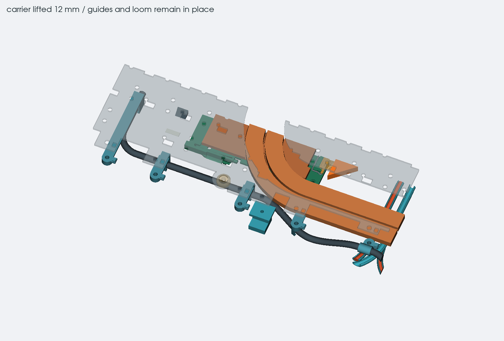
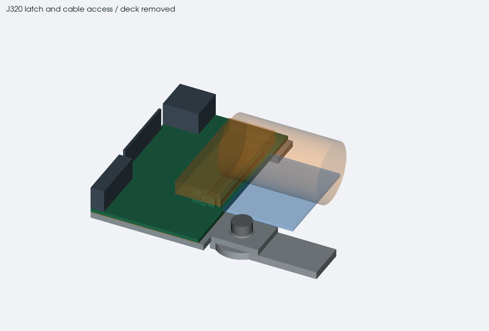

# getting the keyboard and carrier out

12 october 2026. the old carrier had five fan-wire guides built into it.
lifting it caught the stationary loom after only 0.5 mm. the keyboard
itself cleared the retained geometry, so the useful order is to remove
the keyboard first, release the guide mounts, then lift the carrier.

the five guides are now separate parts in the main case. each keeps its
original cable position and guide mouth, with an arm extending to a screw
at the carrier's front edge. small rectangular keys keep them aligned.
the carrier lifts off those keys after the screws are removed.

## guide hardware

| guide | screw X, Y in mm | cable support |
| --- | --- | --- |
| 1 | 148, 105.5 | loop beside J52 |
| 2 | 172, 105.5 | first middle support |
| 3 | 214, 105.5 | second middle support |
| 4 | 242, 105.5 | start of the raised crossover |
| 5 | 277, 102.5 | upper crossover |

the five screws are [M2 x 4 Phillips pan heads](https://www.westfieldfasteners.co.uk/Bolts-Screws-Metric/M2-Screw-Phillips-Pan-4-A2-Stainless.html).
the CAD allows a 4 mm head diameter, 2 mm head height and the full 4.24 mm
maximum shank length. the nominal guide boss is 3 mm deep. allowing for
the short end of the screw tolerance and 1.1 mm under-head thread runout
leaves 2.56 mm of full-thread overlap. the clearance bores show the installed
screw envelope; they are not finished tap-drill dimensions.

the heads stay outside the keyboard PCB outline and below the deck.
the locating keys have a nominal 0.1 mm gap per side. print and fit the
joint before choosing the final hole compensation, thread process and
torque. the thin carrier, long first arm and plastic bosses still need
stiffness, pull and warm-service tests. they are not qualified by a clean
collision report.

## removal order

1. disconnect the charger and battery before working inside the case.
2. open the lid to 105 degrees. release the deck fasteners and attached
   input-device wiring before removing the deck. those attachment details
   are still unfinished in this thin case.
3. release the keyboard FFC at J320 and park it clear of the carrier.
   remove the eight edge-clip screws and clips, then lift the keyboard out.
   lift the separate insulating film next. the complete FFC route and
   parked position still need designing.
4. secure the five fan guides and both USB rails on temporary insulating
   supports. remove the five new guide screws and the two existing USB
   bracket screws at X130 and X225, Y105.5. do not let loose guide pieces
   hang from the wires.
5. remove the four carrier-to-bracket screws and their washers. the
   brackets remain attached to the case. lift the carrier vertically off
   its locating keys, with its eight pressed nuts still fitted. the fan loom and
   guides stay in place. this exposes J52 and the module display connector.

the guide mouths do not need to be spread for this carrier removal.
releasing the wire from a guide for fan replacement is a separate operation,
and the clip material and fit still need a physical sample. the temporary
support arrangement must also be checked with the dressed wiring before
using this as a real disassembly procedure.

## keyboard connector access

J320 is the bottom-contact Hirose FH12 type. its drawing shows a reference
4.8 mm open-actuator height above the PCB; the study allocates 5 mm.
the upper clearance, a 12 mm diameter finger allowance and the space
outside the cable exit are checked with the deck removed. these are
space reservations, not a simulation of the latch or a measured hand fit.

use a thumb or index finger as shown in the
[Hirose instructions](https://www.hirose.com/en/product/series/FH12/documents?path=%2Fapi%2Fv1%2Fseries%2FFH12%2Fdocuments%2Fproduct_series_catalog%2Fcontent%3Flang%3DEN).
the bottom-contact instructions warn against a fingernail or thin tool.
open the actuator before withdrawing the FFC parallel to the board.
the external space shown here does not establish the cable's installed
length, bend limits or parked position.

## checks and saved files

`keyboard_service.py` checks the deck, keyboard, insulating film and carrier
lift in 0.5 mm steps over 30 mm, plus eight clip removals over 10 mm.
it also checks 19 driver paths, the screw withdrawals and the J320 access spaces. the display grip and guard geometry
is included using the same proposed rear reliefs as the display study.
the separate STEP contains 19 solids: the carrier, eight pressed clip nuts,
five guides and five guide screws.

- `fan-guide-mounts.json` records the positions and screw allowances.
- `fan_guide_mounts.py` makes the separate guides, locating features and carrier tabs.
- `keyboard-service.json` records the removal and connector-space assumptions.
- `keyboard-service-checks.json` records contacts, source hashes and image/export hashes.
- `exports/keyboard-service.step` is the separate inspection model.

the [keyboard mounts](keyboard-mounts.md) now have a defined removal order.
the upright AUX fuse clearance, switch-pin height, load tests and flexible
wiring still need resolving. the existing
0.8 mm PCB, its routing and component positions are unchanged. this change
adds no case height, front lip or rear ledge.
