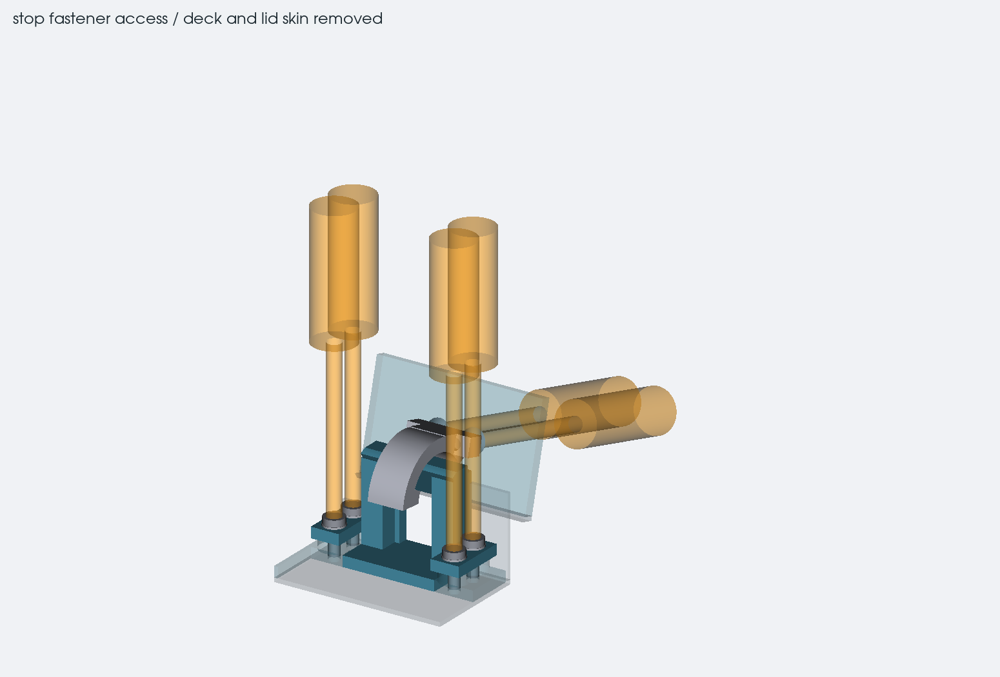

# stop the lid at 135 degrees

the lid now has a 135 degree opening target. two curved metal tabs attach
to the lid backing plate and meet separate blocks on the rear base
reinforcement. the parts stay inside the existing case outline. the case
is still 33.3 mm closed without feet, or 37.4 mm with the nominal feet.

the stops are at X68 and X290. both use the existing hinge axis at Y-15,
H19.3. the purchased Framework hinges keep their geometry and positions.
the stop force goes into the rear reinforcements rather than a PCB,
keyboard support or the thin lid rim.

## parts and screws

each lid tab is 10 mm wide, with extra material near the root and a 5 mm
thick mounting foot. two M3 x 6 countersunk screws enter from the outer
side of the 3 mm lid backing plate and thread into that foot. install them
before the lid skin. the first version had button heads underneath; those
hit the fixed blocks around the middle of the opening movement.

each fixed block has four mounting wings and M3 x 8 button-head screws,
with small M3 washers. raised threaded bosses on the base reinforcement
leave room for the screw tips above the bottom panel. the block replaces
a short section of the rear reinforcement and bolts to the material on
both sides of that opening. local wall and deck reliefs clear its motion.
the two blocks therefore become structural links in the rear member;
they need metal parts and a checked bolted joint before carrying lid loads.

| hardware | total | fit basis |
| --- | --- | --- |
| M3 x 8 ISO 7380-1 button-head screw | 8 | 5.7 mm head diameter; 1.8 mm height allocation |
| M3 DIN 433 / ISO 7092 stainless washer | 8 | 6 mm outside, 3.2 mm inside, 0.5 mm nominal thickness |
| M3 x 6 ISO 10642 countersunk screw | 4 | recessed in the lid backing; 6.72 mm theoretical head envelope |

the [button-head drawing](https://www.westfieldfasteners.co.uk/Standards/ScrewBolt_SHBtn_M.pdf)
gives a 1.65 mm maximum head height and 0.29 mm length tolerance for the
8 mm screws. the [countersunk drawing](https://www.westfieldfasteners.co.uk/Standards/ScrewBolt-SHCsk-M.pdf)
gives a 0.24 mm length tolerance for 6 mm. the countersunk CAD envelope is
deliberately larger than the actual flat top of the head. finish the
countersink to the purchased screw, with its top flush or below the plate;
the modeled cone is not a machining instruction.

[Ettinger 003.01.039](https://www.ettinger.de/en/product-datasheet/f891308e688fe98aa3fc3e33a869b97d/create)
is the washer reference. the separate [DIN 433 tolerance table](https://ratnaveer.com/washer.asp?id=31)
gives a 0.45 to 0.55 mm thickness range. the remaining fastener grade,
finish, locking method and assembly torque still need choosing for the
actual metal parts.

the base screws have 4.5 mm nominal engagement, or 4.16 to 4.84 mm from
the screw and washer limits alone. the longest combination leaves
1.16 mm above the base floor. machining tolerances still need adding.
the lid screws have 3 mm nominal engagement. including screw length and
a separate 0.5 mm seating/stack budget gives 2.26 to 3.74 mm, leaving at
least 1.26 mm before the bottom of the tab foot. incomplete end threads
reduce useful engagement, so these lengths do not establish joint strength.

the assembly model uses 3.05 mm cavities at threaded joints so the
installed screw envelopes can be checked. do not drill those as tap
pilots. the provisional M3 x 0.5 pilot is 2.5 mm and needs matching to
the selected material, tap and thread-depth drawing.

## access and checks

the access check uses the lid at 105 degrees, with the deck and lid skin
removed. it reserves a straight 4 mm diameter, 45 mm long tool shaft and
a 12 mm diameter handle. a short right-angle key is not covered by that
check. the four countersunk screws cannot be serviced through the closed
lid skin. keep that in mind when finishing the lid attachment design.

the rigid movement check includes 0, 2, 4 and subsequent 2 degree samples
through 134, plus 135 degrees. each intended tab/block pair is also checked
at 134.9, 135 and 135.1 degrees. the first should have a gap, the second
should touch without overlap, and the third should intersect. this catches
an incorrectly oriented stop face without hiding other part collisions.

the saved check has no unwanted rigid overlaps at all 69 opening positions.
all twelve driver envelopes clear at 105 degrees after the stated covers
are removed, and none of the stop parts crosses a populated component
courtyard in the height screen. all 34 geometry regression tests pass.

the contact faces have a nominal 2.1 mm radial overlap across the 10 mm
tab width. that is only geometry. the curved tab, its root, screws, base
links and lid backing all need load calculations and a physical test.
one stop may contact before the other, so do not assume they share a
hand load equally. there is no rated push force or impact energy yet.

use a rigid dummy lid for the first load test. check seating, actual stop
angle, clearance, permanent set and loosening before fitting the display.
a printed copy is useful for fit, but is not a substitute for the metal
stop or a strength test. the real hinge holding torque, lid mass, repeat
cycles and manufacturing tolerances remain unqualified.

`lid-stop-checks.json` records the saved contact, hardware and tool checks.
run `verify_lid_stop_exports.py` after rebuilding the case to reopen the
STEP files and refresh `lid-stop-exports.json`.
the main `checks.json` covers the full case movement. neither file is a
fabrication release. the separate display-cable study now uses the same
135 degree limit; its proposed wall openings, grips and full cable still
need finishing with the selected harness.
