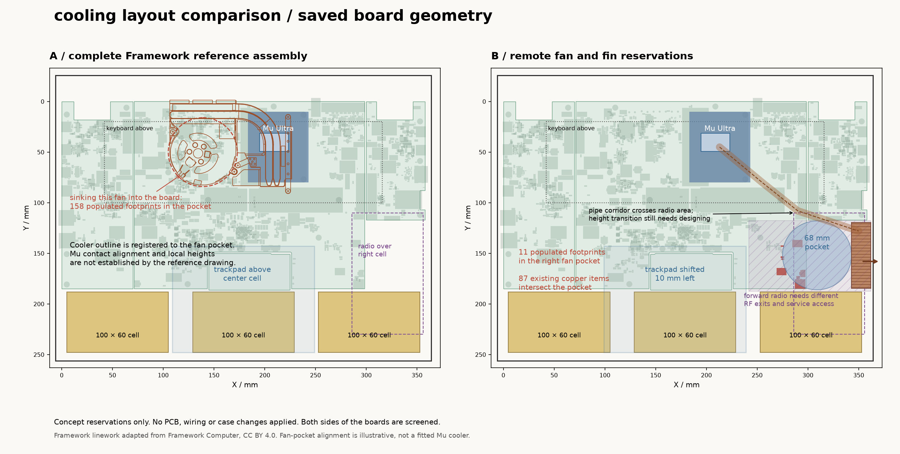
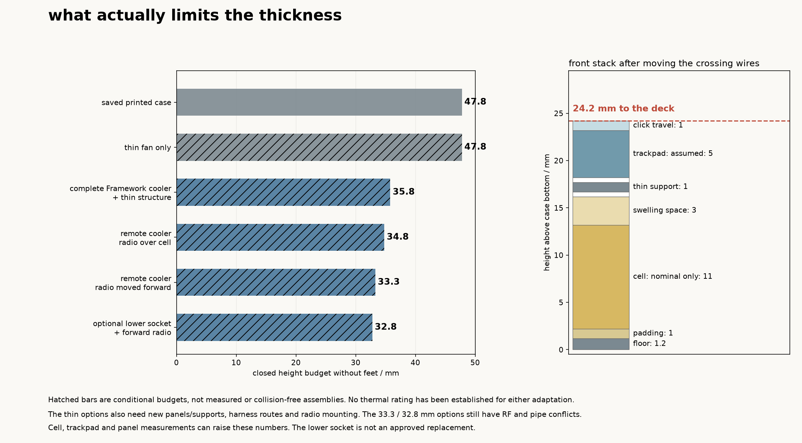

# making the laptop thinner

10 october update: the [current case](../flush-case/cooling.md) uses a
45 mm blower beyond the center-board edge. it avoids the circular cutout
and component moves studied below. this comparison remains the earlier
layout and thickness study, not the current cooler selection.

8 october 2026, with the old-case thickness corrected on 9 october. the
saved printed case is 47.8 mm closed without feet. the earlier 44.8 mm
figure omitted the 3 mm joining plates below the base datum.
there is room to make it thinner, but changing the fan on its own does
not fix the battery, trackpad, wiring and radio stacks.

this folder compares two cooling layouts against the saved boards. the
PCB files and the case in `../case-prototype` have not changed. the STEP
files here contain board substrates and space reservations, not complete
assemblies or printable parts.

9 october: the lid and base must share the same closed outline, with no
front ledge or rear cooling extension. there must also be no fixed shelf
behind the open screen. the forward-radio sketch below only moved parts
inside the existing footprint; it is not a selected layout. an external
radio is now the chosen direction. the saved case already has an 8 mm rear
ledge because its lid is shorter than its base, which needs correcting.
the height budgets below do not establish fit with the revised outline
and hinge arrangement.

the later [flush case candidate](../flush-case/README.md) removes the
internal radio and shortens the base to match the lid. it retains the
current boards and wiring to show what still conflicts with the lower deck.

## the useful space is on the right

a 68 mm fan pocket centered at X309, Y152 removes about 1,113 mm² from
the right edge of the center board. it intersects 11 populated footprints:
`C178 C179 C2070 C2412 J73 J421 R205 R211 SW1 SW4 U63`.
these are the service USB port and protection, reset/boot controls,
speaker connector and nearby capacitors. their new positions still need
designing. this does not remove any of those functions.

87 existing track/via items intersect that pocket. they belong to the
service USB signals, CC resistors, VBUS and ground. no saved PCIe route
intersects this particular pocket. planes, edge clearance, copper near
the new edge and the remaining board strength still need checking.

the screened pocket beside the Mu, at X139, Y50, intersects 158 populated
footprints and 441 track/via items, including PCIe and other fast signals.
that is a much bigger board redesign. the circle is a preliminary space
allocation, so a real fan's tabs and shroud can change either count.

the right fin reservation is X343–362, Y119.6–184.4, with the exhaust
facing the right wall. no existing main-board footprint intersects that
rectangle. the 1.5 mm board seams and mounting-hole positions are kept
in the study. the edge cut only exists in the separate concept STEP.
the substrate slabs omit pad and mounting drills; their locations in the
saved boards have not been edited.

## complete Framework cooler

the [Framework Laptop 13 kit](https://frame.work/products/heatsink-and-fan-kit?v=FRANFV0001)
is a useful starting point because its blower, shroud, fins and heatpipes
were designed together. the Intel option was $39 before shipping and tax
when checked. the listing gives a 65 × 5.5 mm fan and a 120 × 85 × 6 mm
assembly, rated for 28 W continuous and 60 W turbo in its original laptop.
that rating does not transfer automatically to the Mu.

the published 2023 reference drawing has a 6.8 mm local height, so the
budget uses that larger figure plus 0.4 mm allowance. it also reserves
1 mm for adaptation above the Mu CPU. the drawing does not establish the
exact current kit's contact plane, clamp force or tolerances. these are
reasons to measure a sample, not dimensions to guess before machining.

the plan image aligns the reference drawing to the fan pocket. **it does
not establish that the cold plate lands on the Mu CPU.** the purple and
blue reservations are also not a completed mounting arrangement. keeping
the fan above the motherboard can avoid the 158-footprint cutout, at the
cost of height. other cooler rotations remain possible once its actual
contact datum is known.

the fan also needs an electrical change. the reference uses 5 V and
1 mm pitch, with pins 5 V, speed, PWM, ground. current J52 is a 12 V
JST GH connection with pins ground, 12 V, speed, PWM. they cannot be
plugged into one another. confirm the purchased fan's exact pinout and
control levels before revising the supply or connector.

## separate right-side blower and fins

this layout gives the fan its own low space and sends the air straight
out of the side. the budget reserves a 5.5 mm fan, 0.5 mm height allowance,
0.6 mm below it and 3 mm above its inlet. the Mu contact plate, interfaces,
pipes and upper mounting envelope have a combined 6 mm height allocation
above the CPU. no specific cooling assembly has been shown to meet that
allocation yet.

the custom option needs a formed heatpipe assembly with a real capacity
specification, a matched fin/shroud design and a way to service the CPU
mount. the line in the drawing only marks a possible corridor. it does
not specify pipe bends or a working change in height between the Mu and
the low fins. do not cut a donor's sealed pipes or assume a straight-pipe
rating survives flattening and forming. the fan's free-air rating alone
also cannot establish flow through a restrictive fin bank.

moving the radio forward gets it off the right battery. the trial rotates
its 120 × 70 mm board into X242–362, Y117.5–187.5 and shifts the trackpad
10 mm left. this is still an unresolved arrangement:

- the heatpipe corridor passes through the same area. their vertical
  arrangement and actual component bodies have to be designed together.
- the existing SMA exits cannot be carried over without checking the
  adjacent RJ45, shell and battery. internal coax to bulkhead connectors
  is one possible change, not a selected replacement.
- 36 main-board courtyards overlap the radio's plan area. this is not a
  count of 36 required moves, because it sits above them, but every one
  needs a height and service-access check.
- the radio carrier must detach without trapping the fan. blower wiring,
  screws, inlet openings, RF cable bend limits and CPU screw access all
  need their own space.

## complete height budgets

| layout | deck budget | closed without feet | main limitation |
| --- | ---: | ---: | --- |
| saved printed case | 33.5 mm | 47.8 mm | front wiring, cooler and underside joining plates |
| thinner fan at the same position | 33.5 mm | 47.8 mm | unchanged front wiring and joining plates |
| complete Framework cooler and thin structure | 27.5 mm | 35.8 mm | coarse cooler/adapter reservation |
| right-side cooler, radio over the battery | 26.5 mm | 34.8 mm | radio and battery |
| right-side cooler, radio moved forward | 25.0 mm | 33.3 mm | custom cooler and keyboard |
| same, with an optional lower Mu socket | 24.5 mm | 32.8 mm | battery and trackpad |

these are conditional design budgets rounded up to 0.5 mm, not finished
case dimensions. the thinner rows also require a 1.2 mm bottom and deck,
a 1 mm lid skin without the external splice plates, 1 mm keyboard and
trackpad supports, revised radio fasteners, and front wiring moved out
of the trackpad stack. material, reinforcement and stiffness are not
resolved by drawing thin panels. the saved hinge motion checks do not
qualify these changed deck/lid heights.

some savings come from the structure itself. applying the same thinner
panels/supports to the saved cooler position gives a 40.8 mm budget.
combining those structural changes with a 5.5 mm fan at the same position
gives 37.8 mm, still limited by the crossing wires. those extra calculations
are in `comparison.json`, so the enclosure savings are not credited to the
new cooler alone.

the existing 11 mm cell assumption, 1 mm padding and 3 mm swelling space
are retained. even after moving the cables, the front stack totals
24.2 mm before the lid: floor 1.2, pad 1, cell 11, swelling space 3,
gap 0.5, support 1, underside clearance 0.5, trackpad 5, click travel 1.
the reduced trackpad gaps are proposals and depend on its actual motion,
insulation, plug and support stiffness. the 8.3 mm lid increment includes
the current key height, 2 mm screen/key gap, assumed 3.5 mm panel,
0.5 mm behind the panel and 1 mm skin.

every additional millimeter of actual pack or trackpad thickness adds a
millimeter to that front stack. every additional millimeter of panel
thickness adds one to the closed height. complete pack, trackpad and
panel measurements are still missing. getting below 30 mm with these
same parts would need another layout change, such as separating the
middle cell from the trackpad. it is not supported by this study.

## optional socket change

TE's [2309409-1](https://www.te.com/en/product-2309409-1.html) is listed as a
5.2 mm standard DDR4 socket, compared with the recommended 8 mm socket.
the potential 2.8 mm reduction is worth checking, but it is not an approved
Mu replacement. shifting the current module datum by that amount leaves
about 0.74 mm nominal clearance between a 2 mm underside component and
an otherwise bare host board. seating tolerances, nearby parts, insulation
and insertion motion can use that up. the coarse module-edge screen also
touches the courtyards of C457, C458, C459 and C465.

the exact contact numbering, footprint, latches, support heights, power
contacts and populated underside must match before using it. the 4 mm
member of the family would put a 2 mm underside component into the host
board under the same simple datum shift, so it needs a different board
relief arrangement. the saved 8 mm socket remains in place.

## which way to take it

the right-side pocket is the better starting point for a thinner board
layout. it leaves the existing fast routes alone and has a direct side
exhaust. the complete Framework kit is still the cost comparison to beat.
the custom arrangement has only a few millimeters of advantage in these
budgets, so a costly custom cooler is hard to justify until its geometry
and the actual front stack are known.

first measure the owned trackpad, panel and finished packs. then establish
the exact donor cold-plate/contact geometry and compare it with a quoted
formed-pipe assembly for the right-side position. resolve the radio and
heatpipe volumes together before moving footprints or cutting the board.
the useful targets are roughly 36 mm for the donor approach and 33 mm
for the more involved remote arrangement. neither target is a fit promise.

a vapor chamber is another possible heat spreader, but it still needs a
fan, fins and a source-to-air path. there is no suitably documented stock
assembly or one-off quote selected for this layout. two blowers are also
an option if one cannot meet the power/noise goal, but they take more
area and add ducting, wiring and power. neither is automatically thinner.

thermal work must cover both CPUs with the intended firmware power limits,
simultaneous CPU/GPU load, memory and regulator temperatures, charging,
the closed bottom panel and realistic inlet obstruction. Intel lists
[256V](https://www.intel.com/content/www/us/en/products/sku/240954/intel-core-ultra-7-processor-256v-12m-cache-up-to-4-80-ghz/specifications.html)
at 17 W base and 37 W maximum turbo; module losses are additional. these
are not a reason to lower performance to make the case fit. verify contact
pressure and board deflection before powered testing, then measure
temperatures, throttling and noise on the actual enclosed assembly.

## files and repeatability

- `study.json`: dimensions, sources and explicit assumptions.
- `comparison.json`: source hashes, height arithmetic, overlap lists and STEP checks.
- `affected-footprints.csv`: the exact footprint sets for each reservation.
- `concepts/framework-reservations.step` and `concepts/remote-reservations.step`:
  substrate and volume studies, in the case assembly coordinate frame.
- `reference/framework-thermal-plan.json`: derived reference linework, with
  provenance and license alongside it.

run `extract_copper.py` with KiCad's Python, then `compare.py` with CadQuery,
Shapely, NumPy, Matplotlib and VTK available. both resolve the repository
from their own locations. the raw copper extraction stays in `.workbench`.
the comparison refuses changed PCB hashes or stale placement/copper data.

the two STEP exports reopen as 17 and 19 valid solids. all six PCB hashes
and the baseline case inputs are unchanged. this verifies the study files,
not a collision-free, thermally qualified or manufacturing-ready laptop.
