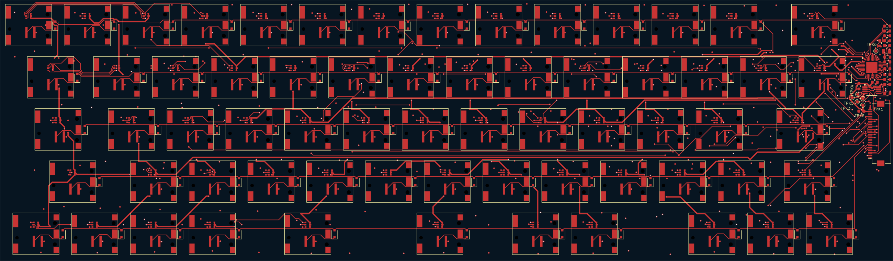
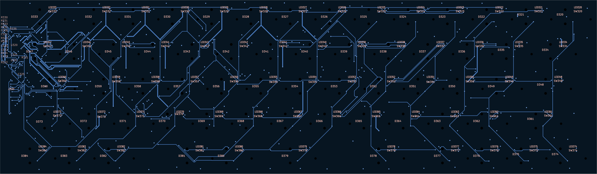
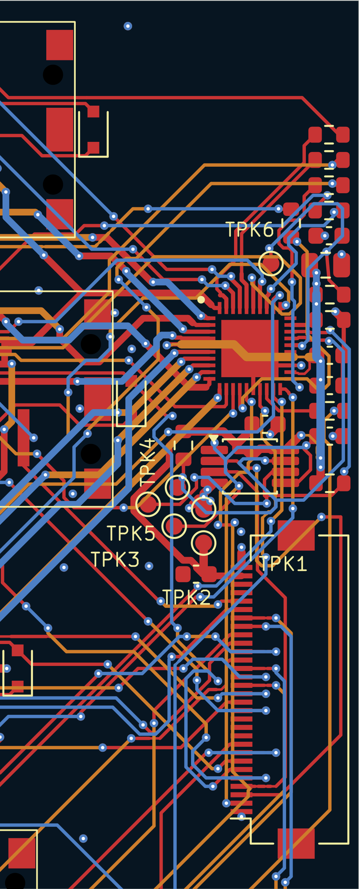

# keyboard RGB checks

checked 5 october 2026 with KiCad 10.0.4. routing is complete and the
canonical board is saved. this is a CAD routing check, not an order release.

| check | before routing | final |
| --- | --- | --- |
| native unconnected items | 290 | 0 |
| physical DRC errors | 6 | 0 |
| dangling tracks | 61 | 0 |
| dangling vias | 33 | 0 |
| off-centre via connections | 4 | 0 |
| silkscreen edge findings | 4 | 0 |
| silkscreen overlaps | 10 | 0 |
| unused-pad parity findings | 8 | 0 |

all DRC warnings and schematic parity findings are clear. schematic ERC
also has zero findings. the native connectivity count is zero separately
from the CLI report. no project rules or courtyard exceptions were weakened.

## routing and cleanup

the RGB bank feeds, row colour sinks, remaining keyboard-matrix connections,
power distribution and corrected U321 wiring are connected. new bank runs
use 0.4 mm. signal runs use 0.2 mm, with short 0.15 mm escapes where needed.
power and substantial ground connections use 0.5 mm where space allows.
new vias use 0.5 mm copper and 0.2 mm drills.

U321 keeps its main 3.3 V bus on the A side and the switched 5 V RGB bus on
the B side. SCL was moved away from its long parallel LED-current run. the
final spacing check found no parallel I2C and LED-current runs of at least
5 mm with less than 0.5 mm edge spacing on the same or adjacent signal layers.
F.Cu is separated from the inner signals by the In1.Cu ground plane.

U320's exposed pad has a short ground return to In1.Cu. the three ordinary
vias in its exposed-pad area were removed. R320 stays at 33.2k with a local
ground return. ground stitches and local solid pad joins repair the starved
thermals and disconnected ground regions. obsolete buffer ends, unused vias
and dangling copper were removed, and collinear segments were merged.

the saved board contains 3,335 tracks and arcs, 830 vias and one
ground zone spanning the four copper layers. In1.Cu has no signal tracks
or non-ground pours.

## preserved geometry and mapping

all 221 footprint positions, orientations and locks are unchanged. the
273.5 x 80 mm outline, mounting geometry, pad geometry and J320 position
are preserved. all 65 switches and 65 LEDs remain locked, with each LED
2.8 mm above its switch. no support components moved. the board remains
four layers and 0.8 mm thick.

all 65 local front-copper anode joins are intact. the CSV, mapping source
and firmware channel header are unchanged. the four mapping tests pass,
and the fresh schematic XML agrees with all 1,096 electrical pads.
there are 195 unique colour channels; registers 196 through 198 remain unused.
R330 through R335 remain in the red sink paths.

all 65 CHERRY exclusions retain their original geometry and block copper
on all four layers. the actual filled Gerber copper was checked against
every exclusion, with zero findings. these plots are verification outputs,
not a complete manufacturing package.

## unused pins and labels

the five unused J320 signal pins and U320 pin 30 now have their exact
schematic no-connect names and metadata. J320's two unused hold-down pads
are represented separately as MP1 and MP2, so no copper link is requested
between them. the keyboard has its own connector symbol and footprint for
that metadata change; the physical connector geometry is unchanged.

`gen/check_keyboard_rgb.py` now checks each unused pad against the fresh XML,
requires its no-connect flag, and rejects copper routing or pours on those
nets. no findings are hidden or excluded.

the support references were repositioned on the back silkscreen at the
0.8 mm minimum text height. the six test-point references are on the front.
all silkscreen findings are clear.

## saved checks and views

[source hashes and complete check results](keyboard-rgb.json), including the
native DRC, schematic ERC and plotted copper exclusion reports.

these views are native PCB plots with zone fill hidden for routing clarity.
the controller detail overlays F.Cu, In2.Cu and B.Cu; it is not a single-layer view.

## before ordering

prepare a new RGB-specific BOM, placement file, stencil and assembly sequence.
the old passive-keyboard exporter does not support this revision. confirm the
0.8 mm four-layer stackup and manufacturing limits with the board house.

the LEDs must be assembled before the switches. physical LED/switch fit,
colour order, full-white current, temperature, I2C operation and power
sequencing still need first-article checks. CAD checks do not establish
physical fit or hardware operation.
